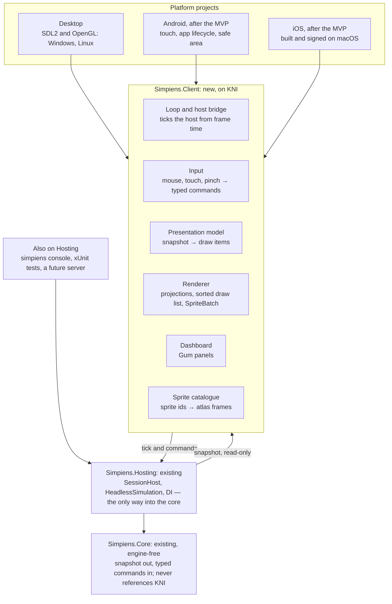

# Simpiens Engine Proposal: KNI

> **Repo copy.** Exported on 2026-10-18 from the Claude Docs proposal, which stays the live version: https://claude.ai/code/artifact/fb1f77f9-7c4e-4083-9ae3-e71f07ed689a. The text is the export as it stood, including the producer's answers. The doc's two diagrams don't export: the architecture is redrawn here in Mermaid, and the roadmap as a table. Status and progress live in [`docs/ROADMAP.md`](ROADMAP.md) and [`docs/epics/epic-client.md`](epics/epic-client.md), not here.

## The proposal in brief

We propose a thin Simpiens client on KNI, the MonoGame-derived framework you chose, over the engine-free core we already have. The MVP runs on desktop, with isometric as the main view; Android and iOS follow it. An agent-first team can confidently build and keep this client. iOS needs a Mac and a person for Apple signing. Detailed art and the UI's look need designers.

- **First pixels:** milestone M0, 1–2 agent days. A desktop window where our .NET host ticks the outpost and draws Floor 1 and its crawlers. The golden hashes are checked from inside the client, and the client builds against both KNI and MonoGame.
- **Unity retires at M2,** once the desktop client and its dashboard match today's game.
- **Feature-complete rendering:** M0 to M7, an estimated 21–36 agent working days, not counting waits on people. Mobile (M4, M5) comes after the MVP.
- **Size:** an estimated 8,000 to 10,000 lines of C#. It replaces 5,646 lines of Unity code and 1,145 lines of UI markup.
- **Hardest parts:** the dashboard is the largest piece, and mobile packaging needs people. The largest outside risk is KNI's single maintainer. Keeping a MonoGame build in CI covers it.
- **The simulation doesn't change.** Isometric is a projection of the same square grid, and height is visual only. The core never references KNI.

This builds on the [engine spike](https://claude.ai/code/artifact/6c8a900a-409e-448d-bd7b-8c9f3b70cef3) and on your answers of 2026-10-18, reviewed below.

## KNI or MonoGame

KNI is a sound choice for a desktop-first game that reaches Android and iOS after the MVP. Its maintainer answers fast, and its mobile packages already target .NET 10. On the spike's agent-first weights, though, it scores 3.65 against MonoGame's 4.05:

- **Stability:** one person writes most of KNI.
- **Documentation and community:** both are thinner than MonoGame's.
- **Gaps after the MVP:** KNI has no console support and no plan beyond OpenGL ES on iOS.

We recommend KNI as the framework, with a MonoGame build of the client in CI from M0. Switching then stays a package swap if either gap matters later. Both implement the XNA 4 API, and KNI is a derivative of MonoGame ([KNI readme](https://github.com/kniEngine/kni)).

| Measured on 2026-10-18 | KNI 4.3 | MonoGame 3.8.6 |
| --- | --- | --- |
| Who runs it | One lead maintainer, nkast, with 90 of the 120 commits since 2026-04-18 (5 authors in all). Funded through GitHub Sponsors. | The MonoGame Foundation, a non-profit. 26 commit authors since 2026-04-18. |
| Responsiveness | 7 issues opened since 2026-04-18. 4 closed, in a median 0.7 days. A 2024 question about Vulkan was answered within two hours ([#1835](https://github.com/kniEngine/kni/issues/1835)). | 128 issues opened in the same period. 56 closed, in a median 7.4 days. Pull requests close in a median 1.7 days. |
| Releases | 4.0 (January 2025), 4.1 (April 2025), 4.2 (November 2025), 4.3 (August 2026), each with a migration guide, plus hotfixes ([releases](https://github.com/kniEngine/kni/releases)) | 3.8.4.1 (October 2025), 3.8.5 (July 2026), 3.8.5.1 (August 2026), 3.8.6 (October 2026), with public previews. A quarterly roadmap runs to 3.9 in Q2 2027. |
| .NET | Android and iOS packages target .NET 10 ([Android](https://www.nuget.org/packages/nkast.Kni.Platform.Android.GL/), [iOS](https://www.nuget.org/packages/nkast.Kni.Platform.iOS.GL/)). The content tools run on .NET 10 ([what's new in 4.3](http://blog.nkast.gr/post/what-s-new-in-kni-v4-03)). | Android and iOS packages target .NET 8 ([Android 3.8.6](https://www.nuget.org/packages/MonoGame.Framework.Android/3.8.6)). 3.8.6 fixed building Android on .NET 10 ([3.8.6 notes](https://github.com/MonoGame/MonoGame/releases/tag/v3.8.6)). |
| Desktop | SDL2 with OpenGL ([SDL2.GL](https://www.nuget.org/packages/nkast.Kni.Platform.SDL2.GL/)); DirectX 11 on Windows | SDL2 with OpenGL; DirectX 11. Vulkan and DX12 are in preview. |
| Mobile graphics | OpenGL ES, with no Vulkan or Metal plan. The maintainer says a new backend would be written from scratch, or built on FNA3D or SDL\_GPU (#1835). | OpenGL ES today. Metal and native mobile are planned for 3.9. |
| Consoles | None | PlayStation, Xbox, and Switch 1 and 2 for registered developers |
| Platforms we don't need | Web (Blazor and WebGL), WebXR, Meta Quest | Web is planned for 3.8.7 |
| Adoption | 380 stars. `nkast.Xna.Framework` has 117.8K downloads ([NuGet](https://www.nuget.org/packages/nkast.Xna.Framework/)). | 14.5k stars. The DesktopGL package has 1.9M downloads. |
| Documentation | Migration guides and a blog. The readme points to MonoGame's docs. | A docs hub, an API reference and a full 2D tutorial |
| Libraries we plan to use | [Gum.KNI](https://www.nuget.org/packages/Gum.Kni) (58.9K downloads, October 2026) and [KNI.Extended](https://www.nuget.org/packages/KNI.Extended) 6.1.1, from the MonoGame.Extended team. We found no KNI build of MonoGame.Aseprite. | Gum, MonoGame.Extended, MonoGame.Aseprite |

Commit, issue and pull-request counts come from GitHub's public API, for 2026-04-18 to 2026-10-18.

**Scored on the spike's weights,** where the two differ:

| Criterion (weight) | KNI | MonoGame | Why |
| --- | --- | --- | --- |
| Stability (20) | 3 | 4 | KNI depends on one maintainer and needs migration steps each minor release. MonoGame is foundation-backed, with a backend switch ahead. |
| Documentation (5) | 2 | 4 | KNI points to MonoGame's docs for most things |
| Community (5) | 2 | 4 | 380 stars against 14.5k; 7 issues in six months against 128 |

The other five criteria score the same, because the API and our architecture are the same. Totals: KNI 3.65, MonoGame 4.05.

**How we take KNI on:**

- **The XNA API only.** The client uses nothing specific to KNI except in one platform class. CI builds it against KNI and against MonoGame from M0.
- **Art without MonoGame.Aseprite.** Art arrives as PNG sheets with a data file, or through a framework-free Aseprite reader, since MonoGame.Aseprite has no KNI build.
- **Two checkpoints.** Before mobile (M4), check iOS graphics: KNI has no Metal plan, and MonoGame's 3.9 may by then be out. Before consoles, switch those builds to MonoGame, because KNI has none.
- **A sponsorship.** Sponsoring nkast is cheap insurance on the bus factor.

## Your answers, reviewed

Your answers make the MVP smaller and clearer:

- desktop only;
- isometric as the main view;
- one phone layout, portrait, after the MVP;
- Unity gone at M2.

Two answers need a follow-up: art size, and what "plain 2D" means for cutscenes. The follow-ups are listed under the questions.

| Question | Your answer | What it changes |
| --- | --- | --- |
| Framework | KNI, the MonoGame fork | The client is built on KNI, with a MonoGame build kept in CI (see the section above) |
| Godot | Not pursued | The spike's Godot slice is dropped; no comparison runs before M0 |
| Isometric | Height is visual only. Isometric will most likely replace top-down. Cutscenes still need plain 2D. | Isometric becomes the main view. Top-down stays for the developers' map designer and for debugging. Cutscenes add a third mode: screen space, with no world projection. The simulation is untouched, since height never reaches it. |
| Mobile | After desktop, post-MVP. There is an Apple developer account. | The MVP is desktop. M4 (Android) and M5 (iOS) move after it. A compile-only Android build stays in CI from M1, so desktop-only assumptions are caught early. Still open: a Mac or macOS runner for iOS. |
| Phone layout | Portrait only; tablets aren't a priority | One phone layout, portrait: the world on top, the dashboard as a bottom sheet. No tablet layout, so M6 shrinks. The isometric camera has to frame a tall, narrow screen. |
| Map designer | For developers only | A desktop-only developer tool, built on the top-down view. It can skip the professional skin and mobile layouts. |
| UI look | Style and designer to be decided | The dashboard starts on one of Gum's stock themes for KNI ([Meadow](https://www.nuget.org/packages/Gum.Themes.Meadow.Kni)) and gets reskinned once a designer is chosen. The panels' code doesn't change. |
| Consoles | Last, and only if mobile goes well | Fine for KNI today. When consoles come, those builds move to MonoGame. |
| Art | Start basic for prototyping, then progressively detailed, up to "64 bit" | We read this as at most 64×64 pixels per sprite. Atlases and the catalogue are sized for that, and isometric tiles would be 64×32. To confirm. |
| Unity's future | Retire Unity at M2 | Unity's views freeze at M0. At M2 a separate chunk removes the Unity project and moves the core out of `Assets/`, which lifts the C# 10 cap and ends finding F1. |
| Performance | 30 fps | A 33 ms frame budget. Drawing is decoupled from the simulation's ticks, so a slow phone draws less often but simulates the same. |
| Working rules | Same as Epic CORE | A new epic on the roadmap first, then a feature branch, one commit per chunk, no merging or pushing without you |

## Requirements

KNI meets all five requirements. FNA can't: its FAQ says "Android is not and cannot be supported" ([FNA FAQ](https://fna-xna.github.io/docs/0%3A-FAQ/)). Mobile still carries most of the risk, but it now comes after the MVP. The rendering requirements are work we own, though none of it is novel.

| Requirement | What KNI gives | What we build | Risk |
| --- | --- | --- | --- |
| Windows and Linux | SDL2 with OpenGL on Windows, Linux and macOS ([SDL2.GL](https://www.nuget.org/packages/nkast.Kni.Platform.SDL2.GL/)); DirectX 11 on Windows | One desktop project, published for `linux-x64` and `win-x64` from CI | Low. SDL2 is the older SDL line, and KNI hasn't announced a move to SDL3. |
| Android and iOS, after the MVP | Android 6 and up, and iPhone and iPad 10 and up, on OpenGL ES ([KNI readme](https://github.com/kniEngine/kni)). The packages target `net10.0-android36.0` and `net10.0-ios26.0`. | Two thin platform projects; touch input; app lifecycle; signing and store packaging; the portrait phone layout | High. iOS builds need a Mac with Xcode ([Microsoft](https://learn.microsoft.com/en-us/dotnet/maui/ios/cli)). Apple has deprecated OpenGL ES since iOS 12 ([GameFromScratch](https://gamefromscratch.com/apple-deprecate-opengl-in-ios-and-macos/)), and KNI has no Metal plan ([#1835](https://github.com/kniEngine/kni/issues/1835)). MonoGame plans Metal for 3.9 ([roadmap](https://docs.monogame.net/roadmap/)). |
| Isometric as the main view, top-down, and plain 2D for cutscenes, all with z-index | `SpriteBatch` with a depth per sprite. KNI shares XNA's API, whose depth sorts are unstable ([SpriteSortMode](https://docs.monogame.net/api/Microsoft.Xna.Framework.Graphics.SpriteSortMode.html)). | Isometric and top-down projections that give a depth key; a screen-space mode for cutscenes; our own stable sort; picking through the inverse projection | Medium. Isometric order breaks on tall or multi-cell objects unless they're split or anchored at their base ([Tiled forum](https://discourse.mapeditor.org/t/isometric-depth-sorting/736)). |
| Desktop windows and portrait phones | A resizable back buffer, orientation, and `TouchPanel`. KNI 4.3 added touch input on Windows, so phone layouts can be tried on a desktop ([what's new in 4.3](http://blog.nkast.gr/post/what-s-new-in-kni-v4-03)). | A layout policy: the world camera zooms rather than stretches; the UI scales with display density inside the safe area; a desktop layout and a portrait phone layout | Medium. The isometric world has to read well on a tall, narrow screen. |
| Simple sprites now, detailed later (up to 64×64) | `Texture2D.SetData` for our generated sprites; KNI's content builder, now on .NET 10 | A sprite catalogue as data; atlases sized for 64×64 frames; point filtering for pixel art and linear for detailed art; PNG sheets with a data file, or a framework-free Aseprite reader | Low |

**Also from your answers in the engine spike (2026-10-18):**

- **No macOS.** The desktop build targets Windows and Linux only.
- **Consoles, maybe.** KNI has no console support; MonoGame ships to PlayStation 4 and 5, Xbox, and Switch 1 and 2 for registered developers ([repo](https://github.com/MonoGame/MonoGame)). A console build would use MonoGame, which the CI build of the client keeps possible; the architecture doesn't change.
- **A custom map designer and procedural generation.** Maps are C# code today (`Floor1Layout`). A designer needs a map file format, an editor mode built on the client's renderer and Gum, and the generator in the core. It isn't in M0 to M7; it gets its own milestone after the dashboard.
- **A UI that feels like a professional game.** That rules out ImGui for anything players see. Gum, with a skin of our own, carries the dashboard, and the skin needs art direction from a person.

## Architecture

The client is one shared library with three thin platform projects on top. It talks to the core only through `Simpiens.Hosting`, as the console host and the tests already do.



A frame runs top to bottom. The platform project starts the client, and the loop ticks the host. The presentation model then turns the core's read-only snapshot into draw items for the renderer and the dashboard. Player input goes down only as typed commands, the path a multiplayer client would use (roadmap §1A.1).

New projects, next to today's in `dotnet/`:

- `Simpiens.Client` (`net10.0`, KNI): everything in the blue box. A second build of it against MonoGame runs in CI, to keep switching a package swap.
- `Simpiens.Desktop`, `Simpiens.Android`, `Simpiens.iOS`: one entry point and the platform services each.
- `Simpiens.Client.Tests` (xUnit v3): sort keys, projections, layouts, and render tests against committed images.

## Rendering design

The game's main view is isometric. Top-down stays for the developers' map designer and for debugging, and cutscenes draw in plain screen space. The simulation stays on its square grid, and height is only visual. All three modes feed the same sorted draw list. Nothing in the simulation changes to support them.

**Projections.** Each view implements one small interface with three jobs: world to screen, screen back to world for picking, and a depth key for sorting.

- **Top-down:** the screen position is the world position times the cell size. Within a layer, sprites lower on screen draw later, so overlapping crawlers look right.
- **Isometric:** the usual 2:1 pixel-art projection, where `w` and `h` are the tile's width and height in pixels, `z` is height above the floor, and `h_z` is pixels per unit of height:

```latex
\begin{aligned} s_x &= (x - y)\,\tfrac{w}{2} \\ s_y &= (x + y)\,\tfrac{h}{2} - z\,h_z \\ \text{depth} &= x + y + \epsilon z \end{aligned}
```

- **Picking:** invert the projection to a point on the floor, then hit-test sprites by their screen bounds. In isometric a sprite stands up from its feet, so its bounds extend above its cell.

* **Screen space, for cutscenes:** no world projection. Sprites, text and backdrops are placed in virtual screen units and sorted by layer, so a cutscene can still layer a character over a backdrop.

**Z-index.** Every frame, the presentation layer turns the snapshot into a list of draw items: texture region, position, pivot, tint, layer and depth. The layers are today's `RenderOrder` table, kept as is:

| Layer | Order |
| --- | --- |
| Floor | −30 |
| Rock | −20 |
| Walls | −10 |
| Props | 0 |
| Fog | 10 |
| Crawlers | 20 |
| Selection | 25 |
| Labels | 30 |

In isometric, walls, props and crawlers share one layer sorted by depth, so a crawler can walk behind a wall. Each item's sort key packs layer, depth and an insertion number into one 64-bit integer. One sort of a struct array then gives a stable order with no allocations, which `SpriteBatch`'s own unstable depth sort doesn't. Objects taller or wider than a cell are anchored at their base cell, or split into per-cell slices, the standard fix for isometric order.

**From simple to detailed sprites.** The renderer knows only sprite ids. A sprite catalogue, kept as data, maps each id to:

- atlas regions and animation frames;
- a pivot at the feet;
- a size in world units, not pixels, so 16-pixel and 64-pixel art both fill one cell;
- variants per facing and per projection, since isometric needs its own art.

The pixels come from the code generator we have today (`AgentSpriteLibrary`), feeding `Texture2D.SetData`. Later they come from PNG or Aseprite sheets packed into atlases. Changing art means changing the catalogue and the files, never the renderer. Each atlas picks its filter: point for pixel art, linear with mipmaps for detailed art.

**Screen form factors.**

- **World:** on resize, the camera keeps its focus point and picks a zoom that shows a minimum number of cells. Pixel art zooms in whole steps to avoid shimmer; detailed art zooms freely.
- **UI:** laid out in density-independent units, inside the safe area that the Android and iOS projects read from the system.
- **Two layouts:** desktop, a landscape window with the dashboard docked beside the world; and phone, portrait only, with the world on top and the dashboard as a bottom sheet. Tablets aren't a priority and get the phone layout.
- **Input:** one command layer. Mouse click, drag and wheel, and touch tap, drag and pinch, drive the same camera and selection commands.

## The work

We estimate the client at 8,000 to 10,000 lines of C# for M0 to M7. The developers' map designer adds about 2,000 more. The client replaces a Unity layer of 5,646 lines plus 1,145 lines of UI markup, and it's bigger because it does more: isometric, cutscenes, mobile, touch and a phone layout. The sizes below are our estimates, based on the Unity code each part replaces. The dashboard and the map designer are the hard pieces to build. Mobile packaging is the one piece agents can't finish alone.

| Component | What it does | Replaces in Unity | Est. lines | Creation complexity |
| --- | --- | --- | --- | --- |
| Solution and platform projects | A shared `Simpiens.Client` library, plus thin desktop, Android and iOS projects. The client also builds against MonoGame in CI. | Unity's player settings | 350 | Low on desktop. Medium on mobile: manifests, `Info.plist`, entitlements. |
| Game loop and host bridge | KNI's `Game` class calls our host's tick from frame time; save and load go through the host | `SimulationClockDriver`, `SimulationStarter`, `AppBootstrapper` (234) | 200 | Low |
| Presentation model | Turns the snapshot into draw items and holds the view's selection state | `SwarmSpawner`'s view half, `AgentView`, `NodeController` (506) | 500 | Low |
| Renderer core | Draw list, sort keys, `SpriteBatch` passes, render targets, atlases and filters | Unity's renderer | 600 | Medium |
| Projections | Isometric (the main view) and top-down, with picking; screen space for cutscenes | Unity's camera maths | 350 | Medium for isometric |
| Map drawing | Floor, rock, walls, fog of war, labels | `MapView`, `ShroudView` (434) | 500 | Low |
| Sprites | The generator ported to pixel buffers, the sprite catalogue, animation clips, atlases sized for 64×64 frames | `AgentSpriteLibrary`, `CampfireView` (981) | 1,200 | Low: mostly mechanical |
| Camera and input | Pan and zoom; mouse, touch and pinch gestures; one command layer | `CameraRig`, `CameraController`, `WorldSelection` (584) | 700 | Medium for touch |
| Dashboard | Every panel rebuilt in Gum, with desktop and portrait phone layouts, on a stock theme until a designer reskins it | `FacilityDashboardPresenter` and zones (1,983 C# + 1,145 UXML and USS) | 2,200 | High: the largest piece |
| Cutscene player | Plays scripted 2D scenes in screen space: backdrops, characters, text | Nothing today | 400 | Medium. It needs a scene format, and its size depends on what cutscenes hold. |
| Text | Fonts as `SpriteFont` from KNI's content builder | UI Toolkit's text | 150 | Medium |
| Platform services | Save paths, pause and resume, saving on background, safe areas, display density | Unity's player loop | 300 | Medium |
| Tests | Render tests (draw to a render target, save a PNG, compare with a committed image), input and layout tests, and the 7 view and UI scenarios ported | The Unity-only tests (6,585) | 1,500 | Medium |
| CI and packaging | Desktop build and tests on Linux, the MonoGame build, a Windows publish, a compile-only Android build, and later iOS on a macOS runner and signing | `run-persistence-smoke.sh` | workflows | Medium. Signing needs a person. |
| Unity retirement, at M2 | Removes the Unity project, moves the core and harness out of `Assets/`, and lifts the C# 10 and netstandard2.1 caps | The Unity project itself | Moves, not new code | Low risk, but a large diff in its own commit |
| Map designer, developers only | Top-down editing of floors, walls, sectors and nodes; runs the procedural generator; saves maps as data | `Floor1Layout`, which is code | 2,000 | High: a map file format and editing tools. It follows M2. |

## Maintenance

Upkeep runs on two outside clocks, not on our renderer: KNI's releases and the mobile toolchains.

- **KNI's releases.** Since January 2025, a minor release has come every three to ten months, each with a short migration guide. Going from 4.2 to 4.3 meant bumping package versions and moving Android to .NET 10 ([migration guide](https://github.com/kniEngine/kni/blob/main/Documentation/articles/migrate_4_2.md)).
- **How we stay exposed as little as possible:** `SpriteBatch` only, no custom shaders at first, pinned package versions, and the MonoGame build as a check that we use only the shared API.

| What changes | When | What we do |
| --- | --- | --- |
| KNI minor releases, each with migration steps | 4.0 (January 2025), 4.1 (April 2025), 4.2 (November 2025), 4.3 (August 2026) | Bump the packages and follow the guide in one chunk. The MonoGame build shows whether we've strayed off the shared API. |
| KNI's mobile packages target .NET 10; its core packages target .NET 8 and .NET Standard 2.0 | Now | We already run on .NET 10, supported until 2028-11-14 ([.NET policy](https://dotnet.microsoft.com/en-us/platform/support/policy/dotnet-core)) |
| Desktop runs on SDL2; no move to SDL3 announced | Unknown | Nothing until KNI moves. Our input code sits behind the command layer. |
| iOS runs on OpenGL ES, which Apple has deprecated, and KNI has no Metal plan | Before M5 | Check Apple's status and MonoGame 3.9. If needed, the iOS build moves to MonoGame. |
| Xcode versions | Each .NET iOS release | Install the Xcode version that release requires ([Microsoft](https://learn.microsoft.com/en-us/dotnet/maui/ios/cli)) |
| Our renderer, input and UI | Whenever we change them | Covered by render tests against committed images, like the golden hashes cover the simulation |

The recurring cost, as an estimate:

- a short agent task per KNI release, two or three a year so far;
- a platform-project update for each yearly Android and iOS release;
- a person's time for signing keys and store accounts;
- optionally, a sponsorship of KNI's maintainer.

The simulation core carries none of this cost: it never references KNI.

## Agent confidence

Yes, with two conditions. We are confident an agent-first team can build and keep the renderer, the desktop and Android builds, and the isometric view. iOS needs a Mac and a person for Apple signing. Detailed art needs an artist.

KNI doesn't change this verdict. It keeps the XNA API that models know well. Its own docs are thin, so for anything specific to KNI, agents read MonoGame's docs and KNI's source. We keep that KNI-specific code to one platform class.

Confidence rests on feedback loops an agent can run itself:

- `dotnet test` for logic.
- Golden hashes for the simulation.
- Render tests that save a PNG an agent can open and look at. This document's own scorecard chart was checked and corrected that way.

| Component | Confidence | Why | Where a person is needed |
| --- | --- | --- | --- |
| Loop, presentation model, map drawing, sprite port | High | Mechanical, testable headless, and the XNA API is well known to models | No one |
| Renderer core and sort keys | High | Pure code. The sort order is unit-tested; the output is render-tested | No one |
| Isometric projection and depth | Medium-high | The maths is testable; edge cases (tall objects, wall corners) show only in images | A look at the first isometric screenshots |
| Camera and touch input | Medium | Gestures can be replayed as recorded input sequences, but feel is judged on a device | Someone trying it on a phone |
| Dashboard in Gum | Medium | The largest piece. Gum is less known to models than XNA (635 stars), so agents read its docs and source. Layout quality is judged from screenshots. | Art direction for a professional look, and sign-off on the desktop and portrait phone layouts |
| Desktop packaging and CI | High | `dotnet publish` and GitHub Actions, as today | No one |
| Android | Medium | Builds on Linux. Emulators should run in CI, which the Android milestone proves. Device quirks won't show there. | A test phone, and the Play signing key |
| iOS | Low without help | Builds need macOS and Xcode. Signing, provisioning and TestFlight need an Apple developer account. | A Mac or macOS CI runner, and the account holder |
| Detailed art | Low for agents | Agents can make placeholders and the art pipeline, not the art | An artist, once detailed sprites are wanted |

## Roadmap

First pixels come in M0. Feature-complete rendering is M0 to M7: top-down and isometric, the dashboard, Android and iOS, every screen size, and real art. Each milestone ends with a gate an agent can check, except where a person must try it on a device.

Estimates are agent working days; waits on people are not included.

| Milestone | Estimate | Scope | Gate |
| --- | --- | --- | --- |
| M0 · First pixels | 1–2 days | A window; our host ticks the outpost; Floor 1 and crawlers drawn top-down | Golden hashes 3 of 3 inside the client; a render test in Linux CI; the MonoGame build compiles |
| M1 · Top-down parity on desktop | 3–5 days | Fog, props, labels, animation, camera, mouse picking; a compile-only Android build in CI | Render tests pass; screenshots reviewed beside Unity's |
| M2 · Dashboard, then Unity retired | 5–8 days | Every panel in Gum with the desktop layout; quick save and load; session switch | The 7 view and UI scenarios pass; Unity is then removed in its own chunk |
| M3 · Isometric, the main view | 3–5 days | Projection, depth sorting, generated isometric placeholders, picking, cutscene mode | Depth-order tests pass; walls and crawlers interleave in reviewed screenshots |
| M4 · Android (after the MVP; needs a person) | 3–5 days | Touch, app lifecycle, density and safe areas, the portrait phone layout | Runs in a CI emulator and on a test phone |
| M5 · iOS (after the MVP; needs a person) | 3–5 days | iOS project built on macOS, signed, installed through TestFlight | Runs on an iPhone |
| M6 · Screen sizes | 1–3 days | Desktop windows of any size, portrait phones, resizing | Render tests pass at five screen sizes |
| M7 · Art pipeline | 2–3 days | Sprite catalogue as data, 64×64 atlases, PNG and Aseprite import, a filter per atlas | New art for a crawler is a data-only change |

M0 to M7 is feature-complete rendering: about 21–36 agent days.

The MVP is desktop, so M4 and M5 come after it. Until then, the compile-only Android build from M1 stops desktop-only assumptions from creeping in. Unity is retired at M2, in a chunk of its own once the dashboard passes. The map designer follows M2 as its own milestone, since it reuses the renderer and Gum. The estimates are re-based after M0. Epic CORE's Phases 0–1 took hours, where the write-up had estimated weeks.

## Risks

The largest risk is now KNI's single maintainer, and the MonoGame build in CI is its fallback. Mobile still carries three risks, but they land after the MVP.

| Risk | Effect | Early warning | Fallback |
| --- | --- | --- | --- |
| KNI's maintainer steps back | No fixes, and no support for new .NET or OS versions | Long gaps between commits or releases | Switch to MonoGame. The client already builds against it. |
| A KNI minor release breaks us | A chunk of migration work | The migration guide shipped with each release | Pin versions and upgrade in one chunk. The MonoGame build shows any drift off the shared API. |
| Apple removes OpenGL ES before either framework has Metal | iOS stops working | Each Xcode and iOS beta | iOS moves to MonoGame once 3.9 ships Metal. iOS is last in any case. |
| Consoles become a goal | KNI can't build for them | Your call after mobile | Console builds use MonoGame |
| The dashboard costs more than estimated in Gum, or Gum lacks a control | M2 runs long | The first two panels | Patch Gum (MIT) or write the missing control |
| Isometric order breaks on walls and tall objects | Crawlers drawn in front of walls | Depth-order tests in M3 | Split walls per cell; draw row by row, interleaving tiles and sprites ([Tiled forum](https://discourse.mapeditor.org/t/isometric-depth-sorting/736)) |
| Render tests need a GPU, and CI has none | No render tests in CI | M0's CI run | Software OpenGL (Mesa) under a virtual display, or a self-hosted runner with a GPU |
| Low-end phones fall below 30 fps | Stutter on phones | Frame time in M4 | Atlases to batch draws, culling off-screen sprites, a lower zoom-out limit |
| Unity and the new client drift apart during the move | Two games to keep | Any feature landing in Unity after M0 | Freeze Unity's views at M0 and remove Unity at M2. Compare the client with `dotnet test`, not with Unity (finding F1). |

## Questions before we start

You answered these on 2026-10-18; your answers are kept below as you wrote them, and reviewed in "Your answers, reviewed". Seven follow-ups come after them. Only the first two block M0.

- [x] **MonoGame, not FNA.** FNA can't run on Android, so this proposal uses MonoGame. Do you approve? A: Monogame specifically KNI fork will been chosen.
- [x] **Godot comparison.** The engine spike planned a Godot slice beside this one. Do we skip it and build on MonoGame, or still run it first? A:We are moving to KNI/Monogame not godot
- [x] **Isometric.** Is it a second view of the same square-grid world that players can toggle, or does it replace top-down as the main view? Does gameplay need height (stairs, raised floors), or is height only visual? A: Height is visual only. Isometric view will most likely replace top down view. But we still need plain 2d rendering for cutscenes.
- [x] **Mobile timing.** Is mobile part of the MVP, or does it follow desktop parity? Do we have a Mac (or budget for a macOS CI runner), an Apple developer account, a test Android phone and an iPhone? Who holds the signing keys? A: We have an apple developer account but Mobile is after desktop / post mvp
- [x] **Phone layout.** Landscape only, or portrait too? Tablets as a target in their own right? Portrait only. A: Tablets will not be priority.
- [x] **Map designer.** An editor mode inside the game, or a separate desktop tool? Do players get it, or only us? Does it need to run on phones? A: Map designer is just for the developers.
- [x] **UI look.** Who designs the UI skin (fonts, panels, icons)? Is there a game whose UI feel we're aiming for? A: Style TBD. Art designer TBD.
- [x] **Consoles.** Which ones, if any, and when? Each needs a registered developer account. A: Consoles are last priority only if mobile goes well.
- [x] **Art.** What size and style should detailed sprites be (32 or 64 pixels, pixel art or painted)? What tool (Aseprite?), and who makes them? A: The goal is to start small and basic for prototyping but still support moving towards progressively detailed art (max 64 bit)
- [x] **Unity's future.** Do we freeze Unity's views at M0 and retire Unity after M2 (desktop parity) or after M7? A: Retire Unity at M2
- [x] **Performance target.** What frame rate on what minimum phone? A: target 30 fps
- [x] **Working rules.** Same rules as Epic CORE: a feature branch, one commit per chunk, no merging or pushing without you, and a new epic on the roadmap first? A: Correct, same rules.

**Follow-ups (2026-10-18):**

- [x] **KNI with a MonoGame build in CI.** Do you accept keeping the client buildable against MonoGame as KNI's fallback? It costs one CI job, and keeps code specific to KNI in one class. A: Accept
- [x] **Epic and branch names.** We'd add "Epic CLIENT" to the roadmap and work on the branch `feat/kni-client`. Do those names work? A: Accept
- [x] **Art size.** Does "max 64 bit" mean sprites of at most 64×64 pixels? A: Correct
- [x] **Cutscenes.** What does "plain 2D" hold: still backdrops with characters and text, or animated scenes? Who writes them? A: Still backdrops, dynamic characters with text boxes like Fire emblem
- [x] **Top-down for players.** We keep top-down only for the map designer and debugging. Should players never see it? A: top down for design only
- [x] **A Mac for iOS.** You have the Apple account. Is there a Mac, or should we budget for a macOS CI runner? It's only needed for M5, after the MVP. A: we have a Mac
- [x] **Sponsoring KNI.** Do you want to sponsor its maintainer, as insurance on the bus factor? A: No we can discuss sponsoring if we get to production with cashflow

## Bibliography

These are the pages opened for this proposal, on 2026-10-17 and 2026-10-18. Line counts come from the repo at `main` (`adf76e5`).

**MonoGame**

- [MonoGame 3.8.5 release notes](https://monogame.net/blog/2026-07-15-3.8.5-release-2026/): DesktopVK and WindowsDX12 previews, the code-based Content Builder.
- [MonoGame roadmap](https://docs.monogame.net/roadmap/): 3.8.7 to 5.x, including Metal and native mobile in 3.9.
- [MonoGame repository](https://github.com/MonoGame/MonoGame): platforms, consoles, shipped games.
- [MonoGame.Framework.DesktopGL](https://www.nuget.org/packages/MonoGame.Framework.DesktopGL): 3.8.6, targets .NET 8.
- [MonoGame.Framework.Android 3.8.5](https://www.nuget.org/packages/MonoGame.Framework.Android/3.8.5): `net8.0-android34.0`, OpenGL ES.
- [MonoGame.Framework.iOS 3.8.5](https://www.nuget.org/packages/MonoGame.Framework.iOS/3.8.5): `net8.0-ios18.0`, OpenGL ES.
- [SpriteSortMode API](https://docs.monogame.net/api/Microsoft.Xna.Framework.Graphics.SpriteSortMode.html): depth sorts are unstable.
- [Implementing UI with Gum](https://docs.monogame.net/articles/tutorials/building_2d_games/20_implementing_ui_with_gum/index.html): MonoGame's 2D tutorial, chapter 20.

**KNI, and the comparison with MonoGame (2026-10-18)**

- [KNI repository and readme](https://github.com/kniEngine/kni): platforms, MS-PL, a derivative of MonoGame.
- [KNI releases](https://github.com/kniEngine/kni/releases) and [changelog](https://github.com/kniEngine/kni/blob/main/CHANGELOG.md): 4.0 to 4.3.
- [What's new in KNI 4.3](http://blog.nkast.gr/post/what-s-new-in-kni-v4-03): .NET 10 on mobile, touch on Windows.
- [Migrating from 4.2 to 4.3](https://github.com/kniEngine/kni/blob/main/Documentation/articles/migrate_4_2.md).
- [KNI issue #1835](https://github.com/kniEngine/kni/issues/1835): no plan to port MonoGame's Vulkan backend.
- NuGet: [nkast.Xna.Framework](https://www.nuget.org/packages/nkast.Xna.Framework/), [SDL2.GL](https://www.nuget.org/packages/nkast.Kni.Platform.SDL2.GL/), [Android.GL](https://www.nuget.org/packages/nkast.Kni.Platform.Android.GL/), [iOS.GL](https://www.nuget.org/packages/nkast.Kni.Platform.iOS.GL/).
- Libraries: [Gum.KNI](https://www.nuget.org/packages/Gum.Kni), [Gum.Themes.Meadow.Kni](https://www.nuget.org/packages/Gum.Themes.Meadow.Kni), [KNI.Extended](https://www.nuget.org/packages/KNI.Extended).
- MonoGame for the comparison: [3.8.6 release notes](https://github.com/MonoGame/MonoGame/releases/tag/v3.8.6) and [MonoGame.Framework.Android 3.8.6](https://www.nuget.org/packages/MonoGame.Framework.Android/3.8.6).
- Activity counts: GitHub's public REST API for [kniEngine/kni](https://api.github.com/repos/kniEngine/kni) and [MonoGame/MonoGame](https://api.github.com/repos/MonoGame/MonoGame) (releases, contributors, commits, issues and pull requests since 2026-04-18), queried 2026-10-18.

**Libraries**

- [Gum](https://github.com/vchelaru/Gum): MIT UI layout engine for MonoGame, FNA, KNI and raylib.
- [Gum with MonoGame](https://docs.flatredball.com/gum/code/monogame): layout in code.
- [MonoGame.Extended](https://www.nuget.org/packages/MonoGame.Extended): 6.1.1, MIT; Tiled, atlases, input, viewports.
- [MonoGame.Aseprite](https://github.com/AristurtleDev/monogame-aseprite): 6.4.1, MIT; sprite sheets, atlases, tilemaps.
- [KNI](https://github.com/kniEngine/kni): a MonoGame-derived fork; the fallback for mobile.

**FNA**

- [FNA FAQ](https://fna-xna.github.io/docs/0%3A-FAQ/): "Android is not and cannot be supported".
- [FNA on Apple platforms](https://fna-xna.github.io/docs/appendix/Appendix-C%3A-FNA-on-Apple-Platforms/): iOS through the .NET SDK on a Mac.
- [FNA docs](https://fna-xna.github.io/docs/).

**Platforms**

- [.NET support policy](https://dotnet.microsoft.com/en-us/platform/support/policy/dotnet-core): .NET 8 ends 2026-11-10; .NET 10 runs to 2028-11-14.
- [Build an iOS app on macOS with .NET CLI](https://learn.microsoft.com/en-us/dotnet/maui/ios/cli): Mac and Xcode required.
- [Apple deprecates OpenGL ES](https://gamefromscratch.com/apple-deprecate-opengl-in-ios-and-macos/): quotes the iOS 12 release notes (2018).

**Rendering**

- [Isometric depth sorting](https://discourse.mapeditor.org/t/isometric-depth-sorting/736): Tiled forum; interleave tiles and sprites row by row.

**Our own documents**

- [Engine Spike: Godot and the Alternatives](https://claude.ai/code/artifact/6c8a900a-409e-448d-bd7b-8c9f3b70cef3).
- [Migrating from Unity to Godot on .NET 10](https://claude.ai/code/artifact/1961406d-0c73-476b-9455-ce8a54a642b4).
- `docs/epics/epic-core.md` (findings F1 and F2) and `AGENTS.md`.
