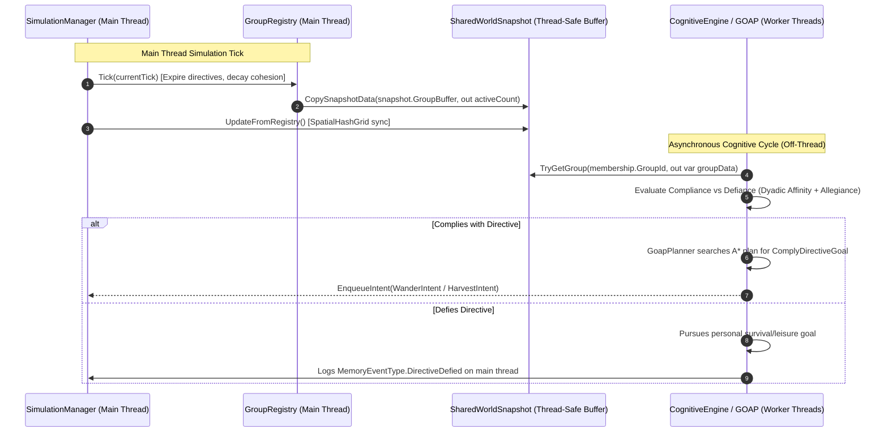
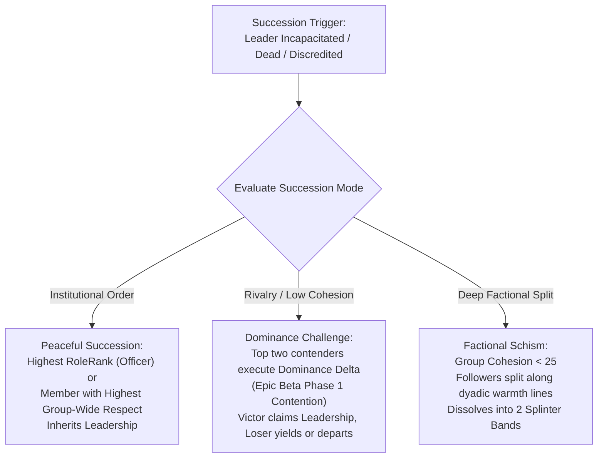

# Epic 8: Socio-Political Structures & The Generic Group Primitive

- **Status**: COMPLETED
- **Track**: Track A: Core Simulation & Cognition Engine
- **Preceding Epic**: Epic Beta: Concrete World Mechanics & Physical Interdependence
- **Following Epic**: Epic 9: Personal Inventories, Economy & World Construction
- **Downstream Consumers**: Epic UI-1 (Dossier Group Badge), Epic UI-2 (Facility Directives Terminal), Epic UI-3 (Sociopolitical Graph)
- **Architectural Layer**: Cognition (`Simpiens.Cognition.Groups`, `AgentMemory`, GOAP Planning) & Core Simulation (`SimulationManager`, `SharedWorldSnapshot`)

---

## 1. Executive Summary & Problem Statement

In **Epic 7** and **Epic Beta**, agents acquired nuanced interpersonal agency:
1. **Dyadic Relational Dynamics**: The 4-axis matrix (`Warmth`, `Trust`, `Fear`, `Respect`) governs selective gossip, mutual knowledge exchange, and temporal regression.
2. **Physical Interdependence**: Agents yield contested resource nodes out of fear or deference, share food with starving companions out of warmth and trust, and gather naturally around campfires (`EntityType.Anchor`).

However, agents remain **atomized, solitary actors**:
- **Zero Macro Coordination**: Pawns cannot band together to secure a perimeter, harvest a large berry orchard, or build permanent communal settlements.
- **The "Hive Mind" Fallacy**: Many simulation architectures attempt to solve macro-coordination by introducing a monolithic, god-mode "Tribe AI" that directly puppeteers agents, completely undermining individual autonomy, personality, and emergent social drama.
- **The Class Explosion Anti-Pattern**: Hardcoding distinct object-oriented classes (`class HuntingBand`, `class FactionGuild`, `class Settlement`) produces rigid silos that cannot dynamically evolve (e.g., a temporary hunting band settling down to found a village).

### The Epic 8 Solution: Decentralized Generic Collectives
Epic 8 introduces macro-societal structures using a **4-layer sociological taxonomy** centered on a single, parameter-driven **Generic `Group` Primitive**. Collectives have no central AI; instead, leaders issue lightweight, unmanaged `GroupDirective` orders into the world state, and subordinate agents individually evaluate **Compliance vs. Defiance** through their own GOAP reasoning loops.

---

## 2. Theoretical Architecture: The 4-Layer Sociological Taxonomy

All sociopolitical mechanics in Simpiens strictly adhere to the 4-layer sociological taxonomy:

```mermaid
flowchart TD
    subgraph Layer 4: Hierarchical Authority & Roles (Epic 8)
        L4["Agent ──[Role Rank / Rights]──► Group\nCommand priority, delegation, succession, compliance vs defiance"]
    end

    subgraph Layer 3: Structural Collective Entities (Epic 8)
        L3["Agent ────[Membership]────► GroupData\nShared inventory, spatial anchors, collective directives, cohesion"]
    end

    subgraph Layer 2: Identity & Categorical Affiliation (Epic 8)
        L2["Agent ────[IdentityTag]────► Category (Culture, Faith, Kinship)\nInjects bias baseline modifiers into Dyadic Matrix"]
    end

    subgraph Layer 1: Dyadic Interpersonal Matrix (Epic 7 & Beta - COMPLETED)
        L1["Agent ◄───[Warmth, Trust, Fear, Respect]───► Agent\nBilateral episodic memory, selective gossip, propinquity bonding"]
    end

    L4 --> L3
    L3 --> L2
    L2 --> L1
```

### Layer Breakdown
- **Layer 1 (Dyadic Matrix - Completed)**: Bilateral scores (`Warmth`, `Trust`, `Fear`, `Respect`) tracking personal history and emotional bonds between pairs of agents.
- **Layer 2 (Identity & Categorical Affiliation)**: Categorical markers (`IdentityTag`) that define culture, kinship, or faction background. Injects baseline biases into Layer 1 dyadic initialization when strangers first encounter each other (e.g., shared kinship grants $+15\text{ Warmth}$, opposing faith inflicts $-20\text{ Trust}$).
- **Layer 3 (Structural Collective Entities)**: Physical and operational existence of a group (`GroupData`). Encapsulates spatial territory (Anchor position), active group directives, cohesion/morale, and membership rosters.
- **Layer 4: Hierarchical Authority & Roles**: Power distribution within a group (`RoleRank`: Follower, Officer, Leader). Defines command privileges, succession order, and individual compliance/defiance evaluation.

---

## 3. Data Architecture & Memory Layout (Zero-Allocation Hot Paths)

To prevent runtime GC spikes and support 100+ concurrent simulated agents, all group structures are implemented as **unmanaged, fixed-size value types**.

```
Memory Layout of Core Unmanaged Primitives:
┌────────────────────────────────────────────────────────┐
│ GroupDirective (32 bytes, unmanaged struct)             │
│ [Type:1B][GroupId:1B][TargetEntityId:16B][Pad:2B]       │
│ [LeaderId:16B]                                         │
│ [TargetLocation:8B (Vector2)]                          │
│ [IssuedTick:4B][ExpirationTick:4B][Radius:4B]          │
├────────────────────────────────────────────────────────┤
│ GroupMembership (8 bytes, unmanaged struct)            │
│ [GroupId:1B][Role:1B][Allegiance:1B][Pad:1B]           │
│ [JoinTick:4B]                                          │
├────────────────────────────────────────────────────────┤
│ GroupData (36 bytes, unmanaged snapshot struct)        │
│ [GroupId:1B][Type:1B][MemberCount:2B][Cohesion:1B][Pad]│
│ [LeaderId:16B]                                         │
│ [AnchorPosition:8B (Vector2)]                          │
│ [ActiveDirective: embedded GroupDirective or pointer]  │
└────────────────────────────────────────────────────────┘
```

### 3.1 Type Definitions (`Simpiens.Cognition.Groups`)

```csharp
namespace Simpiens.Cognition.Groups
{
    public enum GroupType : byte
    {
        TemporaryParty = 0, // Transient expedition (hunting party, foraging crew)
        FactionGuild   = 1, // Functional occupational guild (crafters, town guard)
        Settlement     = 2  // Permanent geographic settlement (clan, village)
    }

    public enum DirectiveType : byte
    {
        None            = 0,
        RallyAtLocation = 1, // Move to and hold position around target location
        HarvestResource = 2, // Coordinated harvest of target node / resource area
        DefendAnchor    = 3, // Patrol perimeter of the group's home anchor
        Disband         = 4  // Orderly dissolution of the group
    }

    public enum RoleRank : byte
    {
        None     = 0,
        Follower = 1, // Rank-and-file member; executes directives
        Officer  = 2, // Sub-commander; can rally subordinates, succession priority
        Leader   = 3  // Supreme authority (Chieftain, Guildmaster); issues directives
    }

    /// <summary>
    /// Unmanaged 32-byte struct representing an active group command.
    /// </summary>
    public readonly struct GroupDirective
    {
        public readonly DirectiveType Type;
        public readonly byte GroupId;
        public readonly UnityEngine.GUID LeaderId;
        public readonly UnityEngine.Vector2 TargetLocation;
        public readonly UnityEngine.GUID TargetEntityId;
        public readonly uint IssuedTick;
        public readonly uint ExpirationTick;
        public readonly float TargetRadius;

        public GroupDirective(DirectiveType type, byte groupId, UnityEngine.GUID leaderId,
                              UnityEngine.Vector2 targetLocation, UnityEngine.GUID targetEntityId,
                              uint issuedTick, uint expirationTick, float targetRadius = 2.5f)
        {
            Type = type;
            GroupId = groupId;
            LeaderId = leaderId;
            TargetLocation = targetLocation;
            TargetEntityId = targetEntityId;
            IssuedTick = issuedTick;
            ExpirationTick = expirationTick;
            TargetRadius = targetRadius;
        }

        public static readonly GroupDirective None = new GroupDirective(DirectiveType.None, 0, default, UnityEngine.Vector2.zero, default, 0, 0, 0f);
        public bool IsActive(uint currentTick) => Type != DirectiveType.None && currentTick <= ExpirationTick;
    }

    /// <summary>
    /// Unmanaged 8-byte stack struct representing an agent's group standing.
    /// </summary>
    public readonly struct GroupMembership
    {
        public readonly byte GroupId;
        public readonly RoleRank Role;
        public readonly byte Allegiance; // 0 to 100 loyalty metric
        public readonly uint JoinTick;

        public GroupMembership(byte groupId, RoleRank role, byte allegiance, uint joinTick)
        {
            GroupId = groupId;
            Role = role;
            Allegiance = allegiance;
            JoinTick = joinTick;
        }

        public static readonly GroupMembership None = new GroupMembership(0, RoleRank.None, 0, 0);
        public bool HasGroup => GroupId != 0;
    }

    /// <summary>
    /// Unmanaged 4-byte struct for categorical identity bias.
    /// </summary>
    public readonly struct IdentityTag
    {
        public readonly byte CultureId;
        public readonly byte KinshipId;
        public readonly byte FaithId;
        public readonly byte CasteRank;

        public IdentityTag(byte cultureId, byte kinshipId, byte faithId, byte casteRank)
        {
            CultureId = cultureId;
            KinshipId = kinshipId;
            FaithId = faithId;
            CasteRank = casteRank;
        }

        public static readonly IdentityTag Default = new IdentityTag(0, 0, 0, 0);
    }

    /// <summary>
    /// Unmanaged snapshot struct embedded in SharedWorldSnapshot for lock-free worker queries.
    /// </summary>
    public readonly struct GroupData
    {
        public readonly byte GroupId;
        public readonly GroupType Type;
        public readonly UnityEngine.GUID LeaderId;
        public readonly UnityEngine.Vector2 AnchorPosition;
        public readonly GroupDirective ActiveDirective;
        public readonly ushort MemberCount;
        public readonly byte Cohesion; // 0 - 100 group morale/unity

        public GroupData(byte groupId, GroupType type, UnityEngine.GUID leaderId,
                         UnityEngine.Vector2 anchorPosition, in GroupDirective activeDirective,
                         ushort memberCount, byte cohesion)
        {
            GroupId = groupId;
            Type = type;
            LeaderId = leaderId;
            AnchorPosition = anchorPosition;
            ActiveDirective = activeDirective;
            MemberCount = memberCount;
            Cohesion = cohesion;
        }

        public static readonly GroupData Empty = new GroupData(0, GroupType.TemporaryParty, default, UnityEngine.Vector2.zero, GroupDirective.None, 0, 0);
    }
}
```

---

## 4. Dual-Loop Architecture & Concurrency Model



### Concurrency Guarantees
1. **Lock-Free Reads**: `SharedWorldSnapshot` maintains a pre-allocated array of `GroupData[64]`. Cognitive workers access groups via `snapshot.TryGetGroup(groupId, out groupData)` with zero locks, zero memory allocation, and zero thread-safety hazards.
2. **Authoritative State Mutation**: Only `GroupRegistry` on the main thread mutates group membership, elects leaders, or alters active directives.

---

## 5. Socio-Political Dynamics: Compliance vs. Defiance

When a leader issues a `GroupDirective`, subordinate pawns do **not** blindly execute it. During their cognitive evaluation, pawns calculate personal compliance utility:

### 5.1 The Compliance Utility Equation

$$U_{\text{comply}} = (\text{Respect}_{\text{leader}} \times 0.35) + (\text{Fear}_{\text{leader}} \times 0.30) + (\text{Allegiance} \times 0.25) + (\text{Warmth}_{\text{leader}} \times 0.10) - (\text{SelfHunger} \times 0.30) - (\text{SelfFrustration} \times 0.20)$$

### 5.2 Resolution Thresholds
- **$U_{\text{comply}} \ge 20$ (Compliance)**:
  - Agent prioritizes `ComplyDirectiveGoal` above mundane goals.
  - Subordinate navigates to directive target and executes the designated task.
  - Upon fulfillment: $+3\text{ Allegiance}$, $+2\text{ Respect}_{\text{leader}}$, and logs `MemoryEventType.DirectiveComplied`.
- **$0 \le U_{\text{comply}} < 20$ (Passive Defiance)**:
  - Agent ignores the directive and pursues personal leisure or minor survival goals.
  - Subordinate suffers $-5\text{ Allegiance}$ to the group.
  - If the leader perceives the defiant agent within line-of-sight ($6.0\text{m}$), the leader loses $-5\text{ Respect}$ for the subordinate and logs `MemoryEventType.SubordinateDefied`.
- **$U_{\text{comply}} < 0$ (Active Desertion / Mutiny)**:
  - Subordinate formally leaves the group (`Membership = GroupMembership.None`).
  - Logs `MemoryEventType.DesertedGroup`.
  - If multiple subordinates desert simultaneously around the same anchor, they trigger a **Factional Schism**.

---

## 6. Organic Emergence & Leadership Succession

### 6.1 Bottom-Up Group Formation (Hearth Clustering)
Groups do not require omniscient player creation. They emerge organically from the campfire gathering mechanics implemented in Epic Beta Phase 3:
1. When $\ge 3$ unaligned pawns spend $\ge 300$ continuous ticks around the same `GatheringAnchor`, accumulating $\text{Warmth} \ge 40$ and $\text{Trust} \ge 30$:
2. A cluster consensus check evaluates the candidate with the highest collective $(\text{Respect} - \text{Fear})$ standing.
3. That candidate is promoted to `RoleRank.Leader`. The remaining pawns become `RoleRank.Follower` with `Allegiance = 70`.
4. A new `Settlement` or `TemporaryParty` is registered with the hearth as its permanent `AnchorPosition`.

### 6.2 Leadership Succession Protocol
When an active leader becomes incapacitated (starvation panic, exhaustion collapse, or death) or suffers a crisis of legitimacy (average follower respect $< 0$):



---

## 7. GOAP Planning Integration

### 7.1 Bitmask WorldState Extensions (`StateFact.cs`)
```csharp
HasActiveDirective = 21,  // Group has a valid, non-expired directive
AtDirectiveLocation = 22, // Agent is within directive's target radius
DirectiveFulfilled  = 23, // Directive objective satisfied
IsGroupLeader       = 24  // Agent holds RoleRank.Leader in their group
```

### 7.2 Goals & Actions Pipeline
1. **`ComplyDirectiveGoal`**:
   - Desired State: `DirectiveFulfilled = true`.
   - Priority: Dynamically scaled by $U_{\text{comply}}$.
   - Dominates generic wandering ($P \approx 10$) and social relaxation ($P \approx 40$), but yields to severe starvation ($Hunger \ge 70$) unless intimidation ($\text{Fear} \ge 70$) is overwhelming.
2. **`TravelToDirectiveAction`**:
   - Preconditions: `HasActiveDirective = true`.
   - Effects: `AtDirectiveLocation = true`.
   - Forms path via `AsyncPathfinder` toward `directive.TargetLocation`.
3. **`ExecuteDirectiveAction`**:
   - Preconditions: `AtDirectiveLocation = true`.
   - Effects: `DirectiveFulfilled = true`.
   - Operates the directive action (rallying in place, harvesting designated resource node, or guarding the anchor perimeter).

---

## 8. Implementation Phases Breakdown

```
 Epic 8 Implementation Roadmap
 ─────────────────────────────────────────────────────────────────────────────
 Phase 1: Identity Tags & Generic Group Primitive (Data structures, GroupRegistry, Snapshot integration)
 Phase 2: Collective Directives & Compliance/Defiance Dynamics (GroupDirective, ComplyDirectiveGoal, Compliance equation)
 Phase 3: Organic Emergence, Leadership Succession & Schisms (Hearth clustering emergence, succession triggers)
 ─────────────────────────────────────────────────────────────────────────────
```

### Phase 1: Identity Tags & Generic Group Primitive
- **Deliverables**:
  - `GroupType`, `DirectiveType`, `RoleRank`, `IdentityTag`, `GroupMembership`, `GroupDirective`, `GroupData` unmanaged structs in `Simpiens.Cognition.Groups`.
  - `GroupRegistry : IGroupRegistry` registered in VContainer DI.
  - `SharedWorldSnapshot` integration: `GroupData[64]` buffer, `TryGetGroup` zero-alloc query API.
  - `AgentContext` and `AgentMemory` integration with `GroupMembership` and group episodic memory events.
  - Domain validation suite: `GroupPrimitiveValidator.cs` verifying unmanaged struct sizes, registration, and 0 GC allocations.

### Phase 2: Collective Directives & Compliance/Defiance Dynamics
- **Deliverables**:
  - `GroupDirective` issuance and broadcast in `GroupRegistry` and `SimulationManager`.
  - Extended `StateFact` with facts 21-24 and `WorldStateBuilder` group mapping.
  - `ComplyDirectiveGoal`, `TravelToDirectiveAction`, and `ExecuteDirectiveAction`.
  - Compliance vs. Defiance mathematical evaluation in cognitive loop.
  - Visual states in `AgentVisualState` (`Rallying = 9`, `Defiant = 10`) with procedural color accents.
  - Domain validation suite: `DirectiveComplianceValidator.cs` verifying compliance scoring, defiance memory logging, and 0 GC allocations.

### Phase 3: Organic Emergence, Leadership Succession & Schisms
- **Deliverables**:
  - Emergent group formation logic around `GatheringAnchor` (campfire propinquity clustering).
  - Incapacitation watchdog for leaders and succession trigger pipeline.
  - Respect-based succession, martial dominance contestation, and factional schism splitting.
  - Domain validation suite: `SuccessionValidator.cs` verifying peaceful transfer, contested claim resolution, and splinter party generation.

---

## 9. Automated Domain Validation & Acceptance Criteria

### Engineering & Domain Acceptance
1. **Zero Heap Allocations in Hot Paths**:
   - `GroupData`, `GroupMembership`, `GroupDirective`, and `IdentityTag` operate strictly on the stack or in pre-allocated buffers.
   - 1,000 iterations of directive polling and compliance scoring produce **strictly 0 bytes of GC allocation**.
2. **Defensive Null-Safety**:
   - When `IGroupRegistry` or `GroupMembership` is null or default in isolated test environments, agents default gracefully to unaligned lone wanderers without throwing `NullReferenceException`.
3. **Domain Validation Suites**:
   - `GroupPrimitiveValidator.cs` (Phase 1)
   - `DirectiveComplianceValidator.cs` (Phase 2)
   - `SuccessionValidator.cs` (Phase 3)
4. **Roslyn Compilation**: Clean build with **0 errors and 0 warnings**.

### User Visual Acceptance
1. **Rally Directive**: A designated leader issues a `RallyAtLocation` order; compliant followers path to the target location and assume the `Rallying` visual pose.
2. **Defiance in Action**: A starving or disaffected follower defies the leader's order, walks away to eat berries, and receives a defiance badge while the leader logs a grievance.
3. **Emergent Settlement**: Pawns gathering at a campfire hearth over extended time naturally coalesce into a named collective with an elected chieftain.

---

## 10. Multi-Track Alignment & Downstream Consumer Contracts

- **Track B (UI / UX)**:
  - `Epic UI-1`: Consumes `GroupMembership` to render Group Badges and Role Ranks on the Agent Dossier card.
  - `Epic UI-2`: Connects the Player Intervention Terminal to `GroupRegistry.IssueDirective()`, allowing player-driven sector rally and evacuation orders.
  - `Epic UI-3`: Visualizes group rosters, faction hierarchies, and schism trees on the Sociopolitical Graph.
- **Track C (Tooling & Diagnostics)**:
  - PlayMode swarm scenarios will inject group directives to stress-test pathfinding traffic and collective collision avoidance.
- **Track A (Future Epics)**:
  - `Epic 9`: Directives will coordinate collective hauling to shared group stockpiles.
  - `Epic 10`: Directives will drive squad-level combat flanking, focus-fire, and tactical retreat.

---

## 11. Open findings

1. **Closed (Epic 10 G4.4, 2026-10-30):** ~~**`GroupRegistry.CreateGroup` doesn't take a new leader off their old group's roster** (found 2026-10-15, Milestone 1 save/load). `AddMember` does. If the old group is then disbanded, the leader's new membership is deleted with the old roster. Latent: no live code path is known to create a group led by a member of another group. Fix: remove the leader from any previous group first, as `AddMember` does. ~~ `CreateGroup` now takes its leader off its old group of the same kind, as `AddMember` does; a schism's splinter leader was the path that reached it.

## 12. The membership model since Epic 10 G4 (2026-10-30)
Groups are many-to-many, one per kind (Epic 10's D1, after the producer's view that they should be many-to-many).
- **One per kind:** a crawler belongs to at most one settlement, one guild and one party at once.
- **Who owns them:** the registry holds each crawler's memberships (`MembershipSet`, up to four inline, ordered by kind). A crawler keeps a copy for cognition, refreshed every tick and not saved.
- **Joining** a group leaves the crawler's other group of the same kind only.
- **Directives:** a crawler obeys its party's directive first, then its guild's, then its settlement's. Desertion leaves that group only.
- **Leaving the outpost** leaves every group.
- **The patron:** a group led by the player has no place for the patron on its roster, and succession never replaces it. The guild is one such group.
