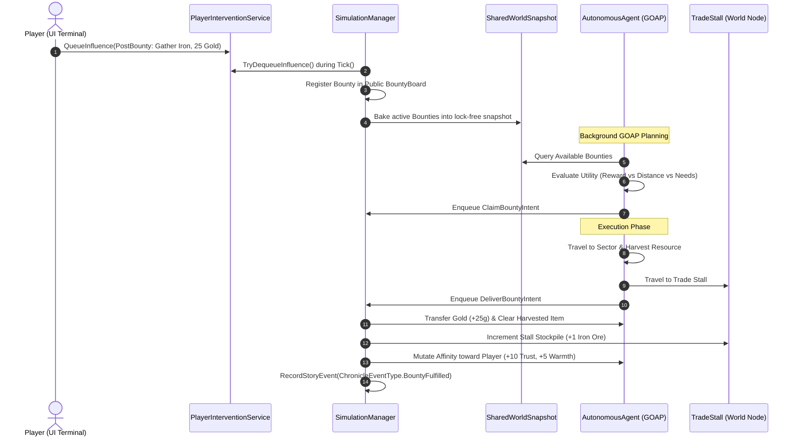

# Epic 9: The Outpost Economy & Public Bounties

- **Status**: MECHANISM COMPLETE (Track A / Production Phase 1 Engine). Status is owned by [ROADMAP.md](../ROADMAP.md).
  - **Live criterion (§1B) demonstrated:** `OutpostSupplyLoopScenario` (supply loop, 2026-10-10) and `PriceResponseScenario` (gradual demand, 2026-10-11) both pass without injection.
  - **§3.2 (personality) landed 2026-10-11.**
  - **Promotion to `COMPLETED` is held only by the deferred §3.3 economy model** (producer decision; see [ROADMAP §3A](../ROADMAP.md#3a-architecture-review-remediation-tracker)).
- **Track**: Track A: Core Simulation & Cognition Engine
- **Preceding Epic**: Epic 8: Socio-Political Structures & The Generic Group Primitive
- **Following Epic**: Epic 10: Sector Hazards & Dungeon Descent
- **Downstream Consumers**: Epic UI-2 (Merchant Terminal & Bounty Board), Epic Test-2 (Outpost Economy Harness)
- **Architectural Layer**: Core Simulation (`Simpiens.Simulation.Economy`, `SimulationManager`), Cognition (`Simpiens.Cognition.Planning`, `AgentInventory`), Intervention (`PlayerInterventionService`, `BountyContract`)

---

> [!IMPORTANT]
> **Status Reconciliation (2026-10-08).** Slices 1–3 (inventory/currency primitives, trade stall, bounty board and intervention pipeline) are delivered and validator-tested. The items below were specified in this document but **not delivered**, and the live gameplay loop is **not yet demonstrated** (see [ROADMAP Milestone 1 Status](../ROADMAP.md#milestone-1-status-verified-against-the-code-2026-10-09-not-yet-closed)).
>
> **Deferred / not delivered:**
> - `MemoryPack` state serialization (package not installed; `ItemInstance`/`BountyContract` were *laid out* to be blittable, but nothing serializes them).
> - ~~Zero-allocation Grid A* upgrade of `AsyncPathfinder`~~ **DELIVERED (2026-10-09)**: Delivered via `StaticNavGrid`, zero-allocation `GridAStarSearcher`, and worker pool in `AsyncPathfinder`.
> - `EconomyZeroAllocValidator` and `EconomySerializationValidator` (§6 items 3–4).
>
> **Live-loop gaps (2026-10-08) → addressed in code by review §3.1 (2026-10-09):** typed resources and salvage harvesting, Scout bounty fulfilment, supply caravan restock and node regrowth, escrow-only payout, and a free-crawler population in the Outpost Commons. The root cause was that Tier-2 GOAP never ran in the live session (ROADMAP §1A.2 #11). **Still open:** the no-injection PlayMode scenario `OutpostSupplyLoopScenario` has not been run, so the live loop is not yet demonstrated.

---

## 1. Executive Summary & Problem Statement

In **Epic 8**, agents gained the ability to organize into collectives ([`GroupRegistry`](file:///home/bfox/Code/Repos/Unity/Simpiens/Assets/Scripts/Simulation/GroupRegistry.cs)) and execute top-down directives ([`GroupDirective`](file:///home/bfox/Code/Repos/Unity/Simpiens/Assets/Scripts/Cognition/Groups/GroupDirective.cs)) based on hierarchical compliance ([`ComplianceUtility`](file:///home/bfox/Code/Repos/Unity/Simpiens/Assets/Scripts/Cognition/Groups/ComplianceUtility.cs)).

However, our simulation currently lacks an **economic feedback loop**:
1. **The Direct Intervention Deficit**: While [`PlayerInterventionService`](file:///home/bfox/Code/Repos/Unity/Simpiens/Assets/Scripts/Intervention/PlayerInterventionService.cs) exists as a concurrent queue of `InfluenceEvent` structs, it is completely unhooked from `SimulationManager.Tick()`. The player has no mechanism to influence the world.
2. **The Binary Inventory Bottleneck**: Agents only possess a single boolean flag `bool HasFoodInInventory` ([`AutonomousAgent.cs:69`](file:///home/bfox/Code/Repos/Unity/Simpiens/Assets/Scripts/Cognition/AutonomousAgent.cs#L69)). There is no concept of item types, stack quantities, equipment, or currencies.
3. **Absence of Public Contracts**: `GroupDirective` only works for formal leaders commanding subordinates within an established group. Unaligned drifters and independent crawlers have no mechanism to take on freelance work.
4. **Zero Trading Mechanics**: There is no merchant infrastructure. Agents cannot trade harvested salvage for provisions, and players cannot accumulate capital or interpersonal affinity through commerce.

### The Epic 9 Solution: The Outpost Economy
Epic 9 implements the foundational engine mechanics for **Production Phase 1 (The Outpost Loop)**:
* **Zero-Allocation Inventory & Currency**: Fixed-capacity unmanaged `ItemInstance` structs and integer `Gold` balances on agents and the player outpost.
* **Public Bounty Board**: Player posts public contracts (`ScoutSector`, `GatherResource`) via `PlayerInterventionService` which are broadcast through `SharedWorldSnapshot`.
* **Trade Stall Entity (`EntityType.Stall`)**: A spatial market anchor where agents buy provisions (Rations) and sell harvested materials (Iron Ore, Herbs).
* **GOAP Economic Expansion**: New goals (`ClaimBountyGoal`, `PurchaseProvisionsGoal`) and actions (`TravelToStallAction`, `DeliverBountyAction`, `TradeAtStallAction`).
* **Trade-to-Affinity Pipeline**: Commercial transactions directly mutate the agent's dyadic [`AffinityRecord`](file:///home/bfox/Code/Repos/Unity/Simpiens/Assets/Scripts/Cognition/Social/AffinityRecord.cs) toward the Player entity ($+\text{Trust}$ and $+\text{Warmth}$ for fair trades; $-\text{Trust}$ for extortion).

---

## 2. Conceptual Architecture & Data Flow

Player agency operates strictly through economic leverage and utility injection rather than direct pawn manipulation:



---

## 3. Data Architecture & Memory Layout (Zero-Allocation Hot Paths)

All economic data types are designed as **unmanaged, fixed-size value types** to guarantee zero heap allocations during high-frequency simulation ticks. Furthermore, their unmanaged, blittable layout makes them natively compatible with **`MemoryPack`** (`com.cysharp.memorypack`) for direct memory block copy (`Unsafe.CopyBlock`) serialization—enabling instant save/load, tick replay streams, and roguenote floor migration at memory bandwidth speed.

```
Memory Layout of Core Economic Structs:
┌────────────────────────────────────────────────────────┐
│ ItemInstance (16 bytes, unmanaged struct)              │
│ [ItemId:2B][Type:1B][Quality:1B]                       │
│ [Quantity:2B][BaseValue:2B]                            │
│ [Durability:2B][Pad:6B]                                │
├────────────────────────────────────────────────────────┤
│ BountyContract (32 bytes, unmanaged struct)            │
│ [BountyId:2B][Type:1B][TargetSectorId:1B]              │
│ [TargetItemType:1B][TargetQuantity:1B][RewardGold:2B]  │
│ [ClaimantId:16B (GUID)]                                │
│ [IssuedTick:4B][ExpirationTick:4B]                     │
├────────────────────────────────────────────────────────┤
│ TradeStallData (32 bytes, unmanaged snapshot struct)   │
│ [StallEntityId:16B (GUID)]                             │
│ [RationSellPrice:2B][RationStock:2B]                   │
│ [OreBuyPrice:2B][OreStock:2B]                          │
│ [HerbBuyPrice:2B][HerbStock:2B]                        │
│ [TreasuryGold:4B]                                      │
└────────────────────────────────────────────────────────┘
```

### 3.1 Type Definitions (`Simpiens.Simulation.Economy`)

```csharp
namespace Simpiens.Simulation.Economy
{
    public enum ItemType : byte
    {
        None        = 0,
        Ration      = 1, // Restores hunger; purchased by agents
        IronOre     = 2, // Raw metal; gathered via bounties, sold to player
        MedicinalHerb = 3, // Healing/comfort; gathered via bounties
        ToolPickaxe = 4, // Enhances harvest yield
        BasicWeapon = 5  // Equipped for hazard defense
    }

    public enum BountyType : byte
    {
        None           = 0,
        ScoutSector    = 1, // Explore shrouded sector and report back
        GatherResource = 2  // Harvest specific resource and deliver to stall
    }

    [MemoryPack.MemoryPackable]
    [System.Runtime.InteropServices.StructLayout(System.Runtime.InteropServices.LayoutKind.Sequential)]
    public readonly partial struct ItemInstance : System.IEquatable<ItemInstance>
    {
        public readonly ushort ItemId;
        public readonly ItemType Type;
        public readonly byte Quality; // 0 = Standard, 1 = Fine, 2 = Masterwork
        public readonly ushort Quantity;
        public readonly ushort BaseValue;
        public readonly ushort Durability;
        private readonly ushort _pad0;
        private readonly uint _pad1;

        public static readonly ItemInstance Empty = default;
        public bool IsEmpty => Type == ItemType.None || Quantity == 0;

        public ItemInstance(ushort itemId, ItemType type, ushort quantity, ushort baseValue, byte quality = 0, ushort durability = 100)
        {
            ItemId = itemId;
            Type = type;
            Quality = quality;
            Quantity = quantity;
            BaseValue = baseValue;
            Durability = durability;
            _pad0 = 0;
            _pad1 = 0;
        }

        public ItemInstance WithQuantity(ushort newQty)
        {
            return new ItemInstance(ItemId, Type, newQty, BaseValue, Quality, Durability);
        }

        public bool Equals(ItemInstance other) => ItemId == other.ItemId && Type == other.Type && Quantity == other.Quantity;
    }

    [System.Runtime.InteropServices.StructLayout(System.Runtime.InteropServices.LayoutKind.Sequential)]
    public readonly struct BountyContract
    {
        public readonly ushort BountyId;
        public readonly BountyType Type;
        public readonly byte TargetSectorId;
        public readonly ItemType TargetItemType;
        public readonly byte TargetQuantity;
        public readonly ushort RewardGold;
        public readonly UnityEngine.GUID ClaimantId;
        public readonly uint IssuedTick;
        public readonly uint ExpirationTick;

        public static readonly BountyContract None = default;

        public bool IsActive(uint currentTick) => Type != BountyType.None && currentTick <= ExpirationTick;
        public bool IsClaimed => ClaimantId != default;

        public BountyContract(ushort bountyId, BountyType type, byte targetSectorId, ItemType targetItemType,
                              byte targetQuantity, ushort rewardGold, UnityEngine.GUID claimantId,
                              uint issuedTick, uint expirationTick)
        {
            BountyId = bountyId;
            Type = type;
            TargetSectorId = targetSectorId;
            TargetItemType = targetItemType;
            TargetQuantity = targetQuantity;
            RewardGold = rewardGold;
            ClaimantId = claimantId;
            IssuedTick = issuedTick;
            ExpirationTick = expirationTick;
        }

        public BountyContract WithClaimant(UnityEngine.GUID claimantId)
        {
            return new BountyContract(BountyId, Type, TargetSectorId, TargetItemType, TargetQuantity, RewardGold, claimantId, IssuedTick, ExpirationTick);
        }
    }
}
```

### 3.2 Fixed-Buffer Agent Inventory

To avoid heap allocations and Garbage Collector pressure in `AutonomousAgent`, inventories use a fixed-size internal array (4 slots for drifters, expandable to 8 slots for contracted veterans):

```csharp
namespace Simpiens.Cognition
{
    public class AgentInventory
    {
        public const int DefaultCapacity = 4;
        private readonly ItemInstance[] _slots;
        private readonly int _capacity;

        public int Capacity => _capacity;
        public int Gold { get; set; }

        public AgentInventory(int capacity = DefaultCapacity, int startingGold = 10)
        {
            _capacity = capacity;
            _slots = new ItemInstance[capacity];
            Gold = startingGold;
        }

        public bool TryAddItem(in ItemInstance item, out ItemInstance remainder)
        {
            // 1. Stack into existing slots of same Type
            for (int i = 0; i < _capacity; i++)
            {
                if (_slots[i].Type == item.Type && _slots[i].Quality == item.Quality)
                {
                    _slots[i] = _slots[i].WithQuantity((ushort)(_slots[i].Quantity + item.Quantity));
                    remainder = ItemInstance.Empty;
                    return true;
                }
            }

            // 2. Insert into first empty slot
            for (int i = 0; i < _capacity; i++)
            {
                if (_slots[i].IsEmpty)
                {
                    _slots[i] = item;
                    remainder = ItemInstance.Empty;
                    return true;
                }
            }

            remainder = item;
            return false; // Inventory full
        }

        public bool HasItem(ItemType type, int count = 1)
        {
            int total = 0;
            for (int i = 0; i < _capacity; i++)
            {
                if (_slots[i].Type == type)
                {
                    total += _slots[i].Quantity;
                    if (total >= count) return true;
                }
            }
            return false;
        }

        public bool TryRemoveItem(ItemType type, int count)
        {
            if (!HasItem(type, count)) return false;

            int remainingToRemove = count;
            for (int i = 0; i < _capacity; i++)
            {
                if (_slots[i].Type == type)
                {
                    if (_slots[i].Quantity <= remainingToRemove)
                    {
                        remainingToRemove -= _slots[i].Quantity;
                        _slots[i] = ItemInstance.Empty;
                    }
                    else
                    {
                        _slots[i] = _slots[i].WithQuantity((ushort)(_slots[i].Quantity - remainingToRemove));
                        remainingToRemove = 0;
                    }

                    if (remainingToRemove <= 0) break;
                }
            }
            return true;
        }
    }
}
```

---

## 4. GOAP Integration & Utility Decision Math

### 4.1 StateFact Additions
Expand [`StateFact.cs`](file:///home/bfox/Code/Repos/Unity/Simpiens/Assets/Scripts/Cognition/Planning/StateFact.cs) with economic facts:
```csharp
HasActiveBounty       = 25,
AtTradeStall          = 26,
BountyDelivered       = 27,
HasProvisions         = 28,
HasSalvageInInventory = 29
```

### 4.2 Economic Goals
1. **`ClaimBountyGoal`**: Triggered when the agent's Energy and Hunger are stable ($\text{Hunger} < 60$, $\text{Energy} > 40$) and an unclaimed public bounty exists in memory or snapshot.
   * Priority formula:
     $$\text{Priority} = \text{BaseRewardWeight} \times \left(\frac{\text{RewardGold}}{50}\right) - \left(\frac{\text{DistanceToSector}}{20}\right) - (\text{Frustration} \times 0.2)$$
2. **`PurchaseProvisionsGoal`**: Triggered when an agent is hungry ($\text{Hunger} \ge 70$), possesses Gold ($\text{Gold} \ge \text{RationPrice}$), but has no food in inventory.

### 4.3 Economic Actions
* **`TravelToStallAction`**: Navigates agent to the trade stall anchor across sector bounds via [`AsyncPathfinder`](file:///home/bfox/Code/Repos/Unity/Simpiens/Assets/Scripts/Cognition/Pathfinding/AsyncPathfinder.cs).
* **`ClaimBountyAction`**: Claims an active bounty contract from the public board.
* **`DeliverBountyAction`**: Interacts with the stall node, handing over required salvage and receiving bounty gold.
* **`BuyProvisionsAction`**: Spends gold at the stall to acquire a `Ration` item.
* **`SellSalvageAction`**: Sells excess harvested ore/herbs for market price.

> [!NOTE]
> **Navigation Infrastructure Upgrade** *(DEFERRED — not delivered)*: Multi-sector travel between resource nodes and the player stall will utilize the upgraded zero-allocation Grid A* engine in [`AsyncPathfinder.cs`](file:///home/bfox/Code/Repos/Unity/Simpiens/Assets/Scripts/Cognition/Pathfinding/AsyncPathfinder.cs), porting the array-backed min-heap and node pool from [`GoapPlanner.cs`](file:///home/bfox/Code/Repos/Unity/Simpiens/Assets/Scripts/Cognition/Planning/GoapPlanner.cs) to eliminate watchdog stalls across complex sector layouts.

---

## 5. System Integration & Execution Flow

### 5.1 Connecting `PlayerInterventionService`
In [`SimulationManager.Tick()`](file:///home/bfox/Code/Repos/Unity/Simpiens/Assets/Scripts/Core/SimulationManager.cs#L170), process queued influence commands before updating spatial snapshots:

```csharp
while (_playerIntervention.TryDequeueInfluence(out var influence))
{
    switch (influence.CommandType)
    {
        case "PostBounty":
            ParseAndRegisterBounty(influence.Payload);
            break;
        case "CancelBounty":
            CancelBounty(influence.Payload);
            break;
        case "UpdateStallPrices":
            UpdateStallPrices(influence.Payload);
            break;
    }
}
```

### 5.2 Trade-to-Affinity Pipeline
When an agent completes a transaction at the trade stall, dyadic affinity toward the Player entity (`WorldRegistry.PlayerEntityId`) is updated:
* **Fair Trade / Generous Reward**:
  * Payout $\ge \text{FairMarketValue}$: $+10\text{ Trust}$, $+5\text{ Warmth}$, $+5\text{ Respect}$.
* **Price Gouging / Low Reward**:
  * Ration price $> 150\%$ base cost: $-15\text{ Trust}$, $-10\text{ Warmth}$.
* **Threshold Conversion**:
  * Once dyadic $\text{Trust} \ge 60$ and $\text{Warmth} \ge 40$, the agent qualifies for recruitment into the player's permanent Guild in **Phase 2 / Epic 10**.

---

## 6. Testing & Headless Verification Suite (`Simpiens.Testing.Economy`)

Following the defensive null-safety and headless testing architecture of Simpiens, all economic mechanics are accompanied by batch-mode domain validators in `Assets/Scripts/Testing/`:

1. **`BountyFulfillmentValidator.cs`**:
   * Simulates posting a `GatherResource` bounty.
   * Asserts an unaligned agent claims the bounty, navigates to the node, gathers the resource, delivers to the stall, and receives the gold payout.
   * Asserts stall stockpile increments by the target quantity.
2. **`TradeTransactionValidator.cs`**:
   * Tests buy/sell boundaries, wallet underflow prevention, and inventory overflow handling.
   * Validates that dyadic `Trust` and `Warmth` increase after fair trade transactions.
3. **`EconomyZeroAllocValidator.cs`** *(DEFERRED — not implemented)*:
   * Runs 1,000 simulated trading and bounty evaluation ticks off-thread.
   * Asserts zero heap allocations during the steady-state evaluation loop.
4. **`EconomySerializationValidator.cs`** *(DEFERRED — not implemented; requires `MemoryPack`)*:
   * Validates that `ItemInstance`, `BountyContract`, and `AgentInventory` round-trip serialize with `MemoryPack` at 0 bytes GC.

---

## 7. Acceptance Criteria (Definition of Done)

- [x] `ItemInstance`, `BountyContract`, and `TradeStallData` implemented as unmanaged structs with zero heap allocations.
- [x] Memory layout compatibility verified for unmanaged economic data structures (fixed 16B, 44B, 64B sizes).
- [x] `AgentInventory` integrated into [`AutonomousAgent`](file:///home/bfox/Code/Repos/Unity/Simpiens/Assets/Scripts/Cognition/AutonomousAgent.cs) with fixed-size struct array storage.
- [x] `PlayerInterventionService` drained and executed within `SimulationManager.Tick()`.
- [x] Public `BountyBoard` baked into `SharedWorldSnapshot` for lock-free background worker queries.
- [x] GOAP actions (`ClaimBountyAction`, `DeliverBountyAction`, `BuyProvisionsAction`, `SellSalvageAction`) registered in `SwarmSpawner` action graph.
- [x] Trade transactions mutate agent dyadic affinity toward the player entity.
- [x] All headless validators (`InventoryValidator`, `TradeTransactionValidator`, `BountyFulfillmentValidator`) passing with 0 errors in headless batch mode.

### Review §3.1 — Milestone 1 Supply Side (implemented 2026-10-09)

Delivered in code (compiles; `SupplyLoopValidator` and `OutpostSupplyLoopScenario` **not yet run**):

- [x] Typed resources: `ResourceData.YieldItem/MaxYield/RegrowTicks`, `EntitySnapshot.ResourceKind`, `SpatialMemoryRecord.ResourceKind`, salvage node sprites.
- [x] Tier-1 `SurvivalUtilityEvaluator` reduced to a hunger reflex; ambient idle/wander moved to the Tier-3 `AmbientWanderEvaluator` fallback, so GOAP runs in the live session.
- [x] Real food chain intents (`SearchResource`, `TravelToResource`, `HarvestResource`).
- [x] Salvage GOAP domain: facts `KnowsSalvageLocation`, `HasGatherBounty`, `HasScoutBounty`, `HasBountyItem`, `HasScoutReport`, `HasSoldSalvage`; actions `SearchSalvage`, `GatherSalvage`, `ClaimGatherBounty`, `ClaimScoutBounty`, `ScoutSector`, `ReportScoutBounty`; `EarnIncomeGoal`.
- [x] Harvest handler yields salvage into inventory, fails without consuming yield when the inventory is full, supports multi-unit gathering, and sends depleted regrowable nodes dormant.
- [x] Scout fulfilment (`ScoutIntent`/`ScoutIntentHandler`, report redeemed at a stall, sector marked explored).
- [x] Escrow-only bounty payout; `RegisterBounty` escrows or rejects.
- [x] `SupplyService`: deterministic dormant regrowth and supply caravan (`SupplyCaravan` ledger sink).
- [x] Outpost Commons arena (stall at (0, 9), Ore Ridge, Herb Hollow, 6 free crawlers, zones 11–13).

**Deferred:** live-loop demonstration (first run of `OutpostSupplyLoopScenario`) — owned by Epic 9 / Milestone 1 closure; personality-driven bounty acceptance — §3.2; faucet/sink retuning — §3.3 / Epic Test-2; moving the production GOAP domain out of `Testing/` — §2.8.

---

## 8. Economy observations: input for the deferred §3.3 decision

The producer deferred the economy design until the game is functional (2026-10-09). This section keeps the measured evidence in one place for that decision. Facts only, no recommendations. It was collected from the working plans, which were removed once their work was done (git history keeps them).

### 8.1 The Outpost Commons yard, 6 crawlers (2026-10-11)
Six runs: 18,000 ticks (30 sim-minutes) at 10×, seeds 20261009 / 1 / 2, provisional export on and off. CSVs are in `Logs/economy-soak-seed<seed>-export<on|off>.csv`.

| Export | Seed | Treasury end (start 210g) | Crawler gold (6 crawlers, start 60g) | Rations bought | Salvage sold | Export faucet | Caravan sink | Skipped restocks | Trading stops at | Max crawlers starving | Mean crawler hunger |
| :-: | :-: | --: | --: | --: | --: | --: | --: | --: | :-: | :-: | --: |
| on | 20261009 | 4,709g | 235g | 278 (4,170g) | 186 (4,305g) | 5,190g | 556g | 0 | never | 0 | 37.0 |
| on | 1 | 4,488g | 250g | 264 (3,960g) | 177 (4,110g) | 4,956g | 528g | 0 | never | 2 | 40.3 |
| on | 2 | 4,260g | 230g | 250 (3,750g) | 166 (3,880g) | 4,680g | 500g | 0 | never | 3 | 40.1 |
| off | 20261009 | 17g (min 2g) | 235g | 79 (1,185g) | 59 (1,320g) | — | 58g | 25 of 29 | min 10 | 4 | 49.3 |
| off | 1 | 1g | 215g | 97 (1,455g) | 69 (1,570g) | — | 94g | 23 of 29 | min 12 | 3 | 50.0 |
| off | 2 | 3g | 245g | 81 (1,215g) | 60 (1,360g) | — | 62g | 25 of 29 | min 11 | 3 | 54.5 |

1. **Treasury trajectory.**
   - *Export off:* the treasury drains to 1–17g within 10–12 sim-minutes. After that, every trade stops: the stall can't pay for salvage and can't afford restocks, and ration stock hits 0. The economy stays frozen for the rest of the run.
   - *Export on:* the treasury grows almost linearly, about +140–150g per sim-minute, to roughly 4,300–4,700g. Growth ≈ export faucet − caravan sink (net flow from crawlers ≈ 0, see 2).
2. **Where gold sits.** Crawler wallets plateau at about 215–250g in total (≈ 35–42g each), with or without the export. Crawlers spend almost exactly what they earn: ration spend is 96–97% of sale income with export on, and 87–93% with it off. Gold doesn't pool in crawler wallets; it pools in the stall treasury (export on) or nowhere (export off, economy frozen). Pen agents hold a constant 240g, since they're walled off from the stall.
3. **Flow volumes.** With export on: about 8–9 ration purchases per sim-minute (15g each) and about 6 salvage sales per sim-minute (20–25g each). Bounty payouts total 40g per run: only the two seeded bounties exist, and no player posts any.
4. **Free vs. bought food.** Crawlers buy rations heavily whenever they can (250–278 purchases per run), even though bushes regrow (≈ 230–250 regrowths per run). With the export off and the stall unable to restock, crawler hunger rises (mean 49–55 vs 37–40) and 3–4 crawlers reach starvation. Free food doesn't fully replace the stall in the current setup.
5. **Supply health.** With export on, the caravan never skips (29/29 restocks) and the export runs every visit (30/30). With export off, 23–25 of 29 restocks are skipped. Salvage then piles up unsold in the stall (39–48 units each of ore and herb), because nothing removes it.

**Measurement notes:**
- Samples are taken every 600 ticks, which coincides with caravan visits. Stall stock columns therefore show post-visit values: ration stock 50, salvage at the 10-unit reserve. Use transfer counters, not stock columns, for rates.
- Same-seed runs aren't bit-identical, because the arrival tick of async cognition still varies (§1A.2 #6). The trends agree across seeds.

### 8.2 Floor 1, 12 crawlers (Epic MAP Phase 3, 2026-10-12)
`scripts/run-economy-soak.sh`: 30 sim-minutes (18,000 ticks) at 10×, with 3 seeds (20261009, 1, 2) × the provisional caravan export on and off. All 6 runs pass their integrity checks: the ledger is conserved and the horizon is reached. No economy values are asserted, and none were tuned: prices, stocks and starting gold are exactly as in Phase 2. Epic MAP Phase 2 measured the Commons yard with 6 crawlers; Phase 3 measured Floor 1 with 12. The CSVs are in `Logs/economy-soak-seed<seed>-export<on|off>.csv`.

| | Yard (Epic MAP Phase 2), export off | **Floor 1, export off** | Yard (Epic MAP Phase 2), export on | **Floor 1, export on** |
| :--- | :-: | :-: | :-: | :-: |
| Stall treasury, start → 30 min | 210 → 2–19g | **210 → 6–17g** (under 20g by minute 3) | 210 → 4,747–5,105g | **210 → 7,616–8,178g** |
| Rations sold out | minute 9–11 | **minute 6–9**, never restocked | never | **never** |
| Caravan restocks | 2–3 of 30 | **2–4 of 30** | 29 of 30 | **30 of 30** |
| Rations bought (purchases) | 78–85 | **72–99** | 280–303 | **458–494** |
| Salvage sold (sales) | 57–62 | **56–71** | 186–201 | **317–342** |
| Rations harvested from the Garden | not measured | **234–283** | not measured | **133–152** |
| Ore / herbs harvested | not measured | **32–42 / 27–34** | not measured | **165–189 / 153–156** |
| Crawler gold total | 60 → 230–250 | **120 → 255–320** | 60 → 215–265 | **120 → 360–430** |
| Mean hunger at 30 min | 36–55 | **55–71** | 35–42 | **41–52** |
| Bunk sleeps | (no bunks) | **52–73** | (no bunks) | **91–117** |
| Exhaustion collapses | not measured | **24–31** | not measured | **9–13** |
| Starving episodes (95+ hunger for 30 s) | not measured | **7–26** | not measured | **0** |

What the numbers say (observations, not decisions):
1. **Without the provisional export the economy still fails,** and faster on Floor 1. The stall can't afford salvage after about 3 minutes, so it stops buying and stops restocking. Rations sell out by minute 6–9. Crawlers fall back on the Garden (234–283 rations harvested, against 133–152 with the export), stop working salvage (ore and herbs fall from about 160 to about 35), go hungrier, collapse two to three times as often, and starve 7–26 times in 30 minutes.
2. **With the export, the treasury grows about 60% faster than on the yard** (about 7,600–8,200g against about 4,700–5,100g). Twice the crawlers means about 60% more purchases and sales. The export is a faucet with no matching sink, so this growth is the stopgap's side effect, not a working economy.
3. **Crawler wealth barely moves either way:** crawlers end with about 20–35g each after 30 minutes (from 10g). Gold flows through the stall and the export, not into the crawlers' pockets.
4. **Hunger dominates the crawlers' day.** Hunger rises 1.5/s (a meal about every 40 s), so food is most of what they do. With the export, 0 starvation; without it, food runs out.
5. **The yard's conclusion stands, now on the real map:** §3.3 has to close the stall's money loop. A sink for the export gold, or a source of income for the stall that isn't a free faucet, is the decision the producer deferred. Floor 1 adds a time constraint: distance and 12 mouths make the stall's failure show within 3–6 minutes.

### 8.3 Floor 1 lifecycle, trust toward the player (Epic MAP Phase 5, 2026-10-13)
`OutpostLifecycleScenario`: 9,000 ticks (15 sim-minutes) at 10×, default seed, nothing injected, the live setting (provisional export on). Prices, stocks and starting gold are unchanged.

- **Trust toward the player falls for almost everyone:** 10 of 12 crawlers end at −80 to −100, the other 2 at 0. None rises.
- **Why:** the stall sells rations at 15g, three times their base value (5g). `TradeIntentHandler` counts any ration price above 1.5× base (7.5g) as gouging: −15 trust per purchase. A fair sale to the stall gives +10. Crawlers buy food more often than they sell salvage (hunger rises 1.5/s), so trust only goes down.
- **Consequence:** the scenario reports trust and does not assert it (producer decision 2026-10-13). Milestone 1 promises "dyadic trust with visiting crawlers", so the economy model has to make fair trade possible at the prices it sets.

### 8.4 The decisions this evidence informs (deferred)
**Producer decision 2026-10-13: every economic decision is folded into §3.3,** including the ones Epic MAP surfaced. Nothing below is decided.
1. **Salvage outlet (faucet):** keep, retune or replace the provisional caravan export.
2. **Agent sinks:**
   - (a) Free bushes yield less or regrow slower, so rations matter.
   - (b) Daily lodging/upkeep fee.
   - (c) Gear wear (defer to Epic 10).
3. **Scarcity lever:** material scarcity (node regrowth) vs. agent willingness to spend (`AgentPersonality`, closure Phase 4).
4. **Target pace:** e.g. "a competent player's treasury roughly doubles in 30 sim-minutes; a careless one hits zero". Once set, it becomes a soak assertion.
5. **Prices and fairness (§8.3):** the default stall prices, and what counts as gouging: a fixed multiple of base value (today), the stall's going rate, or the crawler's own reservation price (`Considerations`). Then trust toward the player becomes an assertion again in `OutpostLifecycleScenario`.
6. **Hunger pacing and food supply:** hunger rises 1.5/s (a meal about every 40 s), so food is most of a crawler's day (§8.2 #4). The Garden (4 plots × 3 rations, regrowing 450 ticks after they empty) can't feed 12 crawlers alone, and a crawler starts with 10g against a 15g ration. Evidence (Epic MAP close-out, 2026-10-13): `OutpostLifecycleScenario` had 0 starving over 9,000 ticks in 3 of 3 runs, but `BunkRestScenario` starved one crawler in 3 of 6 close-out runs. That crawler was broke, every Garden plot it knew was empty, and starvation panic sent it exploring away from the Garden while the plots regrew. `BunkRestScenario` reports starvation instead of asserting it until this is decided.
7. **Drifter arrival and departure** through the Road Gate (population churn brings gold in and out), deferred from Epic MAP.

Once decided: write `docs/economy-model.md`, implement it, and turn the soak's agreed bands into assertions. That is the deferred half of §3.3.

