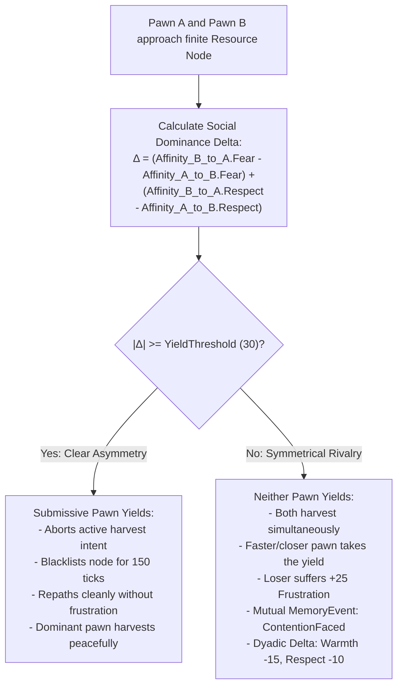

# Epic Beta: Concrete World Mechanics & Physical Interdependence

- **Status**: ACTIVE
- **Preceding Epic**: Epic 7: The Social Affinity Matrix & Relational Dynamics
- **Following Epic**: Epic 8: Socio-Political Structures & The Generic Group Primitive
- **Architectural Layer**: Core Simulation (`SimulationManager`, `SpatialHashGrid`, `SharedWorldSnapshot`) & Cognition (`AgentMemory`, Dyadic Matrix Integration, GOAP Goals/Actions)

---

## 1. Executive Summary & Problem Statement

In **Epic 7 Phase 1**, we implemented the unmanaged 4-Axis Social Affinity Matrix (`Warmth`, `Trust`, `Fear`, `Respect`) with temporal decay, selective gossip filtering, and GOAP world state fact mapping.

However, continuing directly into macro-societal structures (Tribes, Chieftains, Dominance hierarchies) poses a severe architectural risk known as the **"Simulation Void Trap"**:
1. **Lack of Physical Stakes**: Modeling political hierarchies, obedience, and ambition before pawns have concrete, observable reasons to interact over physical map objects produces abstract graph math disconnected from actual gameplay.
2. **Premature Class Monoliths**: Hardcoding bespoke entities like `Tribe` and `Chieftain` locks the codebase into a rigid survival-sim paradigm, when the target architecture demands transient parties, occupational guilds, and emergent settlements.
3. **Missing Feedback Loops**: To prove that `Fear` causes submission and `Warmth` causes altruism, pawns must yield contested berry bushes to intimidating peers and feed starving companions out of mutual affection.

**Epic Beta** bridges this gap. It introduces physical interdependence on the map using existing primitives (hunger, finite resource nodes, fog-of-war memory, and spatial proximity), making the 4-axis relational matrix visually observable and mechanically impactful.

---

## 2. Theoretical Architecture: The 4-Layer Sociological Taxonomy

To ensure future social structures scale cleanly from a 4-man hunting band to a kingdom without class explosion, all sociopolitical systems in Simpiens adhere to this 4-layer taxonomy:

```mermaid
flowchart TD
    subgraph Layer 4: Hierarchical Authority & Roles (Epic 8)
        L4["Agent ──[Role Rank / Rights]──► Group\nCommand priority, delegation, succession, compliance vs defiance"]
    end

    subgraph Layer 3: Structural Collective Entities (Epic 8)
        L3["Agent ────[Membership]────► GroupData\nShared inventory, spatial anchors, collective directives"]
    end

    subgraph Layer 2: Identity & Categorical Affiliation (Epic 8)
        L2["Agent ────[Tag]────► Category (Origin, Faith, Guild)\nInjects bias baseline modifiers into Dyadic Matrix"]
    end

    subgraph Layer 1: Dyadic Interpersonal Matrix (Epic 7 - COMPLETED)
        L1["Agent ◄───[Warmth, Trust, Fear, Respect]───► Agent\nBilateral episodic memory, selective gossip, personal bonding"]
    end

    L4 --> L3
    L3 --> L2
    L2 --> L1
```

### 2.1 The Generic `Group` Primitive Reference (Epic 8 Groundwork)
Instead of subclassing `Party`, `Guild`, `Tribe`, or `Settlement`, all collectives are represented by a single, generic, parameter-driven `Group` primitive.

#### Data Structures Specification:
```csharp
namespace Simpiens.Cognition.Groups
{
    public enum GroupType : byte
    {
        TemporaryParty = 0, // Ad-hoc transient collective (hunting band, foraging party)
        FactionGuild   = 1, // Occupational collective (craft guild, military order)
        Settlement     = 2  // Macro geographic collective (clan, village, town)
    }

    public enum DirectiveType : byte
    {
        None            = 0,
        RallyAtLocation = 1,
        HarvestResource = 2,
        DefendAnchor    = 3
    }

    /// <summary>
    /// Zero-allocation 24-byte unmanaged struct representing an active collective order.
    /// </summary>
    public readonly struct GroupDirective
    {
        public readonly DirectiveType Type;
        public readonly byte GroupId;
        public readonly UnityEngine.GUID LeaderId;
        public readonly UnityEngine.Vector2 TargetLocation;
        public readonly UnityEngine.GUID TargetEntityId;
        public readonly uint ExpirationTick;

        public GroupDirective(DirectiveType type, byte groupId, UnityEngine.GUID leaderId, 
                              UnityEngine.Vector2 targetLocation, UnityEngine.GUID targetEntityId, uint expirationTick)
        {
            Type = type;
            GroupId = groupId;
            LeaderId = leaderId;
            TargetLocation = targetLocation;
            TargetEntityId = targetEntityId;
            ExpirationTick = expirationTick;
        }

        public static readonly GroupDirective None = new GroupDirective(DirectiveType.None, 0, default, UnityEngine.Vector2.zero, default, 0);
        public bool IsActive(uint currentTick) => Type != DirectiveType.None && currentTick <= ExpirationTick;
    }

    /// <summary>
    /// Stack struct representing an individual agent's standing within a group.
    /// </summary>
    public readonly struct GroupMembership
    {
        public readonly byte GroupId;
        public readonly byte RoleRank; // 0 = Initiate/Follower, 1 = Officer/Elder, 2 = Commander/Chieftain
        public readonly uint JoinTick;

        public GroupMembership(byte groupId, byte roleRank, uint joinTick)
        {
            GroupId = groupId;
            RoleRank = roleRank;
            JoinTick = joinTick;
        }

        public static readonly GroupMembership None = new GroupMembership(0, 0, 0);
        public bool HasGroup => GroupId != 0;
    }

    /// <summary>
    /// Unmanaged snapshot struct representing a group's spatial and operational state in SharedWorldSnapshot.
    /// </summary>
    public readonly struct GroupData
    {
        public readonly byte GroupId;
        public readonly GroupType Type;
        public readonly UnityEngine.GUID LeaderId;
        public readonly UnityEngine.Vector2 AnchorPosition; // Hearth / Campfire / Guildhall center
        public readonly GroupDirective ActiveDirective;
        public readonly ushort MemberCount;

        public GroupData(byte groupId, GroupType type, UnityEngine.GUID leaderId, 
                         UnityEngine.Vector2 anchorPosition, in GroupDirective activeDirective, ushort memberCount)
        {
            GroupId = groupId;
            Type = type;
            LeaderId = leaderId;
            AnchorPosition = anchorPosition;
            ActiveDirective = activeDirective;
            MemberCount = memberCount;
        }
    }
}
```

#### Lock-Free Snapshot Reading:
1. `SharedWorldSnapshot` allocates a fixed array of `GroupData[64]`.
2. Written once per tick on the main thread during `SpatialHashGrid.UpdateFromRegistry()`.
3. Background cognitive workers running `EvaluateCognitionAsync()` read `snapshot.TryGetGroup(groupId, out groupData)` with zero locks, zero mutexes, and zero heap allocations.

---

## 3. Epic Beta Phases: Physical Interdependence

```
 Epic Beta Roadmap
 ─────────────────────────────────────────────────────────────────────────────
 Phase 1: Resource Contention & Yielding (Fear & Respect on Finite Nodes)
 Phase 2: Altruistic Sharing & Food Transfer (Warmth & Trust in Survival)
 Phase 3: Gathering Anchors & Organic Social Bonding (Campfires & Hearths)
 ─────────────────────────────────────────────────────────────────────────────
```

---

### Phase 1: Resource Contention & Yielding (Fear & Respect Integration)

#### Problem
Currently, when two pawns target the same berry bush, the first to finish the timer consumes the yield. The second pawn finishes a moment later, finds a depleted node, and suffers generic frustration. This is an unrealistic race condition.

#### Mechanism
When two pawns approach a finite resource node (distance $\le 2.0\text{m}$), they execute a deterministic **Social Yielding Protocol** based on their pairwise dyadic scores:



#### Dual-Loop Synchronization
- **Worker Thread (Async GOAP)**:
  - During `HarvestResourceAction.IsValid(context)`, the agent checks `context.Snapshot` for peers within $2.0\text{m}$ of the target resource.
  - If a peer is present, looks up `context.Memory.GetAffinity(peer.Id, context.CurrentTick)`.
  - If `affinity.Fear >= 40` (intimidated) or `affinity.Respect >= 50` (deferent), the action returns `false`. GOAP seamlessly repaths to an alternative resource without main-thread blocking.
- **Main Thread Authoritative Validation (`SimulationManager.cs`)**:
  - In `ExecuteIntent` under `HarvestIntent`: When pawn $A$ arrives, if pawn $B$ is already harvesting and has lower dominance, $A$ continues; if $B$ yields, $B$'s intent transitions to `IntentResult.PathBlocked` with zero frustration.
  - If symmetrical contention occurs, `SimulationManager` completes the harvest for the victor, applies frustration to the loser, and logs `MemoryEventType.ContentionFaced` into both pawns' memory ledgers.

---

### Phase 2: Altruistic Sharing & Food Transfer (Warmth & Trust Integration)

#### Problem
Pawns currently let their companions starve to death in front of them while holding full bellies.

#### Mechanism
A sated pawn ($Hunger < 50$) who perceives an incapacitated or critically starving peer ($Hunger \ge 85$ or `IsExhaustionCollapsed`) evaluates an altruistic aid action:

$$\text{Utility}_{\text{share}} = (\text{Warmth} \times 0.5) + (\text{Trust} \times 0.3) - (\text{SelfHunger} \times 0.4) + (\text{IsCollapsed} \ ? \ +30 : 0)$$

- **Resolution Branches**:
  1. If $\text{Utility}_{\text{share}} \ge 25f$:
     - Giver formulates and emits `ShareResourceIntent(TargetPawnId, Path, TransferDuration = 1.0f, FoodAmount = 40f)`.
     - Giver navigates to starving pawn ($1.5\text{m}$ interaction reach).
     - Giver triggers `AgentVisualState.Sharing = 8` (outstretched offering gesture, emerald/mint palette, pulsating micro-animation).
     - Authoritative execution in `SimulationManager`:
       - Transfers $40$ hunger satisfaction: Giver $+15$ Hunger (metabolic exertion), Receiver $-40$ Hunger.
       - If Receiver was in starvation panic or collapse and hunger drops below $85$, panic/collapse state is alleviated.
       - Giver logs `MemoryEventType.AidGiven` (Giver: $+10\text{ Warmth}$, $+5\text{ Respect}$).
       - Receiver logs `MemoryEventType.AidReceived` (Receiver: $+25\text{ Warmth}$, $+30\text{ Trust}$, $+15\text{ Respect}$).
  2. If $\text{Utility}_{\text{share}} < 25f$:
     - Sated pawn exhibits **Selfish Indifference**: ignores the starving peer to pursue its own survival or leisure goals.

#### Dual-Loop Synchronization
- **Worker Thread (Async Cognition / Evaluators & GOAP)**:
  - Read-only spatial check: `context.Snapshot` provides `peer.Hunger` and `peer.IsCollapsed` without locking or main-thread access.
  - Off-thread utility calculation: `context.Memory.CalculateAltruismScore(peer.Id, ...)`.
  - Asynchronous path calculation via `_pathfinder` to target peer.
- **Main Thread Authoritative Validation (`SimulationManager.cs`)**:
  - Validates target peer still exists in `_worldRegistry`.
  - Moves giver towards receiver using `ExecutePathMovement`.
  - Triggers sharing visual pose and executes state mutations: modifies hunger values, updates dyadic affinities, and appends memory events.

#### Acceptance Criteria
- **User Visual Acceptance**:
  - `SwarmAgent_6` (Warm companion) paths to starving `SwarmAgent_7`, assumes `Sharing` pose with warm pulsating glow, feeds `SwarmAgent_7`, and `SwarmAgent_7` recovers from panic.
  - `SwarmAgent_8` (Estranged peer) ignores starving `SwarmAgent_9` and walks away.
  - Dyads 1, 2, 3 retain existing fear-yielding, respect-yielding, and rivalry contention behavior.
- **Engineering Acceptance**:
  - Clean Roslyn compilation (0 errors, 0 warnings).
  - Automated test suite `AltruisticSharingValidator` passing all 5 headless domain tests + 0-GC allocation benchmark.

---

### Phase 3: Gathering Anchors & Organic Social Bonding (Campfires & Hearths)

#### Problem
Pawns currently wander across the map at random when idle. Social interactions only occur via random collision trajectories.

#### Mechanism
1. **World Entity**: Introduce `GatheringAnchor` (e.g. `Campfire`, a stationary simulation node with `EntityType.Anchor`).
2. **GOAP Gravitation**:
   - Action: `TravelToAnchorAction` (`Preconditions: None`, `Effects: AtAnchorLocation = true`).
   - Goal: `GatherAtAnchorGoal` (`DesiredState: AtAnchorLocation = true`).
   - Priority: Dynamic fallback when drives are satisfied ($Hunger < 40$, $Energy > 50$, $Social < 80$). Priority $= 80 - \text{Social}$.
3. **Proximity Bonding Loop**:
   - When multiple pawns sit within $3.0\text{m}$ of a `GatheringAnchor` during an `IdleIntent`:
     - Gossip frequency increases ($3\times$ faster cooldown: 100 ticks instead of 300).
     - Every 100 ticks spent together around an anchor quietly awards $+2\text{ Warmth}$ and $+1\text{ Trust}$ to all present peers.
   - **Emergent Consequence**: Pawns naturally form social cliques, buddies, and mutual trust clusters around shared hearths *organically*, providing the emergent social fabric needed for Epic 8 groups!

---

## 4. Technical Constraints & Design Principles

1. **Strict Zero-Allocation in Hot Paths**:
   - `GroupDirective`, `GroupMembership`, and `GroupData` are unmanaged structs.
   - Contention and altruism calculations use stack mathematics with zero heap allocations.
2. **Dual-Loop Decoupling**:
   - Intent generation, utility scoring, and dyadic lookups execute off-thread in `CognitiveEngine`.
   - All state mutations (hunger transfers, resource node decrements, entity deregistration) occur authoritatively on the main thread in `SimulationManager`.
3. **Defensive Null-Safety for Test Isolation**:
   - All evaluators and intent handlers gracefully fallback when dependencies (`ISpatialPartition`, `IWorldRegistry`, `ISimulationClock`) are null during headless unit tests.
4. **Episodic Memory Causality**:
   - Every physical contention or altruistic transfer records corresponding `MemoryEvent`s into both pawns' ring buffers, ensuring personal history informs future decisions.
