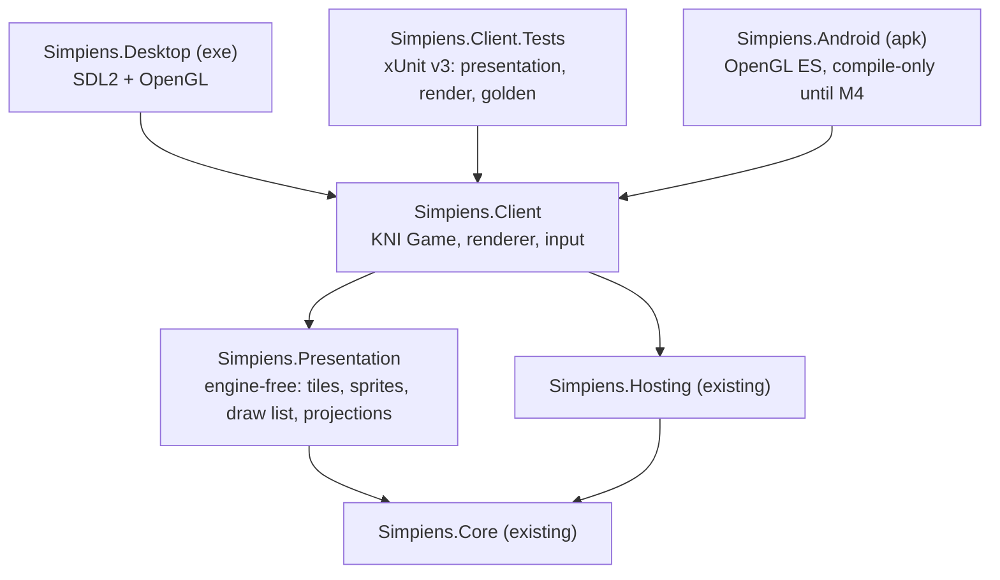

# Epic CLIENT: KNI Client and Engine Rework

- **Status**: PAUSED (2026-10-29) after graphics V3–V5 (§3: item icons and map sprites from a sprite kit, the sampling rules that close F12 and F19, the packed single world sheet, icons in the dashboard, the stall with its goods, worn gear, carried salvage), done under the producer's provisional authority; the producer's own look at the art and renders is pending. ACTIVE for it on 2026-10-29; before that, PAUSED (2026-10-28) after the art catalogue (graphics V0–V2, pulled forward from M7: review R5's catalogue half and S10; §3), with no picture changed. ACTIVE for the catalogue on 2026-10-28; before that, PAUSED (2026-10-24), after M2.8–M2.9 removed Unity (producer: "remove Unity first"; ACTIVE again for that on 2026-10-24). It was PAUSED (2026-10-23): the producer set Android and the other engine work aside for core gameplay ([Epic 10 Part 1](epic-10.md)). **What exists**, merged into `main` as PR #6 on 2026-10-23: M0 and M1; M2.0–M2.7 (parity with Unity's game); the text cleanup, the client seams, M3 (isometric and cutscenes) and the architecture review's findings. **Producer sign-offs (2026-10-24):** the side-by-side with Unity, the look at M3, the motion between ticks and the header's pause and speed passed; the producer: "we can officially move away from Unity". **What does not exist:** Unity's removal (M2.8, M2.9: unblocked, see §4), M4 (Android, deferred) and M5–M7. Epic 10's new screens are built in this client. Status is owned by [ROADMAP.md](../ROADMAP.md). Decisions and deviations: `.agents/architecture_history.md`.
- **Track**: Independent (cross-cutting architecture)
- **Source**: the engine proposal, [`docs/engine-proposal-kni.md`](../engine-proposal-kni.md). That is a repo copy of the Claude Docs proposal, including the producer's answers of 2026-10-18. The engine spike that led to it compared Godot, BRUTAL, MonoGame, FNA and staying on Unity.
- **Builds on**: [Epic CORE](epic-core.md). The simulation is engine-free (`Assets/Simpiens.Core`), builds for .NET 10 (`dotnet/`) and runs headless through `Simpiens.Hosting`.
- **Replaces**: Unity's views and dashboard. They were frozen from M0, and Unity was removed at M2.9 (2026-10-24).

---

## 0. Producer intent and decisions

The producer chose KNI on 2026-10-18 for its responsive maintainer and its modern .NET 10 support on mobile. They asked the agent to see M0 and M1 through under provisional authority, with an implementation plan before each, committing regularly and only in a working state.

**Decisions (2026-10-18):**

- **Framework:** KNI (`nkast.Xna.Framework.*`, 4.3.9001). MonoGame stays compiling in CI as its fallback. Godot is dropped.
- **Views:**
  - Isometric will most likely replace top-down as the main view.
  - Height is visual only.
  - Top-down is for design only: the developers' map designer, and debugging.
  - Cutscenes are still backdrops with dynamic characters and text boxes, in the style of Fire Emblem.
- **Platforms:**
  - The MVP is Windows and Linux desktop.
  - Android and iOS follow the MVP: phones in portrait only, tablets not a priority. An Apple developer account and a Mac exist.
  - Consoles come last, only if mobile goes well.
  - No macOS, no web.
- **Seams before M3 (2026-10-20):** carry out the architecture review's high findings A1–A3 (projection, draw order, view frame) before isometric. Plan: the Claude Doc "Plan: Projection, Draw Order and Frame Snapshot (A1–A3)".
- **Fog, D1 = C (2026-10-21), replacing A in the client:** the fog hides everything in an uncharted sector, crawlers included, in both projections. A scout vanishes into the fog until the room is charted.
- **M3 (2026-10-21):**
  - **Cutscenes come in two kinds:**
    - **Hard,** traditional cutscenes pause the game.
    - **Dynamic** cutscenes are part of the gameplay itself.
  - **No rotation:** the isometric view is one fixed view.
  - **Dynamic scenes:**
    - **Start:** a scene starts when a crawler enters a zone, or starts an interaction with another crawler.
    - **Crawlers:** the scene never moves them.
    - **The player:** keeps control, and can click away to watch another crawler or do other gameplay.
  - **The plan's other defaults stand:**
    - placeholders at 32×16;
    - cutaway walls, with the three styles shown at the look;
    - isometric by default, with V switching to top-down in every build;
    - three pull requests into `main-kni`.
- **M4 deferred (2026-10-22):** Android waits until later. Its plan stays in Claude Docs ("Plan: M4 Android (Epic CLIENT)"). The architecture review's open findings come first; they are done (§3).
- **Into `main` before M4 (2026-10-23):** the client merges into `main` without waiting for Android, in one pull request from `feat/client-architecture` (everything on `main-kni`, and the architecture work). `main` is the main branch again; `main-kni` retires with the merge.
- **Paused (2026-10-23):** after PR #6 merged, the producer set Android and the other engine work aside for core gameplay ([Epic 10 Part 1](epic-10.md)). Its new screens (the guild roster, the expedition tracker) are built in this client.
- **M2 (2026-10-18):** two pull requests, the first at parity and the second removing Unity. The M2 plan's defaults are approved (Gum's built-in visuals in Unity's palette; Unity's layout first; the Definition of Done in `dotnet/` once Unity is gone). The parity work went into `main` with PR #6 instead.
- **Remove Unity first (2026-10-24):** after the sign-offs below, the producer asked for Unity's removal (M2.8–M2.9) before Epic 10 G3.
- **The latest .NET and C# KNI supports (2026-10-24),** as part of the removal: if the core were independent of the client it could run on its own version, but the client references it. KNI 4.3.9001, the latest, ships its Android platform for `net10.0-android`, so the solution is .NET 10 with C# 14; it moves when KNI does.
- **Sign-offs (2026-10-24):** the producer's side-by-side with Unity passed, as did the looks at M3, at the motion between ticks and at the header's pause and speed. "We are at a point where we can officially move away from Unity": M2.8 and M2.9 are unblocked, to be scheduled.
- **Art and performance:**
  - Art starts basic and grows to at most 64×64 px sprites.
  - The UI style and the art designer are still to be decided.
  - Target 30 fps.
- **Unity** retires at M2.
- **Map designer:** for developers only.
- **Working rules:** the same as Epic CORE.
  - A feature branch, never merged or pushed by the agent.
  - One commit per chunk, with its measured test status.
  - Roadmap first.

---

## 1. Goal

A KNI game client draws the simulation for players, replacing Unity, and the simulation doesn't change.

- **Read-only views:** the client reads the core's state through `Simpiens.Hosting` and never writes it.
- **Typed commands:** player input enters the core only as typed commands (ROADMAP §1A.1).
- **Testable without a person:** every frame the client draws can be checked by an agent, through render tests against committed images and the golden world hashes from inside the client.

**Milestones** (estimates in agent days; proposal §Roadmap):

| Milestone | Scope | Gate |
| :--- | :--- | :--- |
| M0 First pixels (1–2) | A desktop window; the host ticks the outpost; Floor 1 and its crawlers drawn top-down | Golden hashes 3 of 3 from inside the client; a render test in Linux CI; the MonoGame build compiles |
| M1 Top-down parity (3–5) | Fog, props, labels, animation, camera, mouse picking; a compile-only Android build in CI | Render tests pass; screenshots reviewed beside Unity's |
| M2 Dashboard (5–8) | Every panel in Gum (desktop layout); quick save and load; session switch; then Unity retired in its own chunk | The 7 view and UI scenarios pass |
| M3 Isometric (3–5) | Projection, depth sorting, generated isometric placeholders, picking, cutscene mode | Depth-order tests; reviewed screenshots |
| M4 Android, M5 iOS (3–5 each, after the MVP) | Touch, lifecycle, density, safe areas, the portrait phone layout; signing | Runs on devices (a person) |
| M6 Screen sizes (1–3) | Desktop windows of any size, portrait phones | Render tests at five sizes |
| M7 Art pipeline (2–3) | Sprite catalogue as data, 64×64 atlases, PNG and Aseprite import | New art is a data-only change |

The developers' map designer follows M2 as its own milestone.

**Done:** M0, M1, M2 (M2.8–M2.9 on 2026-10-24: Unity removed) and M3 (§3). **Remaining:** M4–M7 and the map designer (§4).

---

## 2. Architecture

The full design is in the proposal. In outline:

**Rules:**

- **`Simpiens.Presentation` has no XNA reference.** It turns the core's state into data:
  - tile layers;
  - generated sprite pixels;
  - draw items with sort keys;
  - projections.

  It is tested without a GPU. (A refinement of the proposal, which had a single `Simpiens.Client`.)
- **`Simpiens.Client` holds the only code that touches XNA types.** KNI-specific code sits in one class. The MSBuild property `XnaFramework` picks the framework: `Kni` (the default) or `MonoGame`. CI compiles both.
- **Views read state; they never write it.** Input goes down as typed commands.
- **Projections (review A1):** a view is an `IViewProjection` (a linear map of the floor onto a view plane: `TopDownProjection`, `IsometricProjection`) seen through a `ViewCamera`, as a `View`. The renderer, the map's text, the camera rig and its controls, and picking all go through the `View`, so a new projection touches none of them. A draw item stands on a floor anchor with a pivot and a size in art pixels; `ScreenQuad` places it for both the renderer and the picker, so a click picks what is drawn.
- **Draw order (review A2):** each item has a `DrawRole`; the projection maps roles to layers (top-down: Unity's `RenderOrder` table; isometric: walls, props and crawlers in one World layer). The sort key is layer, depth, role and insertion order, stably sorted by us, not by `SpriteBatch`. The fog's rule (D1 = C) lives in the scene builder, not in the order.
- **Views read frames (review A3):** after every tick (`SessionHost.TickCompleted`) the client copies what it draws into a `WorldViewFrame` of plain data; the scene, appearance, fog and selection read only the last two frames, never the live simulation (a test enforces it). Crawlers are drawn between the two at the clock's interpolation fraction, one tick behind.

---

## 3. Acceptance checklist (delivered work only)

- [x] C0: roadmap entry, this epic doc, the proposal copy (`docs/engine-proposal-kni.md`), the M0 plan (2026-10-18).
- [x] M0.1: the client's projects (`Simpiens.Presentation`, `Simpiens.Client`, `Simpiens.Desktop`, `Simpiens.Client.Tests`), the `XnaFramework` switch (KNI, or MonoGame compile-only), and the client booting offscreen in tests (2026-10-18).
- [x] M0.2: the engine-free presentation: the generated art ported pixel for pixel from Unity's `AgentSpriteLibrary` (`ProceduralSprites`, 33 sprites, pinned), the map as tiles (`MapTileLayer`, a port of `MapView`'s cell logic; Floor 1 is 1,175 floor, 384 rock and 254 wall tiles), the draw list with its stable 64-bit sort key, the top-down camera, the frame's scene (`WorldScene`) and PNG files (2026-10-18).
- [x] M0.3: the client ticks the simulation (`SimulationDriver`: real time, or N ticks a frame). **Gate met:** the game, run frame by frame offscreen, reproduces the golden world hashes for all 3 baseline seeds, and uneven frame pacing (hitches, zero-length frames) gives the same world (2026-10-18).
- [x] M0.4: first pixels. The client draws Floor 1 top-down (sector-tinted floor, walls, rock) and its crawlers in their current states, from one sprite atlas, through a camera snapped to whole pixels. Render tests compare the outpost at t0 and t300 (800×600, Mesa llvmpipe) with reference images in `dotnet/Simpiens.Client.Tests/Baselines/`. The desktop exe runs the live outpost (2026-10-18).
- [x] M0.5: CI runs the client's tests (Xvfb, Mesa llvmpipe, the system SDL2) and the MonoGame compile; `AGENTS.md` describes the client's projects and checks (2026-10-18). Unverified in CI until the branch is pushed.
- [x] **M0 complete (2026-10-18):** golden hashes 3 of 3 from inside the client; render tests pass on llvmpipe; the MonoGame build compiles.
- [x] M1.1: props and crawler appearance, ported from Unity's `AgentView`, `CampfireView` and `SwarmSpawner`.
    - Resource nodes by kind, the hearth (two frames at 6 Hz, a ±3% pulse) and bunks, at Unity's sizes on the Props layer.
    - Crawler state overrides, the 3-tick display dwell and every per-state micro-animation (tilt and squash).
    - A view clock: real time in the game, the tick's time in tests, so renders stay deterministic.
    - Render references re-recorded after review (2026-10-18).
- [x] M1.2: text and room names. `PixelFont` is a code-generated 5×7 font (ASCII 32–126) in its own sheet. `WorldText` lays it out in world units, snapped to its pixel grid. Floor 1's eight room names are drawn in their label colours on the Labels layer, as Unity's `MapView` placed them. The renderer starts a batch per sheet (2026-10-18).
- [x] M1.3: fog of war, ported from Unity's `ShroudView`.
    - Each uncharted sector's interior is covered by the value-noise cloud (alpha 0.97, linear sampling, its own sheet), over the props and under the crawlers.
    - "UNCHARTED" sits under the room's name. The line is 1.125 units down instead of Unity's 0.9, because the pixel font is taller.
    - A scout's report fades the sector's fog over 1.5 s of view time, then removes it. A respawn brings the fog back (2026-10-18).
- [x] M1.4: the camera, ported from Unity's `CameraRig` and `CameraController`.
    - Margin 2, closest zoom 3, zoom about the cursor (0.85 a notch), clamping, frame-rate-independent follow, reframe.
    - Right or middle drag to pan, WASD or arrows (0.6 view heights a second), Home, Esc; a left click is one that moves no more than 6 px.
    - Plain input snapshots, so the controls are tested without devices. The window is resizable.
    - Addition: given the window's pixel height, reframing (and the zoom-out limit) shows the whole map at whole pixels per art pixel. `CameraRigValidator`'s checks are ported (2026-10-18).
- [x] M1.5: picking and selection, ported from Unity's `WorldPicker` and `WorldSelection`.
    - A left click picks the nearest crawler within 0.6, ties going to the lower id. It selects and follows that crawler and its room, or selects just the room under an empty spot.
    - The selected crawler gets Unity's generated gold ring on the Selection layer, and its name from the identity service above it.
    - The camera follows the selection; panning or Esc stops it.
    - A respawn or a new map clears the selection (2026-10-18).
- [x] M1.6: a compile-only Android build (2026-10-18).
    - `dotnet/Simpiens.Android` runs KNI's game activity over the shared client, portrait only (`net10.0-android`, `nkast.Kni.Platform.Android.GL`). It is outside `Simpiens.slnx`, because it needs the Android workload.
    - Built locally with a user-local toolchain (`scripts/setup-android-toolchain.sh`: a .NET 10 SDK with the android workload, a portable JDK 21 and the Android SDK, under `~/.cache/simpiens-toolchains`, with no sudo) and `scripts/build-android.sh`: 0 errors, and a debug-signed APK and AAB produced.
    - CI has an `android` job that does the same on Ubuntu.
- [x] M1.7: the gate and close-out (2026-10-18).
    - The review set: the outpost at t0, t300 and t1500 (fog lifting as the scout charts rooms), a zoomed and panned view, and a selected crawler. Each is a render reference, and the agent looked at each against the ported Unity logic.
    - Frame time measured (§6 F2); the desktop exe logs through `SimLog` (the console sink moved into `Simpiens.Hosting`, shared with `simpiens`); a smoke test reads KNI's mouse and keyboard on a running game.
- [x] **M1 complete (2026-10-18):** render tests pass for fog, props, labels, animation, the camera and selection; the Android client compiles. Measured: `dotnet test` 111/111 (client 49, core 62); golden check 3/3; the MonoGame and Android builds compile.
    - The gate's second half, the producer's look at the client beside Unity, is person-gated and still open (§5).
- [x] M2.0: Gum in the client (2026-10-18).
    - Gum 2026.10.1.1 (Gum.KNI, or Gum.MonoGame for the fallback), with its built-in visuals in the palette of Unity's `FacilityDashboard.uss` and its font at 0.75 scale (`UiStyle`).
    - The UI layer is drawn over the map and updated before it, so the map ignores the pointer over a control and the camera ignores the keys while a control has them.
    - Gum keeps global state, so the game that started it last owns it (`UiLayer`).
    - Tests drive Gum's own cursor from a script, with the offscreen game marked active.
    - The client suite ran clean 20 times in a row, and the frame time is unchanged.
- [x] M2.1: the dashboard as data, in `Simpiens.Presentation/Dashboard` with no UI types (2026-10-18).
    - Unity's `FacilityZoneService` is ported read-only, and `FacilityDashboardPresenter`'s logic is split into five models: the header, the merchant, the bounty board, the sector panels and the dossier. A `DashboardModel` ties them together.
    - The player's actions leave only as typed commands through `IPlayerInterventionService`.
    - Selection follows the map's `WorldSelection` both ways.
    - Unity's `FacilityZoneServiceValidator` and `BountyTerminalValidator` checks are ported. The validator's prices, escrow, refund and target rules now go through the model; the Unity UI-pool check moves to the views.
    - Deviation: affinities name peers by their friendly names, the dashboard's convention, where Unity printed the entity name.
- [x] M2.2: "Calm frustration" is a typed command (2026-10-18).
    - The core gets `CalmCrawlerCommand` in the `InfluenceEvent` union (`InfluenceCommandType.CalmCrawler`), with its string form for tools. `SimulationManager` applies it on the tick, as Unity's dossier did directly to the crawler: frustration to zero, a tantrum or collapse ended, the crawler shown idle.
    - The dossier model's Calm sends it.
    - `CalmCommandValidator` runs in both runtimes. Unity's PlayMode suite passed 69/69, and Unity's golden check matched 3 of 3 seeds. Unity's own presenter keeps its direct write, since Unity is frozen.
- [x] M2.3: the header over the map (2026-10-18).
    - `HeaderBar` is 52 px, in Unity's colours: the title and the OPERATIONAL pill, the treasury, rations, salvage and bounty pills, the Merchant and Bounties buttons, Save and Load (hidden until there is a slot, as in Unity), the tick, the speed and the Tab switch.
    - It refreshes at 10 Hz (`DashboardView`) and takes clicks, so the map ignores the pointer over it.
    - Keys: Tab switches between the panels and the map (Unity started on the panels), and Esc closes an open window before it stops the camera.
    - Unity's `MapHudScenario` is ported. The map's render references are now map-only captures; the full frame is captured for the UI's references.
    - Finding F5: KNI can report a negative frame time, which the client clamps.
- [x] M2.4: the merchant terminal (2026-10-18).
    - `Window`: Unity's modal. An 82% veil from under the header takes the clicks, and a bordered window sits centred with its title row and close button.
    - `MerchantWindow` (600 px): the stall's status, treasury and stock, and three price sliders (1–50, sky thumbs) whose prices are loaded from the stall on opening. Apply hands the prices to the model to queue.
    - Tests: a real thumb drag and the Apply button through the scripted pointer change the stall on the next tick; the open window keeps the map from clicks; the close button; a render reference.
    - Finding F6: `AdvanceTicks` on a paused clock counts ticks that the paused simulation skips. Tests step with the clock running.
- [x] M2.5: the bounty board (2026-10-18).
    - `BountyBoardWindow` (820 px): the active contracts as cards, each with Cancel while it can be cancelled.
    - The post form: type, sector by name, item and quantity (hidden for Scout), reward and duration. The model's checks and reasons, and Post disabled when nothing can be scouted.
    - **The player's Definition of Done:** Unity's `PlayerScoutScenario`, ported through the UI only, on the real outpost, with nothing injected.
        - The player opens the board over the map, picks Scout and the Overgrowth from the drop-downs by clicking, and posts at the default 25 g.
        - Measured on the default seed: claimed at tick 2, charted at tick 291 (bound 520), fog gone 1.5 s later (bound 2 s). Once the seeded scout charts the Deep Seam, Scout offers nothing.
    - A Gather contract posted and cancelled from its card; a render reference.
- [x] M2.6: the Tab dashboard (2026-10-18).
    - `DashboardPanels` has Unity's three panels, opaque over the map, under the header:
        - the sectors, as cards with their occupancy or SHROUDED;
        - the selected room's name, description, residents with their state badges, and its last 100 events;
        - the dossier: drive bars, GOAP goal and action, affinities, and the calm button.
    - Residents (240 px), events (the rest of the column) and affinities (120 px) scroll.
    - Rows are pooled. Sector and resident cards take clicks and stay in step with the map's selection both ways. The game starts on the panels, as Unity's did.
    - Deviation: the player shows as "You (the outpost)" in affinities, where Unity printed the first six characters of its id.
- [x] M2.7: saving, the session switch and the camera's follow (2026-10-18).
    - Quick save and load: the header's Save and Load, with Unity's messages, write to `Saves/quicksave.simsave` under the user's local application data (`ClientOptions.SaveDirectory`).
        - The save message sits at the bottom left; the header has no room for it at 1280 px.
        - An asynchronous save is polled on the game thread.
        - A load, a respawn or a switch drops the selection, closes the windows, reloads the fog and the crawlers' poses, and rebuilds the lists.
    - The Dev Map switch and its banner sit under the header at the right, in Debug desktop builds only. They reference the harness and register `CanaryPenSession`, as Unity's editor did; Release builds have no harness.
    - Ported scenarios: `QuickSaveButtonsScenario`; `SessionSwitchScenario` (the outpost comes back as a fresh boot: ids, positions, personalities, ledger, stall, bounties, exploration); and `ShroudViewScenario`'s camera part (200 frames checked, worst 0.020 against Unity's 0.25 tolerance).
    - Map labels never reach a neighbour on their row. The Dev Map's pen titles shrink to fit, and a row shares one size; Floor 1's are unchanged.
    - The header is tightened to fit 1280 px with Save and Load.
- [x] Text cleanup T1: the fonts and their baker (2026-10-18; producer: Inter, smooth labels).
    - Inter (SIL OFL 1.1) Regular and Bold sources, with their licence, sit in `dotnet/Simpiens.FontBaker/Fonts/Inter`.
    - `FontSet` (Presentation) lists 15 faces: Regular 10–13, and Bold 10–16 plus 20, 24, 28 and 32 for the map's labels.
    - `Simpiens.FontBaker` bakes them with KernSmith 0.21.0 and FreeType, hinted and grayscale, through Gum's own `BmfcSave` and `GumFontGenerator`. They become BMFont atlases under Gum's cache names in `Simpiens.Client/Content/FontCache`: 30 files, 1.8 MB, ASCII and Latin-1 with kerning. They are copied next to the game and packed as Android assets.
    - The bake is deterministic: two bakes are byte-identical.
    - Tests: `FontSet`'s names are Gum's; every face ships; the committed atlases equal a fresh bake (the font golden); Gum draws every face from its atlas with no fallback.
- [x] Text cleanup T2: the UI on the baked fonts (2026-10-18).
    - `UiText` defines the dashboard's text styles in Unity's sizes, each a baked face: Title 15 bold, Heading 14 bold, Body 13, Status 12, Small 11, Badge 10, and their bold forms.
    - `UiParts` styles a text with its font, size and weight set together under suspended layout, so Gum looks the face up once.
    - Gum's control styles and its default font are Inter. No `FontScale` is left.
    - Gum's property errors (a font it can't find) are logged as warnings instead of failing silently.
    - The merchant's status bar is laid out as a row, because Inter is wider.
    - Tests: across the panels, both windows with their drop-downs open, a save and the Dev Map, Gum reports no missing font, and every text (over 100) draws at scale 1 from a baked face. The five UI references are re-recorded, each looked at whole and magnified.
- [x] Text cleanup T3: the map's text in screen space (2026-10-18).
    - Room names, "UNCHARTED" and the selected crawler's name are now label requests (`WorldScene.Labels`). `MapLabelLayout` places them on screen from the baked faces, every glyph on a whole pixel with kerning (`BitmapFontMetrics`, `FontLibrary`).
    - Room names are a world unit tall in baked steps (10 to 32 px). A row shares one size, the largest at which none overlaps (8 px apart); a row that fits nowhere from 10 px is hidden.
    - "UNCHARTED" sits on the next line, one size smaller, fading with the fog. The selected name sits above its crawler at 13 px.
    - Each label has a 1 px shadow.
    - The client reads the pages through `TitleContainer`, so it works from Android's assets too, and draws them point-sampled after the world.
    - Removed: the code-made `PixelFont`, `WorldText`, M2.7's `FitLabels` and the font draw sheet.
    - Tests:
        - the fonts' metrics parse (ASCII and Latin-1, kerning, '?' fallback);
        - layout on whole pixels with kerning;
        - the size steps with zoom;
        - no overlaps on Floor 1 or the Dev Map at seven zooms;
        - "UNCHARTED" under its room;
        - the name above its crawler.
    - The map's references are re-recorded (t0, t300, t1500, zoomed, selected, and those under the header and windows, plus the Dev Map), each looked at, some magnified.
- [x] **Text cleanup complete (2026-10-18):** every text is a baked Inter face drawn 1:1.
    - Frame time: 2.2 ms (llvmpipe) and 1.4 ms (GPU) for the map with its header; 3.2 and 3.6 ms with the panels refreshed every frame.
    - The producer's look is open; the plan is deleted.

- [x] Client seams before M3 (review A1–A3; producer request 2026-10-20, on `feat/client-seams` into `main-kni`).
    - Plan `a34eb78`; CI on `main-kni` pushes `0022a66` (review T1).
    - Phase 1, the projection seam (A1): the picture pinned as data `c018688` (`PicturePinTests`, finer than the render tolerance); `IViewProjection`, `ViewCamera`, `View` and `TopDownProjection` `a21c0ee`; draw items on anchors, sized in art pixels `7f1a2df`; the camera rig through the projection `db6aed8`; clicks pick what is drawn, topmost first, with Unity's 0.6-unit reach `0b2f947`; `IsometricProjection`'s maths, tested in four orientations and carried by the rig, not wired in `2992b1d`.
    - Phase 2, the draw order (A2): draw roles and layers chosen by the projection, with a role tie-break in the sort key `8c02eb9`; isometric depth order tested on a hand-built room `ee8fcee`; the fog rule D1 = C (props and crawlers in a covered sector aren't drawn, fade in with the cloud, and can't be clicked; the selected crawler's ring and name hide with it) `0eb0489`. Seven references were re-recorded for it after a look: the props that showed 3% through the cloud are gone.
    - Phase 3, the view frame (A3): `SessionHost.TickCompleted` `4d7ef49` (core; Unity PlayMode 69/69, golden 3/3); `WorldViewFrame` and its writer `7fff0a4`; the views read only frames `eb1c439`; crawlers and the camera's follow drawn between ticks `a192dc9`.
    - Measured: `dotnet test` 199/199 (client 136, core 63); golden 3/3; the MonoGame build compiles; frame time 2.14 ms against 2.09 ms before (F10).
- [x] M3 Phase 0, the groundwork (2026-10-21, on `feat/client-m3`). Nothing on screen changed.
    - **One world epoch** (review A5), `533a3b4`. `WorldViewFrames.Epoch` is unique in the process and renewed by every respawn, switch or load.
        - The scene's fog and poses, and the selection, key on it.
        - The tick and map-object checks are gone; data derived from the map alone (tiles, the camera's framing) stays keyed on the map.
    - **Drawing is pure** (A6), `5add9c4`:
        - `WorldScene.Advance` moves fades and poses on, once per update;
        - `Present` builds the picture and changes nothing;
        - a capture or a second view can't start a fade or touch the selection.
    - **The game splits** (A4), `69a2b8c`:
        - `ClientSession`: the simulation, driver, frames, selection, dashboard model and save slot, with no XNA type;
        - `WorldView`: projection, camera, scene, labels and picking;
        - `IScreen` and `ScreenStack`, with `PlayScreen`;
        - `SimpiensGame`: the XNA shell.
    - **A world frame allocates nothing and culls what is off screen** (R1–R3), `0581522` and `320f20c`:
        - the pins count only what lands on screen;
        - the label layout reuses its row set;
        - glyph pages are numbered;
        - a test holds 100 frames at 0 bytes, KNI's `SpriteBatch` included.
    - **Measured:**
        - `dotnet test` 211/211 (client 148, core 63); golden 3/3;
        - the MonoGame, Debug desktop and Android builds compile;
        - the desktop exe ran offscreen;
        - frame time 2.27 ms (llvmpipe) and 1.59 ms (GPU), the map at 800×600 with a tick every frame.
- [x] M3 Phases 1–2, isometric as the game's view (2026-10-21, on `feat/client-m3`).
    - **Art sets** `3c185d6`: a `WorldArt` gives each thing's sprite, size in art pixels and pivot; `TopDownArt` is Unity's art and sizes; a `ViewMode` pairs a projection with its art. Labels have a height, so a name hangs over a standing head.
    - **Placeholders** `85645b0`: `IsometricSprites` on 32×16 tiles (producer P1). Each pixel is decided against the projection's diamond, so floor tiles meet with no gap or overlap.
        - Flagstone and rock diamonds; slate wall blocks, full (24 px) and low (4 px).
        - An isometric bunk, a 2:1 ring and a crawler shadow.
        - Crawlers, the hearth and resource nodes stand on their feet as their 16×16 sprites.
        - Isometric draws from its own sheet, one batch; top-down's atlas is laid out as before (F12).
    - **The fog on the floor** `6de670b`: things lying on the floor are drawn in floor units under the view's affine transform (`View.FloorToScreen`, `DrawItem.OnFloor`), so a sector's cloud is the parallelogram the projection makes of it. Top-down's clouds are pixel-identical.
    - **Walls in the way** `2fa2fa3`: the cutaway (producer P2). A wall stands full height only when none of its eight neighbours further from the viewer is floor; C cycles full and low.
    - **Isometric is the game's view** `4913be7` (producer P4): `ClientOptions.View`, `--view iso|top`, and V switches views keeping the centre and the scale. Framing is crisp first (F14). The rest of the suite (picking, the dashboard, saving, the golden hashes inside the client) runs in isometric unchanged.
    - **The gate** `0fa92fa` (`IsometricGateTests`), on Floor 1:
        - depth order wherever a crawler or prop overlaps a wall;
        - a crawler walking past a wall goes behind it exactly where its depth crosses;
        - a click on a head picks its crawler; a click on empty floor selects the room; a crawler hidden behind a full wall can be clicked;
        - no two room names overlap on either map at seven zooms;
        - "UNCHARTED" under its room; the name over the head.
    - **Review set** `e023873`: nine isometric references at 1280×720 (t0, t300, t1500, zoomed with a selection, a cloud lifting, the header, the Dev Map, full and low walls) and two pins, each looked at.
    - **Frame time** `4f00abd` (F11).
    - Measured: `dotnet test` 258/258 (client 195, core 63); golden 3/3; the MonoGame, Debug desktop and Android builds compile; the desktop exe ran offscreen in both views.
- [x] M3 Phase 3, cutscenes in two kinds (2026-10-21, producers P3, P7, P8).
    - **The model** `f4049a0`: `CutsceneScript` written with `CutsceneBuilder`, as sessions are (a hard stage, or dynamic actor roles), and `CutscenePlayer`.
        - Lines appear 40 letters a second; an advance finishes a line first; Esc skips.
        - A dynamic line moves on by itself after a reading time.
        - Characters slide in and out over 0.3 s.
    - **Dialogue face** `7fa43bb`: Inter Regular 16, baked.
    - **Screen space** `7bfe6b8`: `ScreenProjection`, a 640×360 virtual screen at whole scales, letterboxed, through the same renderer.
    - **Hard cutscenes** `b4cd422`: `CutsceneScreen` (via `SimpiensGame.PlayCutscene`) covers the game, holds the world and hides the dashboard.
        - `CutsceneStage` draws the backdrop and characters (6×, mirrored when facing left, dimmed while another speaks).
        - A Gum text box (Gum's `MaxLettersToShow`); a click, Space or Enter advances.
        - `ClientGraphics` is the shell's shared batch, sheets, renderer and fonts.
    - **Dynamic scenes** `ca58e33`:
        - **Triggers:** `SceneDirector` checks them once per captured frame. The frames carry each crawler's sector and the tick's chronicle events. Triggers fire on zone entry or a two-crawler interaction, play once per world or after a cooldown, one scene at a time.
        - **The view:** `DynamicSceneView` puts the line in a bubble over the speaker's head, or a bottom box while it is hidden or off screen. A click on the box brings the camera back.
        - **The camera:** `WorldView.DirectCamera`; the player's pan, or a follow of their own, takes it back.
        - **Proof they write nothing:** the golden hashes hold with the scenes playing, on every seed.
    - **The harness** `afdb4ea` (F15): `SimpiensGame.Restart`; the tests reuse windows.
    - **Demonstrations** `8daf5d1`: F9 and two dynamic ones in Debug builds.
        - Both dynamic ones start in real play with nothing injected within 1,000 ticks (t169–t568 on the seeds).
        - References of two hard frames and the gossip's bubble; the backdrops pinned.
- [x] **M3 complete (2026-10-21):** isometric is the game's view and both kinds of cutscene play.
    - Measured: `dotnet test` 297/297 (client 234, core 63); golden 3/3; the MonoGame, Debug desktop and Android builds compile.
    - Frame time 1.62 ms (isometric) and 2.38 ms (top-down) on llvmpipe; 1.40 and 1.64 ms on the GPU.
    - The producer's look is open (person-gated); the working plan is deleted.
- [x] **The architecture review's open findings** (producer request 2026-10-22, on `feat/client-architecture`; M4 deferred). Each step is one commit with its measured status.
    - **Measure and guard** (D1, T3, T4):
        - `FrameTimings`, the frame's phases with a mean and 99th percentile, shown on F3 in Debug, `7d96570`;
        - `FrameTimeGateTests`: a mean of at most 10 ms and a 99th percentile of at most 33 ms, `2eb6b62`;
        - `ViewsWriteNothingTests`: a paused world's hash holds through a minute of looking around, `9ea1f1b`.
    - **Host commands** (D3, D2):
        - `HostCommand` (speed, pause, resume, quick save, quick load, switch), queued by the dashboard and applied by `ClientSession` before the ticks, so a load or a switch never runs inside a click, `cebc9e3`;
        - pause and speed controls in the header, with P and 1–4, `ce56fc2`;
        - a stalled frame simulates at most 400 ms, `9c3105f`.
    - **One input frame** (U1):
        - `InputAction` and `KeyBindings`, keys mapped to actions as data, `2195f35`;
        - `ClientCursor`, Gum's cursor fed from the game's one `InputFrame` with Gum's own mouse rules; the tests' reflection into Gum is gone, `01ced93`.
    - **The dashboard** (U3, U4, U5, S3, S7, S8, S9):
        - every colour a `UiStyle` token, `974352d`;
        - `DashboardContext.From` requires the game's services, and the host gains typed `Identity` and `Chronicle`, `89732e1`;
        - `PlanText` display names; crawlers counted once by the map's sector lookup; affinities warmest first, absent peers "Unknown"; the stall named by its room and priced by id; `SetType` on the bounty board, `fb7d3dc`.
    - **Smaller items** (S1, S2, S4):
        - the appearance forgets crawlers that leave, and "UNCHARTED" pairs with its room by sector id, `d8b609b`;
        - `HeadlessSimulation` became `LocalSimulation`, `1c2c68a`.
    - **The pinned image** (T2):
        - `scripts/client-tests.Containerfile`: Ubuntu 24.04 by digest, apt from the 2026-10-15 snapshot (Mesa 25.2.8, SDL 2.30.0), .NET SDK 10.0.109;
        - `scripts/test-client-in-container.sh`, and CI's client tests in the image, `55562ee`;
        - the references recorded in the image and matched exactly there (`SIMPIENS_RENDERS_EXACT`), `ff3d81f`.
    - Measured: `dotnet test` 324/324 (client 261, core 63); the client's 261/261 exactly in the image; golden 3/3; the MonoGame and Android builds compile; frame time 1.51 ms (isometric) and 2.40 ms (top-down) on llvmpipe, unchanged.

- [x] M2.8: every Unity test has a .NET twin or a recorded reason (2026-10-24, `feat/remove-unity`; plan `006975d`).
    - Unity's `VisualAnomalyDetector` became the engine-free `AnomalyDetector` (`Simpiens.Hosting`), judged per tick on the simulation's own data, `351f72e`. `OutpostWatch` asserts zero jitter, stacking, penetration and breaches over the day, as Unity's lifecycle scenario did. Thrashing is judged on what the client shows (`ThrashingTests`, through `CrawlerAppearance`), as Unity judged its views' displayed state (F18).
    - The Dev Map pens and walls dropped into doors, `f07d42b`: `DevMapScenarioTests` (PenCanary: every outcome within 600 ticks; ResourceContention: no stacking) and `ObstacleTests` (DynamicChaos, with an engine-free `EdgeCaseInjector`).
    - Bunks, prices, live saves and population, `f8f940e`: `OutpostBehaviourTests` (BunkRest, PriceResponse), `LiveSaveTests` (SessionCapture, SessionRestore) and the explicit `PopulationScalingProbe`.
    - Already twinned: the lifecycle, supply-loop, save/load, determinism, golden-hash and soak scenarios (Epic CORE C9, C10), the view and UI scenarios and validators (this epic's M2.1–M2.7), the 60 engine-free validators. `SwarmNavigationScenario` is covered by the day's checks over 9,000 ticks on 23 seeds. Dropped: `EntityIdCompatibilityValidator`, which proved bit-compatibility with `UnityEngine.GUID`.
    - Measured: `dotnet test` 372/372 (core 105, client 267).
- [x] M2.9: Unity removed (2026-10-24).
    - `ff8c841`: the core and its harness moved with `git mv` into `dotnet/Simpiens.Core` (219 files) and `dotnet/Simpiens.Testing.Core` (53), compiled from their own folders; `Assets/`, `ProjectSettings/`, `Packages/`, Unity's root solution, `.vscode/` and the six Unity scripts deleted; `.gitignore` and `.gitattributes` rewritten. The core still builds for `netstandard2.1` at C# 10.
    - `7d4187e`: words that pointed at Unity's tools and assemblies (the golden baselines are re-recorded with `simpiens golden record`, which writes the committed file line for line); notes on where code was ported from stay.
    - Docs: `AGENTS.md` rewritten for a .NET-only repo; the roadmap's rules and library table; Epic CORE's F1 closed.
    - Measured: `dotnet test` 372/372; golden 3/3; the client's 267/267 exactly in the pinned image; the MonoGame and Android builds compile.
    - `fb86e80`: C# 14 on .NET 10 everywhere. The core dropped its `netstandard2.1` build and the C# 10 pin, which only Unity needed; nothing in the sources worked around them. Measured the same.

- [x] Graphics V0–V2: the art as data (2026-10-28, `feat/graphics-catalogue`; pulled forward from M7, review R5's catalogue half and S10). No picture changed: every render exact in the pinned image at every step.
    - **The safety net (V0):**
        - `SpriteSheets`, the one table of what each sheet holds, `b789cce`;
        - the picture pins hash a sprite's name instead of its sheet and index (re-pinned once, renders exact), `173d150`;
        - every sprite pinned by name in `Baselines/art-pins.txt` (45 sprites; `SIMPIENS_RECORD_ART=1`), `629fab9`;
        - the art review sheet, `render-output/art-sheet.png`, every sprite named, `43b0ece`.
    - **The catalogue (V1):**
        - sprite indices belong to their sheets (`SpriteSheet`; `PixelSprite` has no index), `5e8c6cf`;
        - `ArtCatalog` per view mode: rows by key (`ArtKeys`), each an `ArtDefinition` (sheet, frames, frame rate, size in units of a scale, pivot, pulse), resolved once to `ArtId`s; the numbers are data in `TopDownArtTable` and `IsometricArtTable`, `89816d6`. `ArtCatalogTests` pins every piece of both modes (bits of sizes and pivots), recorded from the art sets before the catalogue.
        - One world sheet for both modes was tried and reverted (F12 again): it moves to graphics V3.
    - **Visuals as data (V2):**
        - a crawler's pose is a state and a frame, not a sprite, `41bbdf3`;
        - a view mode is a projection and a catalogue; `EntityVisuals` says which art each frame entity has; `WorldArt` and its art sets are gone; the cutscene stage draws from top-down's catalogue, `14ff1ea`;
        - completeness: everything the frames carry has art, every node on a shipped map has its own, no row is dead, `3550e74`.
    - Measured: `dotnet test` 398/398 (core 112, client 286); the client's 286/286 exactly in the pinned image; the MonoGame and Android builds compile; frame time unchanged (F20).

- [x] Graphics V3–V5: item art, icons in the dashboard, items in the world (2026-10-29, `feat/graphics-catalogue`, under the producer's provisional authority; the producer's own look is pending).
    - **Sampling (V3):** standing pieces land on whole pixels, and a fixed sampling bias keeps pixel centres off texel edges, `7058682` (renders and pins re-recorded, `caa2404`). Then sheets packed by shelves within a 2048 budget, with every render unchanged and a test that the picture doesn't depend on the layout, `345c386`; one world sheet for both view modes, every render unchanged, `9f992fc` (F12, F19).
    - **Item art (V3):** the loud missing art, `3136ff2`; `ItemDefinition.ArtKey` in place of the sprite key (golden and soak unchanged), `78027c5`; the sprite kit, `8a66057`; every item's icon (rarity rims), map sprite and carried marker from one line of `ItemArt`, `be163ef` (pins `53e7c54`).
    - **Icons in the menus (V4):** the dashboard's draw measured by cause (F21), `9abf2f2`; the icon atlas (1x and 2x, drawn 1:1, proven filter-independent), `6a09441`; icon keys in the models, `d1af80d`; icons in the merchant terminal, the dossier, the bounty board and the header, windows snapped to whole pixels, `d49c371` (renders `039c086`).
    - **Items in the world (V5):** frames carry worn gear, carried salvage and the stalls, `180f5c3`; the stall's art, helmeted crawlers, layout as data, `6588d33` (pins `5f94d24`; the pieces' pins by name, `b8c3c2b`); no cycle in the art's static initialisation (F22), `99ced16`; the scene draws the stall with its goods, worn gear and carried bundles, `6711bee` (renders `19c8acf`); the live outpost shows all three with nothing injected (first carrier tick 158, first helmet tick 1034), `6371a84`.
    - Measured: `dotnet test` 451/451 (core 112, client 339); the client's 339/339 exactly in the pinned image; golden 3/3 and the soak identical to `main` at the one core change; the MonoGame and Android builds compile; frame time unchanged (F23).

---

## 4. Deferred

- M4 to M7 and the developers' map designer: they wait for the producer.
- **The story:** which cutscenes exist, what they say, and what starts a hard cutscene in play. Owned by the narrative work (producer P3); M3 ships the mechanisms and Debug-only demonstrations.
- **Cutscene art:** real portraits and backdrops (M7). Text boxes at screen density (M6).
- Isometric's real art (64×64, possibly 64×32 tiles): M7. The catalogue as data, the packer, the missing art and one world sheet are done (graphics V0–V3, §3).
- **From graphics V3–V5, open:**
    - the pixel-perfect render target: the world drawn at a whole scale, then scaled once, would make in-between zooms exact and their texels even (F12's residual); M6 or M7, a change to the look at in-between zooms. Or whole-step zoom (1x, 2x, 3x, eased), decision D6's alternative, which the producer may still choose;
    - the stall sorts by its centre (it is wider than a cell), so a crawler beside one end can draw on the wrong side of it: split it, or sort multi-tile props by their nearest point; with the real art (M7);
    - the dashboard's ~205 render-state sprite-batch begins a frame (F21): renderables that share render states; when the UI's cost matters (M4);
    - clicking the stall to open the merchant terminal; icons inside the bounty board's dropdown (Gum list templates); tools shown in hand when tools have a source (Epic 10 Part 2); dropped items as world entities (the epic that brings loot into play).
- The static floor pass in vertex buffers with chunk culling (review R1's second half): M4, measured first on a phone. Culling before sorting is done (M3 Phase 0).
- The dashboard on a snapshot and the simulation on its own thread (review D1): after M3; the frames are built for it (three buffers behind one swap).
- The UI's scaling by display density (review U2) and a frame cap per platform (R6): M4.
- Premultiplied alpha (R4) and textures through `Texture2D.FromStream` (R7): M7, with PNG and Aseprite import overriding a key's generated sprite. The sprite catalogue (R5), its packer and sizes as data (S10) are done (graphics V0–V3).
- (S5, comments naming Unity's code: done at M2.9 where they misled; notes on where code was ported from stay.)
- Sound: not in the proposal's milestones; unscheduled.
- Touch controls: M4 (Android).

---

## 5. Risks

- **Closed 2026-10-24: the producer's person-gated looks** (the side-by-side with Unity, the gate of M1 and M2.7; M3's isometric view, wall styles and cutscenes; the motion between ticks; the header's pause and speed) all passed.
- **The render tolerance hides small changes** (F9) on machines other than the pinned image. In the image (`scripts/test-client-in-container.sh`, and CI) renders must match exactly; elsewhere, use the picture pins to tell a real change from rounding.
- **The pinned image depends on Ubuntu's snapshot service** (snapshot.ubuntu.com) and dot.net's install script to build. If either is down, CI's client tests can't run until it is back. A registry with a pushed image would remove the dependency; it needs an account.
- **Fonts are baked on Linux:** the font golden compares a FreeType bake with the committed atlases. A bake on another system may differ by a pixel; if that happens, re-commit deliberately or move the baker to StbTrueType, which is managed and identical everywhere.
- **Narrow windows (M6):** the dashboard is laid out for the default 1280×720 and up. Below that, the header crowds and the detail column narrows (at 800 px it is 112 px wide), as Unity's would have.
- **Gum moves fast:** a preview most days. It is pinned at 2026.10.1.1. The client's `ClientCursor` follows Gum's cursor rules at the commit that package was built from (de21a042); a Gum update that changes them should be ported. One test helper still reaches into KNI's internals: an offscreen game is made active through KNI's private flag, because Gum skips its whole update while the game hasn't focus. It fails loudly if an update moves it.
- **The application id is a placeholder (M1.6):** the Android project uses `dev.simpiens.game` until the producer picks the store identity (M4).
- **CI ran clean (2026-10-22):** both jobs, `test` (the client's tests under Xvfb with Ubuntu's SDL 2.30 and Mesa) and `android`, pass on `main-kni` at `9ff5be3`. The references, recorded on Fedora, match Ubuntu's renders within the tolerance. Pinning the renderer (review T2) is in the architecture plan. Since the architecture work, the client's tests run in the pinned image. Its first CI run passed on pull request #6 (2026-10-23): the client's 261/261 with renders matching exactly, after `0537155` made the script executable.

See the proposal's risk table. These matter for M0 and M1:

| Risk | Mitigation |
| :--- | :--- |
| Render tests need a GPU, and CI has none | SDL's offscreen video driver with Mesa's software OpenGL (llvmpipe), proven locally on 2026-10-18; CI may need a virtual display instead |
| KNI-specific APIs leak into shared code | The MonoGame build in CI fails on any KNI-only API outside the one platform class |
| The client changes the simulation | The golden world hashes are checked from inside the client, through its own tick path |

---

## 6. Findings

- **F1: headless rendering needs the system SDL2** (2026-10-18, scratch prototype).
  - KNI's bundled `libSDL2-2.0.so.0` can't create an OpenGL context under SDL's offscreen video driver.
  - The system's SDL2 (sdl2-compat 2.32 over SDL3 on Fedora) can, with Mesa: llvmpipe with `LIBGL_ALWAYS_SOFTWARE=1`, radeonsi without.
  - In offscreen mode, `Game.Dispose()` segfaults after `Run()`. The process exits cleanly if the game isn't disposed.
  - `Game.RunOneFrame()` works, and two games run in one process.
  - SDL and Mesa read their settings (`SDL_VIDEODRIVER`, `LIBGL_ALWAYS_SOFTWARE`) with `getenv`. On Unix, .NET's `Environment.SetEnvironmentVariable` doesn't reach it, so the test set-up calls libc's `setenv`. Without that, the first test run hung trying to open a real window (M0.1).
- **F2: frame time is far inside the budget** (2026-10-18, M1.7, `FrameTimeProbe`, an explicit test).
    - The probe ticks once a frame and builds and draws the whole outpost at 800×600: 1,925 draw items at tick 600.
    - Per frame: 1.18 ms on Mesa's llvmpipe and 0.67 ms on an AMD RX 7900 XTX. The 30 fps budget is 33 ms.
    - Rerun with `dotnet dotnet/Simpiens.Client.Tests/bin/Release/net10.0/Simpiens.Client.Tests.dll -method "*FrameTime*" -explicit only -showLiveOutput`; `LIBGL_ALWAYS_SOFTWARE=0` measures the GPU.
    - Phones aren't measured yet (M4).
- **F3: an offscreen game never has focus** (M1.7). XNA then naps `InactiveSleepTime` (20 ms) every frame, and doesn't read input (the game reads devices only while active). The tests set the nap to zero, which halved the client suite's time. The devices are exercised by a direct `ClientInput` test instead.
- **F18: the simulation's visual state flickers; the screen does not** (M2.8, 2026-10-24). Judged per tick on the simulation's own state, Unity's thrashing rule (4 changes within 0.5 s) fires 2–13 times in a gate seed's 15-minute day and 438 times in 1,000 ticks of the Dev Map's pens: single-tick decision bookkeeping (Idle > Thinking > Idle). `CrawlerAppearance` holds a state at least 3 ticks, as Unity's `AgentView` did, so on screen it fires 0 times on both maps (`ThrashingTests`). Unity's detector judged the displayed state for the same reason. The Dev Map's pens also jitter (38 in 1,000 ticks), which Unity never asserted there either.
- **F4: KNI registers its platform factories by reflection** (M1.7). The desktop exe prints "GameFactory not found ... Registering ... through reflection" to standard output at start. Registering them explicitly in each platform's entry point would quiet it and avoid reflection, which matters for trimming and AOT on mobile (M4).
- **F5: KNI can report a negative frame time** (M2.3). Seen offscreen from `RunOneFrame`: −0.5 ms. It froze the dashboard's refresh timer, so the game, the simulation driver and the dashboard clamp it to zero.
- **F6: a paused clock counts ticks it doesn't simulate** (M2.4). `ISimulationClock.AdvanceTicks` increments the tick while `SimulationManager` skips paused ticks, so `HeadlessSimulation.Step` on a paused game moves the counter but not the world. This is core behaviour and left as it is; tests step with the clock running (`UiDriver.Ticks`).
- **F7: frame time with the dashboard** (M2.7, `FrameTimeProbe`, explicit tests, the dashboard refreshed every frame where the game does it at 10 Hz):
    - The map with the header at 800×600: 1.8 ms (llvmpipe), 1.1 ms (RX 7900 XTX).
    - The panels with a dossier at 1280×720: 3.3 ms and about 3.9 ms.
    - The bounty board over the map: 1.3 ms and 0.6 ms.
    - The budget is 33 ms.
- **F8: scaled text is never pixel-snapped in Gum** (text cleanup).
    - `BitmapFont.DrawTextLines` places glyphs free-floating (at fractional pixels) whenever a text's scale isn't 1. That is why the UI's scaled 18 px Arial blurred and drifted.
    - The fix is a baked face per size, drawn 1:1.
    - Gum finds BMFont files under its cache names (`FontCache/Font{size}{family}[_Bold].fnt`) next to the game. They render pixel-identical to generating in memory.
    - Gum looks a face up once per property set (font, size, weight), so the three are set together under suspended layout.
- **F9: the render tolerance hides a crawler** (client seams, 2026-10-21). The references allow 0.1% of pixels (480 at 800×600) to differ by more than 2 per channel; a crawler is about 11×11 px at the default zoom, and props showing 3% through the fog differ by a few levels. The fog rule D1 = C passed every render test unchanged. `PicturePinTests` hash every draw item and label in screen terms (to 1/64 px) and caught it, so the references were re-recorded deliberately.
- **F10: frame time after the seams** (2026-10-21, `FrameTimeProbe`, llvmpipe, 800×600, a tick every frame, three alternating runs each): 2.14 ms against 2.09 ms on `main-kni`. The per-tick capture runs every frame in the probe but at 10 Hz in play at 1×. The budget is 33 ms.
- **F11: frame time in isometric** (M3 step 2.4, `FrameTimeProbe`, 800×600, a tick every frame, two runs of each view): isometric 1.54–1.59 ms on llvmpipe and 1.65 ms on the RX 7900 XTX (1,577 draw items); top-down 2.33 ms and 1.68 ms (1,844). The isometric outpost is wider than the window at 1:1, so culling drops part of it. The budget is 33 ms.
- **F12: point sampling depends on the atlas layout** (M3 step 1.2). Growing the shared sprite atlas changed which texels the zoomed top-down view picked at its in-between scale: 15,614 pixels moved, with nothing in the art changed. So each art set has its own sheet: top-down's laid out as before, isometric's holding every sprite by the same indices (one batch for its interleaved World layer).
    - **Rechecked 2026-10-28 (graphics V1.1):** drawing top-down from the isometric sheet moved six renders in the pinned image (104–120 pixels at the normal zoom, 15,316 zoomed, 54 under the header). They are tie flips, not bleeding: a screen pixel's centre lands on a texel boundary, and the division by the texture's width picks the side (a bunk's frame pixel became its blanket's). The step was reverted. Merging the sheets waits for graphics V3, which changes the layout anyway and should pick a tie-free sampling rule (a quarter-texel inset on source rectangles, or whole-pixel scales for top-down's props and crawlers).
    - **Closed 2026-10-29 (graphics V3.1–V3.2):** a fixed sampling bias (`WorldRenderer.SampleBias`, 0.13 px) keeps pixel centres off texel edges: over 172 views (40 wheel notches each way, whole zooms 1–4, both modes) centres within 1e-4 texel of an edge fell from 99,886 to 296, and every whole zoom, the framing and the closest zoom keep them at least 8e-3 texel clear. Then every sheet was re-packed, and the sheets merged, with every render byte-identical; `AtlasIndependenceTests` holds it. Residual: continuous zoom leaves a few generic near-ties at some in-between zooms (1 pixel of 480,000 in the zoomed isometric view when the atlas is packed in reverse); a pixel-perfect render target would remove them (§4).
- **F13: captures carry the fog's alpha** (M3 step 2.3). The fog's non-premultiplied blend leaves the render target's alpha below 255 (247 under a cloud, 197 mid-fade). An image viewer then shows covered rooms lighter over its own background; the colours are right and the window ignores alpha. Read a capture's colour channels, not how a viewer shows it.
- **F14: the isometric outpost doesn't fit 1280×720 at 1:1** (M3 step 1.5); it would need 0.95. Framing is now crisp first: a map that doesn't fit at 1:1 is framed at 1:1 on its centre, and the zoom-out limit still shows all of it. Top-down at today's window sizes fits at 1:1 and is unchanged.
- **F15: offscreen games can't be freed, so the tests reuse windows** (M3, 2026-10-21).
    - **What happened:** the client suite's process was killed out of memory (exit 137) after 133 tests. Disposing a game segfaults under the offscreen driver after `RunOneFrame` as after `Run` (F1, rechecked), so every game stayed alive.
    - **The cost:** a game is about 81 MB, of which about 63 MB is its window and device; the suite needed about 14 GB.
    - **The fix:** `SimpiensGame.Restart(options)` starts a new session in the same window and device. The harness restarts a window no running test holds. The suite peaks at about 750 MB and every reference holds on reused windows.
- **F16: the tick is a small share of the frame** (2026-10-22, `FrameTimings`, llvmpipe, 800×600, a tick every frame). Isometric: the tick 0.10 ms mean (0.20 ms p99) of a 1.41 ms CPU frame; the screens' draw 0.97 ms. Top-down: the tick 0.16 ms (1.0 ms p99) of 2.36 ms. Drawing, not the simulation, is where frame time goes, so moving the simulation to its own thread (review D1's second half) can wait for a measured need.
- **F17: Gum's update is gated on focus** (2026-10-22). `FormsUtilities.Update` returns at once while `Game.IsActive` is false, so an offscreen test game still needs KNI's private focus flag even with the client's own cursor. Gum's typed `GumService.Cursor` is null once a custom `ICursor` is installed (Gum's documented behaviour); the client reads its own `UiLayer.Cursor`.

- **F19: top-down's crawlers shimmer; isometric's don't** (2026-10-28, graphics V2.5, `ShimmerProbe`, an explicit test). Point sampling modelled on the CPU, a walking crawler moved by sixteenths of a pixel:
    - **Isometric** (the game's view) draws 16×16 sprites at whole scales: one shape at zooms 1, 2 and 3. It only shifts. Snapping anchors to pixels (plan item P7) isn't needed.
    - **Top-down** draws a crawler at 0.7 of a cell (11.2 px for 16 texels at zoom 1): 9 shapes at zoom 1 (47–55 pixels), 5 at zoom 2, 10 at zoom 3. The cause is the in-between scale, as in F12. Snapping its anchors, or whole-texel sizes, would steady it; it is the developers' view, so this waits for graphics V3.
    - **Corrected 2026-10-29: isometric shimmers too, at the zooms players use.** The wheel zooms by 0.85 a notch and the rig doesn't snap, so play is almost always at an in-between scale. Measured with the probe at in-between zooms: isometric takes 4 shapes at 1.25×, 14 at 1.37×, 2 at 1.5× and 2.5× (one only at 1× and 2×). Snapping standing pieces' anchors to whole pixels (P7) is needed in both views after all, with a sampling bias for F12: graphics V3.1 (§3).
    - **Closed 2026-10-29 (graphics V3.1):** standing pieces (props, crawlers, their shadows, the ring) snap their anchors to whole pixels, so a moving crawler keeps one shape at every zoom in both views (`ShimmerProbe`: up to 13 shapes before, 1 after); `SamplingTests.AStandingPieceKeepsItsShapeAsItMoves` holds it.
- **F20: frame time after the art catalogue** (2026-10-28, `FrameTimeProbe`, llvmpipe, two runs). The screens' draw: top-down 1.59 ms (1.55 before), isometric 0.98 (0.98), the dossier panels 1.00 (1.01), the bounty board 0.86 (0.86). Whole frames within 4%.

- **F21: the dashboard's draw is sprite-batch begins** (2026-10-29, graphics V4.0, `UiDrawProbe`). The dossier-panels frame at 1280×720: UiDraw 2.97–3.09 ms warm, with 232 sprite-batch begins a frame (205 for render-state changes, 25 for clip changes), 344 texture switches, and no shape batches (the fills draw through the sprite batch). Gum's batch-grouped sibling ordering leaves the begins as they are, cuts texture switches to 319, and costs 0.7 ms of its own: not adopted. The process's first measured frames run slow (about 5 ms), so the probe measures twice. With the icons: 2.92–3.05 ms, 228 begins.
- **F22: art initialised in a cycle, depending on who came first** (2026-10-29, graphics V5.2). SpriteSheets → WornSprites → TopDownArtTable → SpriteSheets: the suite touched a table first and passed; a test that touched the sheets first, as the client does, threw. The frame names moved to `CrawlerFrames`, which depends on nothing. `ArtInitialisationTests` touches each art entry point first in a fresh load context; a cycle planted back failed four of its seven cases. Rule: generators never read a table or a sheet.
- **F23: frame time after graphics V3–V5** (2026-10-29, `FrameTimeProbe`, llvmpipe). The screens' draw, back to back against V4's last commit in the same sitting: isometric 1.00–1.08 ms (0.99–1.01 at V4), top-down 1.55–1.57 (1.54–1.58), the dossier panels 1.00–1.06, the bounty board 0.87–0.88: within 3%. A run right after an Android build read isometric +7–20% while its build servers were still running: measure in a quiet sitting, and measure the comparison point alongside.

- **F24: an allocation test failed once, not reproduced** (2026-10-29). `FacilityZoneServiceTests.QueriesWithoutARegistryAreEmptyAndQueriesWithOneAllocateNothing` counted 5,360 bytes on its thread in one local run of graphics V3–V5's final gate; the pinned image's run of the same code and three local reruns passed (about forty runs that day in all). It predates the graphics work and queries the dashboard's zones, which it doesn't touch. A per-thread allocation count includes anything else that runs on the thread (a first-time type initialiser, for one). Open: if it recurs, capture what allocated (an allocation listener on the thread) before changing the test.

---

## History

- 2026-10-18: epic opened from the KNI engine proposal; C0 (setup) done.
- 2026-10-18: M0 (first pixels) done in five chunks: M0.1 `ba1f17c`, M0.2 `27c48be`, M0.3 `79fa223`, M0.4 `cf88e89`, M0.5 the close-out commit. M1's plan follows.
- 2026-10-18: M1 (top-down parity) done in seven chunks: the plan `f83a948`, M1.1 `0dbfaf9`, M1.2 `981e5aa`, M1.3 `fa789fc`, M1.4 `510d31a`, M1.5 `989f2cd`, M1.6 `adcde54`, M1.7 the close-out commit. The plan was deleted at close-out. The agent's authority ends here: M2 waits for the producer.
- 2026-10-21: the client seams before M3 (review A1–A3) done on `feat/client-seams` in 15 commits, `a34eb78` to `0eb0489`, with the producer's fog decision D1 = C. The working plan was deleted at close-out.
- 2026-10-22: M4 deferred by the producer; the architecture review's open findings done on `feat/client-architecture`, 16 commits from `9b8c456` to `ff3d81f`, not pushed. A power cut emptied the git objects of step 4.3's first commit; `.git` was repaired from the last sound commit and the same tree committed again after a full re-check. The working plan was deleted at close-out.
- 2026-10-23: the producer chose to merge the client into `main` before M4, in one pull request from `feat/client-architecture`; `main` is the main branch again and `main-kni` retires with the merge.
- 2026-10-23: PR #6 merged into `main`; the epic is PAUSED for core gameplay (Epic 10 Part 1).
- 2026-10-24: the producer signed off the side-by-side with Unity and the open looks, and called the move away from Unity; M2.8–M2.9 are unblocked. The M2 plan (`.agents/client_m2_plan.md`) was deleted; its remaining scope is in §4.
- 2026-10-24: "remove Unity first": M2.8 (every Unity test twinned in .NET) and M2.9 (Unity removed) done on `feat/remove-unity`, from `006975d` to the close-out; the epic is PAUSED again for Epic 10. The working plan was deleted at close-out.
- 2026-10-28: ACTIVE for the art catalogue (graphics V0–V2, pulled forward from M7) before Epic 10 G4; done the same day on `feat/graphics-catalogue`, with no picture changed, and PAUSED again. The V0–V2 plan was deleted; the overview plan kept V3–V5 until they were done.
- 2026-10-29: ACTIVE for graphics V3–V5 under the producer's provisional authority; done the same day on `feat/graphics-catalogue` (item art and icons, the sampling rules, items in the world), and PAUSED again. Both graphics plans were deleted; their open items are in §4.
