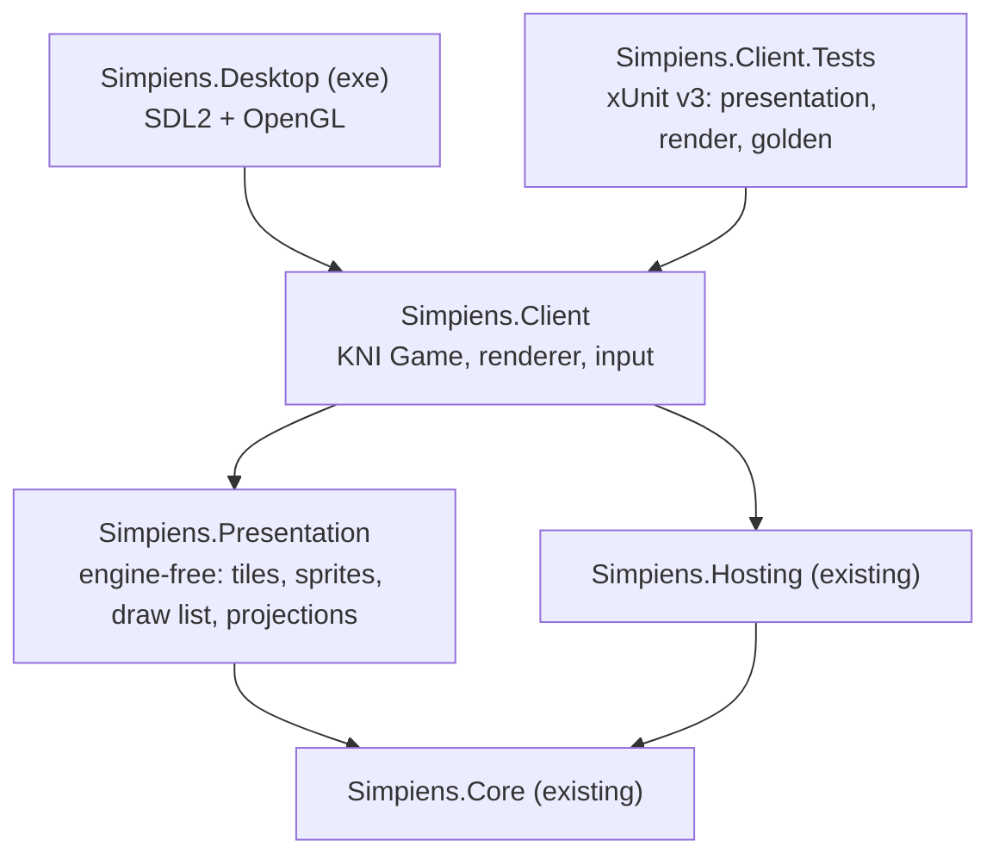

# Epic CLIENT: KNI Client and Engine Rework

- **Status**: ACTIVE (2026-10-18) on branch `feat/kni-client`. Status is owned by [ROADMAP.md](../ROADMAP.md). Decisions and deviations: `.agents/architecture_history.md`.
- **Track**: Independent (cross-cutting architecture)
- **Source**: the engine proposal, [`docs/engine-proposal-kni.md`](../engine-proposal-kni.md). That is a repo copy of the Claude Docs proposal, including the producer's answers of 2026-10-18. The engine spike that led to it compared Godot, BRUTAL, MonoGame, FNA and staying on Unity.
- **Builds on**: [Epic CORE](epic-core.md). The simulation is engine-free (`Assets/Simpiens.Core`), builds for .NET 10 (`dotnet/`) and runs headless through `Simpiens.Hosting`.
- **Replaces**: Unity's views and dashboard (`Assets/Scripts/`). They are frozen from M0, and Unity is retired at M2.

---

## 0. Producer intent and decisions

The producer chose KNI on 2026-10-18 for its responsive maintainer and its modern .NET 10 support on mobile. They asked the agent to see M0 and M1 through under provisional authority, with an implementation plan before each, committing regularly and only in a working state.

**Decisions (2026-10-18):**

- **Framework:** KNI (`nkast.Xna.Framework.*`, 4.3.9001). MonoGame stays compiling in CI as its fallback. Godot is dropped.
- **Views:**
  - Isometric will most likely replace top-down as the main view.
  - Height is visual only.
  - Top-down is for design only: the developers' map designer, and debugging.
  - Cutscenes are still backdrops with dynamic characters and text boxes, in the style of Fire Emblem.
- **Platforms:**
  - The MVP is Windows and Linux desktop.
  - Android and iOS follow the MVP: phones in portrait only, tablets not a priority. An Apple developer account and a Mac exist.
  - Consoles come last, only if mobile goes well.
  - No macOS, no web.
- **Art and performance:**
  - Art starts basic and grows to at most 64×64 px sprites.
  - The UI style and the art designer are still to be decided.
  - Target 30 fps.
- **Unity** retires at M2.
- **Map designer:** for developers only.
- **Working rules:** the same as Epic CORE.
  - A feature branch, never merged or pushed by the agent.
  - One commit per chunk, with its measured test status.
  - Roadmap first.

---

## 1. Goal

A KNI game client draws the simulation for players, replacing Unity, and the simulation doesn't change.

- **Read-only views:** the client reads the core's state through `Simpiens.Hosting` and never writes it.
- **Typed commands:** player input enters the core only as typed commands (ROADMAP §1A.1).
- **Testable without a person:** every frame the client draws can be checked by an agent, through render tests against committed images and the golden world hashes from inside the client.

**Milestones** (estimates in agent days; proposal §Roadmap):

| Milestone | Scope | Gate |
| :--- | :--- | :--- |
| M0 First pixels (1–2) | A desktop window; the host ticks the outpost; Floor 1 and its crawlers drawn top-down | Golden hashes 3 of 3 from inside the client; a render test in Linux CI; the MonoGame build compiles |
| M1 Top-down parity (3–5) | Fog, props, labels, animation, camera, mouse picking; a compile-only Android build in CI | Render tests pass; screenshots reviewed beside Unity's |
| M2 Dashboard (5–8) | Every panel in Gum (desktop layout); quick save and load; session switch; then Unity retired in its own chunk | The 7 view and UI scenarios pass |
| M3 Isometric (3–5) | Projection, depth sorting, generated isometric placeholders, picking, cutscene mode | Depth-order tests; reviewed screenshots |
| M4 Android, M5 iOS (3–5 each, after the MVP) | Touch, lifecycle, density, safe areas, the portrait phone layout; signing | Runs on devices (a person) |
| M6 Screen sizes (1–3) | Desktop windows of any size, portrait phones | Render tests at five sizes |
| M7 Art pipeline (2–3) | Sprite catalogue as data, 64×64 atlases, PNG and Aseprite import | New art is a data-only change |

The developers' map designer follows M2 as its own milestone.

**The agent's current authority covers M0 and M1.** M2 and later wait for the producer.

---

## 2. Architecture

The full design is in the proposal. In outline:

**Rules:**

- **`Simpiens.Presentation` has no XNA reference.** It turns the core's state into data:
  - tile layers;
  - generated sprite pixels;
  - draw items with sort keys;
  - projections.

  It is tested without a GPU. (A refinement of the proposal, which had a single `Simpiens.Client`.)
- **`Simpiens.Client` holds the only code that touches XNA types.** KNI-specific code sits in one class. The MSBuild property `XnaFramework` picks the framework: `Kni` (the default) or `MonoGame`. CI compiles both.
- **Views read state; they never write it.** Input goes down as typed commands.
- **Draw order:** layers from today's `RenderOrder` table, then depth, then insertion order, packed into one sort key and stably sorted by us, not by `SpriteBatch`.

---

## 3. Acceptance checklist (delivered work only)

- [x] C0: roadmap entry, this epic doc, the proposal copy (`docs/engine-proposal-kni.md`), the M0 plan (2026-10-18).
- [x] M0.1: the client's projects (`Simpiens.Presentation`, `Simpiens.Client`, `Simpiens.Desktop`, `Simpiens.Client.Tests`), the `XnaFramework` switch (KNI, or MonoGame compile-only), and the client booting offscreen in tests (2026-10-18).
- [x] M0.2: the engine-free presentation: the generated art ported pixel for pixel from Unity's `AgentSpriteLibrary` (`ProceduralSprites`, 33 sprites, pinned), the map as tiles (`MapTileLayer`, a port of `MapView`'s cell logic; Floor 1 is 1,175 floor, 384 rock and 254 wall tiles), the draw list with its stable 64-bit sort key, the top-down camera, the frame's scene (`WorldScene`) and PNG files (2026-10-18).
- [x] M0.3: the client ticks the simulation (`SimulationDriver`: real time, or N ticks a frame). **Gate met:** the game, run frame by frame offscreen, reproduces the golden world hashes for all 3 baseline seeds, and uneven frame pacing (hitches, zero-length frames) gives the same world (2026-10-18).
- [x] M0.4: first pixels. The client draws Floor 1 top-down (sector-tinted floor, walls, rock) and its crawlers in their current states, from one sprite atlas, through a camera snapped to whole pixels. Render tests compare the outpost at t0 and t300 (800×600, Mesa llvmpipe) with reference images in `dotnet/Simpiens.Client.Tests/Baselines/`. The desktop exe runs the live outpost (2026-10-18).
- [x] M0.5: CI runs the client's tests (Xvfb, Mesa llvmpipe, the system SDL2) and the MonoGame compile; `AGENTS.md` describes the client's projects and checks (2026-10-18). Unverified in CI until the branch is pushed.
- [x] **M0 complete (2026-10-18):** golden hashes 3 of 3 from inside the client; render tests pass on llvmpipe; the MonoGame build compiles.
- [x] M1.1: props and crawler appearance, ported from Unity's `AgentView`, `CampfireView` and `SwarmSpawner`.
    - Resource nodes by kind, the hearth (two frames at 6 Hz, a ±3% pulse) and bunks, at Unity's sizes on the Props layer.
    - Crawler state overrides, the 3-tick display dwell and every per-state micro-animation (tilt and squash).
    - A view clock: real time in the game, the tick's time in tests, so renders stay deterministic.
    - Render references re-recorded after review (2026-10-18).
- [x] M1.2: text and room names. `PixelFont` is a code-generated 5×7 font (ASCII 32–126) in its own sheet. `WorldText` lays it out in world units, snapped to its pixel grid. Floor 1's eight room names are drawn in their label colours on the Labels layer, as Unity's `MapView` placed them. The renderer starts a batch per sheet (2026-10-18).

---

## 4. Deferred

- M2 to M7 and the map designer: they wait for the producer (the agent's authority covers M0 and M1).
- The removal of Unity: M2, by producer decision.

---

## 5. Risks

- **CI is unverified (M0.5):** the workflow runs the client's tests under Xvfb with Ubuntu's SDL 2.30 and Mesa; locally they run SDL's offscreen driver on Fedora's sdl2-compat. The first push shows whether the reference images match there as well (the render tolerance allows 0.1% of pixels to differ). If they don't, the renders from CI are kept as a workflow artifact.

See the proposal's risk table. These matter for M0 and M1:

| Risk | Mitigation |
| :--- | :--- |
| Render tests need a GPU, and CI has none | SDL's offscreen video driver with Mesa's software OpenGL (llvmpipe), proven locally on 2026-10-18; CI may need a virtual display instead |
| KNI-specific APIs leak into shared code | The MonoGame build in CI fails on any KNI-only API outside the one platform class |
| The client changes the simulation | The golden world hashes are checked from inside the client, through its own tick path |

---

## 6. Findings

- **F1: headless rendering needs the system SDL2** (2026-10-18, scratch prototype).
  - KNI's bundled `libSDL2-2.0.so.0` can't create an OpenGL context under SDL's offscreen video driver.
  - The system's SDL2 (sdl2-compat 2.32 over SDL3 on Fedora) can, with Mesa: llvmpipe with `LIBGL_ALWAYS_SOFTWARE=1`, radeonsi without.
  - In offscreen mode, `Game.Dispose()` segfaults after `Run()`. The process exits cleanly if the game isn't disposed.
  - `Game.RunOneFrame()` works, and two games run in one process.
  - SDL and Mesa read their settings (`SDL_VIDEODRIVER`, `LIBGL_ALWAYS_SOFTWARE`) with `getenv`. On Unix, .NET's `Environment.SetEnvironmentVariable` doesn't reach it, so the test set-up calls libc's `setenv`. Without that, the first test run hung trying to open a real window (M0.1).

---

## History

- 2026-10-18: epic opened from the KNI engine proposal; C0 (setup) done.
- 2026-10-18: M0 (first pixels) done in five chunks: M0.1 `ba1f17c`, M0.2 `27c48be`, M0.3 `79fa223`, M0.4 `cf88e89`, M0.5 the close-out commit. M1's plan follows.
