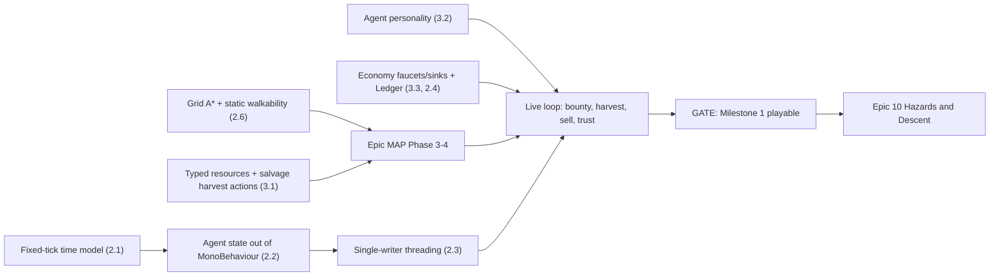

# Simpiens — Architecture, Scaling & Game Design Review

*This review is a dated snapshot. Live remediation status is tracked in [ROADMAP §3A](../ROADMAP.md#3a-architecture-review-remediation-tracker). Its code links were repointed on 2026-10-24 to where the files live now (the core now lives in `dotnet/Simpiens.Core/`; the Unity layer was removed in Epic CLIENT M2.9, so its files are named without links); the text describes the code as it was on 2026-10-08.*  
*Documentation drift flagged in §4.3 was reconciled on 2026-10-08 (ROADMAP.md is now the top source of truth; multiplayer confirmed as required post-MVP; the "Done means emerges in the live sim" rule from §4.2 is in ROADMAP §1B and AGENTS.md).*  
*Reviewer: Consulting Lead Developer · Scope: `Assets/Scripts/` (~21k LOC), `docs/ROADMAP.md`, `docs/Game Design Proposal.md`, epic specs, `.agents/` history · Date: 2026-10-08*

---

## 0. Executive Summary (read this if nothing else)

The team has built a **strong set of engine parts** but hasn't yet **put them together into a playable game**. The concepts (agents that read a snapshot of the world, a command queue for player input, compact data structs, an efficient GOAP planner, a grounded social model) are better than most indie simulation projects I review. The problems aren't about code quality. They're about **how the parts connect**: time, who owns agent state, and whether the Milestone 1 game loop actually runs end to end.

**Producer takeaway:** Milestone 1, "The Outpost Loop", isn't closed yet, even though Epic 9 is marked complete. In the live simulation, agents **can't harvest Iron Ore or Herbs**. No agent behaviour produces salvage, and Scout bounties have no way to be fulfilled. So "agents gather → sell at stall → trust grows" only happens in automated tests that put items into inventories directly. I recommend a **Milestone 1 closure gate** before Track A moves on to Epic 10 (Hazards & Descent).

| Area | Rating | One-line verdict |
|---|---|---|
| Core decoupling concept (snapshot → intent → main-thread execution) | 🟢 Strong | Right pattern for this genre. Keep it. |
| Player-intervention command queue | 🟢 Strong concept / 🟡 weak contract | Pattern is correct. Commands are stringly-typed. |
| Data layout (unmanaged structs, pooling) | 🟢 Strong | Ready for serialization and scale. |
| GOAP planner engineering | 🟢 Strong | Well built. Will run out of "fact" space (§2.7). |
| Social / relational model | 🟢 Strong design | Well grounded. Mostly invisible to the player for now. |
| Narrative pipeline + LLM plan | 🟢 Strong | Correctly scoped as flavour only, with a fallback. |
| **Time model / determinism** | 🔴 Structural fault | Two clocks. Fast-forward and pause are semantically broken. |
| **Agent state ownership** | 🔴 Structural fault | All agent state and logic lives in a `MonoBehaviour`. This blocks save/load and floor relocation. |
| **Thread safety** | 🔴 Latent crash risk | Snapshot is safe. Agent memory is read and written by two threads. |
| `SimulationManager` scalability | 🟠 Will not scale with features | 1,500-line switch statement. Every new mechanic adds to it. |
| Agent-count scalability | 🟠 Unmeasured, likely O(N²) | Spatial hash exists but the main thread doesn't use it. |
| Pathfinding | 🟠 Placeholder | Straight-line only. The MAP epic depends on real A*. |
| **Milestone 1 game loop** | 🔴 Not closed | No salvage supply, no agent personalities, no economy faucets or sinks. |
| Docs / roadmap integrity | 🟡 Drifting | Status and scope disagree across files. AI agents treat these docs as truth. |

---

## 1. What Is Well Designed (keep doing this)

These are real strengths. Protect them as the codebase grows.

1. **Snapshot → Intent → Execute loop.** Background reasoning reads an immutable, pooled [`SharedWorldSnapshot`](../../dotnet/Simpiens.Core/Simulation/Spatial/SharedWorldSnapshot.cs) and returns a data object ([`AgentIntent`](../../dotnet/Simpiens.Core/Cognition/Contracts/AgentIntent.cs)). Only the main thread changes the world. This is the correct pattern for agent simulations, and it's the reason an LLM can later be plugged in safely.
   - *Plain terms:* agents "think" on a photograph of the world and hand in a request. Only one referee updates the real board.
2. **Player influence as queued commands** ([`PlayerInterventionService`](../../dotnet/Simpiens.Core/Intervention/PlayerInterventionService.cs)). The UI never changes simulation state directly. This is exactly what you need later for replays, multiplayer, undo, and analytics.
3. **Data-oriented economy and group primitives.** `ItemInstance`, `BountyContract`, `TradeStallData`, `GroupData` and `WorldState` are small, blittable structs. They are cheap to copy into snapshots, cheap to serialize, and won't cause GC hitches.
4. **GOAP planner implementation** ([`GoapPlanner.cs`](../../dotnet/Simpiens.Core/Cognition/Planning/GoapPlanner.cs)). Bitmask state, pooled nodes, a binary heap and an open-addressing closed set make it professional-grade.
5. **The "simulation void trap" pivot (Epic 7 → Epic Beta).** The team noticed that abstract social numbers mean nothing without concrete world mechanics, and grounded affinity in contention, food sharing and campfires. That's mature design judgement.
6. **Two-stage narrative pipeline.** Deterministic templates come first, and an optional async LLM enrichment runs behind a circuit breaker. The LLM can never block or corrupt the simulation. This is the right risk posture for Epic 11.
7. **Library policy with written rationale** (ROADMAP §2). Rejecting MonoBehaviour-coupled pathfinding and the ASP.NET-bound MCP SDK was correct, and writing down *why* is rare and valuable.
8. **Multi-track roadmap (A/B/C).** Separating engine, UI and verification work so they can proceed in parallel is a sound way to organise production.
9. **Testing culture.** Every epic ships with domain validators and a PlayMode scenario harness. The habit is right. §4 covers making the validators *measure the right thing*.

---

## 2. Structural Issues (ranked by impact)

### 2.1 🔴 Two clocks: the simulation doesn't actually run on its own tick

**What's happening.** [`SimulationClock`](../../dotnet/Simpiens.Core/Simulation/SimulationClock.cs) produces logical ticks at 10 Hz × speed multiplier. But [`SimulationManager.Tick()`](../../dotnet/Simpiens.Core/Simulation/SimulationManager.cs#L384-L494) runs **once per rendered frame**, and gameplay depends on *unscaled* `Time.deltaTime`:

| Uses **frame time** (ignores speed and pause) | Uses **logical ticks** (respects speed and pause) |
|---|---|
| Walking speed, harvest/share/idle durations ([SimulationManager.cs](../../dotnet/Simpiens.Core/Simulation/SimulationManager.cs#L1404)) | Bounty expiry, directive expiry |
| Hunger, energy, social and frustration decay (`AutonomousAgent.cs`) | Memory decay, blacklists, gossip cooldowns, affinity regression |
| Watchdog stall timers | Hearth bonding and succession (`currentTick % 50`) |

**Consequences.**
- **At 10x speed:** bounties expire 10x faster, but agents still walk and get hungry at 1x. The economy outruns the agents who are supposed to serve it.
- **When the clock is paused (multiplier 0):** agents keep walking and starving.
- **Periodic logic fires the wrong number of times.** At 60 fps a 10 Hz tick lasts about 6 frames, so `currentTick % 50 == 0` is true for about 6 consecutive frames. Hearth bonding, gossip and group-formation checks run about 6 times per scheduled tick. At high speeds, several ticks pass within one frame, so some multiples of 50 are **skipped entirely**.
- The roadmap promises "deterministic logical ticks to enable a future client-server multiplayer runtime" and MemoryPack tick replays. Neither can work while gameplay depends on frame rate.

**Recommendation.**
- Subscribe the simulation step to `OnSimulationTick`, so it runs exactly once per logical tick with a fixed `dt`.
- Express every gameplay duration in ticks.
- Let views (`AgentView`, `AgentMotor`) interpolate between tick positions for smooth visuals.
- This is the **cheapest it will ever be to fix**. Every new mechanic written on frame time adds to the cost.

> [!IMPORTANT]
> **Producer decision recorded (2026-10-08): multiplayer is a required post-MVP feature.** The architecture must allow it to be added later. That makes this fix mandatory rather than optional, and it brings the following along with it: seeded RNG, fixed iteration order, and agent decisions applied in a deterministic order rather than "whenever the thread pool finishes". These constraints are now binding for new work in `docs/ROADMAP.md` §1A.1, and the current violations are catalogued in §1A.2.

---

### 2.2 🔴 Agent "brain and body" live in a MonoBehaviour

**What's happening.** The project rule is "MonoBehaviours are dumb views". But `AutonomousAgent` is an 870-line `MonoBehaviour` that owns:
- needs, inventory, memory, group membership and the active GOAP plan;
- the cognition loop;
- the *consequences* of completed actions (e.g. "harvest done → hunger −50").

Agent position is `transform.position`, and the simulation moves pawns by writing to `node.transform.position`. The [`ISocialAgent`](../../dotnet/Simpiens.Core/Cognition/Contracts/ISocialAgent.cs) interface was added specifically to work around this when testing.

**Why it matters for the roadmap.**
- **Save/load and floor relocation (Milestone 4, MemoryPack):** you can't serialize a GameObject graph. The agent state must be plain data first.
- **Headless soak tests and server simulation:** these need agents without scenes.
- **Off-screen and "shrouded" sectors:** the design wants many agents in sectors the camera isn't showing. Every agent paying for a GameObject, Rigidbody2D and Update hook is the wrong cost model.

**Recommendation.**
- Introduce a plain C# `AgentState` (needs, inventory, memory handle, membership, plan cursor, position) stored in an `AgentRegistry`.
- Move "decide" and "apply consequences" into services.
- `AgentView` reads `AgentState` and renders it.
- This is a refactor, not a rewrite. The evaluators, actions and goals already take `AgentContext` and won't change much.

---

### 2.3 🔴 Hidden thread-safety hole: the snapshot is safe, the agent's memory isn't

**What's happening.** The snapshot is immutable, but [`AgentContext`](../../dotnet/Simpiens.Core/Cognition/Contracts/AgentContext.cs) also carries **live references** to `AgentMemory` and `AgentInventory`. Both use plain `Dictionary`s with no locking ([AgentMemory.cs](../../dotnet/Simpiens.Core/Cognition/Memory/AgentMemory.cs#L27-L31)).
- **Background planners read memory.** `GetAffinity` even *writes* to the dictionary on read, because it applies decay toward neutral.
- **At the same time, the main thread writes to the same dictionaries:** gossip (`TryGossip` rewrites *both* agents' spatial maps), trade affinity, contention penalties, hearth bonding.
- **Snapshot lifetime gap:** in `EvaluateCognitionAsync`, `snapshot.Retain()` is called *after* `SwitchToThreadPool()` (`AutonomousAgent.cs`). The main thread can recycle the snapshot to its pool in between.

**Consequence.** Rare, nondeterministic failures: "Collection was modified" exceptions, corrupted dictionaries, or agents planning on a half-cleared snapshot. These will appear only at higher agent counts and speeds, which is exactly when they are hardest to diagnose.

**Recommendation.** Adopt a **single-writer rule**:
- Background threads may only read immutable data: the snapshot plus a per-agent memory *copy* or versioned view taken at plan start.
- All memory and affinity mutations become results applied on the main thread.
- Call `Retain()` before leaving the main thread, as `AsyncPathfinder` already does correctly.

---

### 2.4 🟠 `SimulationManager` is becoming the whole game

**What's happening.** [`SimulationManager.cs`](../../dotnet/Simpiens.Core/Simulation/SimulationManager.cs) is about 1,500 lines. Every intent type (harvest, share, trade, claim, deliver…) is a `case` in one `ExecuteIntent` switch. Contention rules, gossip, hearth bonding, succession, the bounty lifecycle, escrow and string-command parsing all live in the same class. Epic 10 (hazards, gear checks, combat), Milestone 2 (parties) and Milestone 3 (crafting) will each add more cases.

**Symptoms already visible.**
- **Split ownership of consequences.** Harvesting reduces hunger by 50 in `SimulationManager` *and* again by 50 (plus grants a ration) in the agent's `OnComplete` callback. This happens because no single owner is responsible for "what harvesting does".
- **No economic invariants.** In `ParseAndPostBounty`, if the stall can't afford the escrow, the bounty is still posted. When it expires or is cancelled, the reward is "refunded" to the treasury, which **creates gold from nothing**.
- **Stringly-typed player commands.** `InfluenceEvent` carries `"PostBounty"` plus a comma-separated payload that is parsed with `Split`. This contract is fragile, allocates memory, and can't be versioned for save files or replays.

**Recommendation.**
- Split execution into **one handler per intent type**, e.g. `IIntentHandler<TradeIntent>`, registered in DI. Each handler owns the full consequences of its action.
- This is the `IToolExecutionRegistry` your own architecture rule calls for. It becomes the surface the MCP layer can call later.
- Make `InfluenceEvent` a typed command, e.g. a tagged union of structs.
- Route all gold movement through a small `Ledger` service that enforces "gold is conserved unless a named faucet or sink is used".

---

### 2.5 🟠 Agent-count scaling: unmeasured, and structurally O(N²) on the main thread

**What's happening.**
- Gossip checks scan **all** world nodes for **every** idle agent, every frame.
- Contention scans all active intents.
- Hearth evaluation is anchors × all nodes.
- The spatial hash exists but is used only by background threads. Main-thread systems ignore it.
- [`GoapPlanner`](../../dotnet/Simpiens.Core/Cognition/Planning/GoapPlanner.cs#L92) is a DI singleton guarded by a `lock`. **All agents' planning is serialized onto one lane**, so the background parallelism is mostly illusory.
- There is no cognition scheduler. Every free agent launches its own task as soon as its previous intent finishes, with no global budget or rate limit.

**Recommendation.**
- Run a soak test now at 50, 100 and 200 agents with the profiler. You have a `ProfilerCaptures/` folder and the Test-2 soak-runner plan. Record a target ("N agents at 10x on min-spec").
- Then:
  1. Make main-thread proximity queries use the spatial hash.
  2. Give each worker thread its own planner instance (pooled or `[ThreadStatic]`) and remove the lock.
  3. Add a `CognitionScheduler` with a per-tick think budget and staggered replanning.
- **Defer Burst/Collections** (ROADMAP §2.1). The current bottleneck is algorithmic, not SIMD throughput, and adding native containers early increases complexity.

---

### 2.6 🟠 Pathfinding is still a placeholder, and the MAP epic depends on it

[`AsyncPathfinder`](../../dotnet/Simpiens.Core/Cognition/Pathfinding/AsyncPathfinder.cs#L71-L74) walks a straight line and stops at the first wall. Its own comment says it is for stress testing.

The 3-tier motor watchdog, the "nudge" reflexes and some of the anti-jitter fixes in recent commits are **compensating for missing navigation**. Epic MAP's 9-sector map with 2.5 m doorways can't work without real pathing: an agent in the Quarry can't reach the Hub stall in a straight line.

Grid A* is currently buried inside Epic 9's deliverables. Epic 9 is marked COMPLETED in `curentfocus.txt` and ACTIVE in `ROADMAP.md`.

**Recommendation.**
- Make Grid A* an explicit, standalone deliverable that **gates MAP Phase 3/4**.
- Separate **static walkability** (walls, built once per map) from the **dynamic per-frame entity grid**. Walls are currently re-inserted into the snapshot every frame and share a 16-entity-per-cell cap with pawns, so a crowded cell can silently drop a wall.
- With a static layer in place, precomputed flow fields to hot destinations (stall, hearth, bunkhouse) become an inexpensive option.

---

### 2.7 🟠 GOAP is approaching its "fact budget" and its expressiveness limit

`WorldState` is a 64-bit mask, and **30 of 64 facts are used after 9 epics** ([StateFact.cs](../../dotnet/Simpiens.Core/Cognition/Planning/StateFact.cs)). Epic 10 (hazards, gear, injuries), Milestone 2 (party roles) and Milestone 3 (crafting inputs and outputs) will exhaust it.

The facts are also **global booleans** (`HasSalvageInInventory`, `HasActiveBounty`). The planner can't express *which* item, *which* bounty or *which* sector. That choice is made ad hoc inside each action's `CreateIntent`. For example, `ClaimBountyAction` takes the **first** open bounty, regardless of type, distance or reward.

In practice, most plans are 2–3 step chains (travel → act). **Most of the agents' real decisions are made by goal priority functions, not by the planner.**

**Recommendation.**
- Keep GOAP for *sequencing*.
- Move *target selection* (which bounty, which node, which stall) into an explicit utility-scoring layer with reusable "considerations" (reward, distance, risk, personality, affinity).
- If you need more facts, scope them per domain rather than widening the global mask indefinitely.

---

### 2.8 🟡 The production game is assembled inside the test harness

- The real GOAP domain (action graph, goals), agent spawning, and world seeding live in `Testing/Environment/SwarmSpawner.cs`.
- `AppBootstrapper` registers about 24 validators as `IStartable`, so they **run on every game boot**.
- There is a single `Simpiens.asmdef`, so test code ships in player builds.
- `CognitiveEngine`, `IContextBuilder` and `IToolExecutionRegistry` are unused stubs. The real cognition loop is inside `AutonomousAgent`.

**Recommendation.**
- Create a `GameplayLifetimeScope` and a `SessionBootstrap` (world, domain and population definition, ideally driven by ScriptableObjects).
- Move validators into a separate `Simpiens.Testing` asmdef and test scope.
- Either delete the stub engine or make it the real scheduler from §2.5.

---

## 3. Game Design Review

### 3.1 🔴 The Milestone 1 loop has no supply side

The design loop is: *Post bounty → agents harvest salvage → sell at stall → trust grows → recruit.* In the live simulation:

- **Resources are untyped.** [`ResourceData`](../../dotnet/Simpiens.Core/Simulation/ResourceData.cs) has no item type. Every node behaves like a food bush.
- **No agent action produces Iron Ore or Herbs.** Nothing has `HasSalvageInInventory = true` as an effect. `FulfillBountyGoal` and `LiquidateSalvageGoal` are therefore unreachable through planning, so agents never complete Gather bounties.
- **Scout bounties exist in the UI and data model with no fulfilment behaviour.** Agents can still *claim* them, because claiming ignores bounty type.
- **The stall's ration stock only goes down.** I found no restock path. Agents start with 10 gold, and earning gold requires salvage, which they can't get.
- The economy validators pass because they **put ore directly into agents' inventories**.

> [!WARNING]
> The roadmap reports Epic 9 as complete (in `curentfocus.txt` and `epic-9.md`), but the player-facing loop doesn't run. This is the most important gap between status reporting and reality in the project.

### 3.2 🟠 Agents have no personality, so the player's levers will feel binary

The design proposal says agents "claim or ignore tasks based on their personal traits, risk tolerance, and reward sizing". **No trait system exists.** Every agent runs the same utility curves, so the only differences between agents come from current needs and affinity history.

In an indirect-control game, **variation between agents is what makes pricing decisions interesting**. If all agents accept a ration price below X and refuse it above X, the price slider is effectively an on/off switch.

**Recommendation:**
- Add a small personality struct to each agent (e.g. Greed, RiskTolerance, Sociability, Loyalty, Diligence; 5 bytes).
- Feed it into goal priorities and the consideration layer from §2.7.
- This is cheap, testable, and multiplies emergent variety more than any single new system.

### 3.3 🟠 The economy needs a faucet/sink model before Epic 10

The design proposal ends with an unanswered question: *what stops the player from equipping everyone with top-tier gear?* That is the central economy question, and the roadmap moves on to gear-gated hazards without answering it.

Today the economy is a closed loop. Treasury gold goes out as bounty rewards, comes back through ration sales, and the escrow bug in §2.4 leaks extra gold in. There are no defined **faucets** (where new value enters) or **sinks** (where value leaves).

> [!NOTE]
> **Producer Confirmation (2026-10-08):** Faucets and sinks fall under Section 3.3 and will be explicitly addressed when the team tackles that section prior to expanding the economy.

**Recommendation:** before Epic 10, write a one-page economy model:

| Element | Questions to answer |
|---|---|
| **Faucets** | What brings new value into the economy: resource regrowth, visiting traders, dungeon loot? |
| **Sinks** | What removes value: food consumption, gear durability, upkeep, tax? |
| **Scarcity lever** | What limits the player: material scarcity, agents' willingness to spend, or both? |
| **Tuning** | Which numbers set the pace? Tune them in the Test-2 market soak runner, not by hand. |

### 3.4 🟡 The social simulation is rich but mostly invisible to the player

Epics 7, Beta and 8 built dominance, altruism, gossip, emergent groups, succession and schisms. This is impressive. But until Milestone 2, the player has **no lever** that touches groups and **no feedback** beyond the chronicle feed.

The risk is a lot of simulation the player never perceives (the same "void trap" the team already recognised once).

**Recommendation:**
- Add a gate to every future epic: *"What does the player see, and what can they do about it?"*
- Cheap first step: a **"Why?" inspector** for each agent that shows the top goal priorities and the deciding factors. The data already exists in the goal priority calculations. Indirect-control games succeed or fail on whether players can read what agents are doing and why.

### 3.5 🟢 The narrative and LLM scoping is right

LLM output is flavour only and is never authoritative over game state. It has a template fallback and a circuit breaker, and it will consume a deterministic event ledger. Keep it that way.

The only addition I'd suggest: give the LLM a **cost and latency budget**, and enrich only `Dramatic`/`Crisis` intensity events. The `ChronicleIntensity` enum already supports this.

---

## 4. Roadmap & Process Observations

### 4.1 Sequencing: close Milestone 1 before Epic 10

`curentfocus.txt` lists Epic 10 as next for Track A, while MAP is still queued and Milestone 1 isn't playable. Recommended **Milestone 1 closure gate**, in dependency order:

MemoryPack, Burst and Collections are "approved" in the roadmap but not installed. That's fine: MemoryPack is only useful after §2.2, and Burst should wait for profiling data.

### 4.2 "Done" should mean "emerges in the live sim", not only "validator passes"

Validators test mechanisms in isolation, often by injecting the preconditions (inventory, proximity) that the live game should produce on its own. That's how Epic 9 passed with no supply side.

**Recommendation:** each epic's definition of done should include one **live PlayMode scenario assertion**, for example: "within N ticks on the outpost map with no injection, at least one Gather bounty completes". The Track C harness (`SwarmPlayModeTests`, `VisualAnomalyDetector`) already supports this.

### 4.3 Documentation drift (higher stakes because AI agents read these docs)

| Inconsistency | Where | Status / Resolution |
|---|---|---|
| Epic 9: **ACTIVE** vs **COMPLETED** | `ROADMAP.md` vs `curentfocus.txt` / `epic-9.md` | Reconciled: Epic 9 is `MECHANISM COMPLETE` pending live loop verification. |
| Epic UI-2: **COMPLETED** (body) vs **ACTIVE** (diagram, focus file) | `ROADMAP.md` | Reconciled: Epic UI-2 is `COMPLETED`. |
| Map: **12 sectors** vs **9 sectors** | Design proposal / Milestone 1 vs Epic MAP | Clarified: 12 sectors is canonical design target; 9 sectors is incomplete paused WIP. |
| "Ticking up to 500 Hz at 10x" vs actual 10 Hz × 10 = 100 Hz | ROADMAP §2.2 | Reconciled: corrected to 10 Hz / 100 Hz. |
| `CognitiveEngine.cs` listed as a key file (it's an unused stub); `SimulationManager` listed under `Simulation/` (it's in `Core/`) | `AGENTS.md` | Reconciled: `AGENTS.md` rewritten with accurate directory structure. |

The team's workflow relies on AI agents that treat `AGENTS.md`, `ROADMAP.md` and the epic docs as ground truth, so drift **compounds**: agents build on the documented architecture, not the actual one. Pick one status source of truth (I suggest `ROADMAP.md`) and make the other files link to it rather than repeat it.

---

## 5. Prioritised Recommendations

| # | Action | Why now | Size |
|---|---|---|---|
| 1 | Drive simulation from `OnSimulationTick`; all durations in ticks; views interpolate | Every new feature makes this more expensive. Fast-forward is broken today. | M |
| 2 | Close the Milestone 1 supply side: typed resources, salvage harvest actions, Scout fulfilment, ration restock | The core game loop doesn't run | M |
| 3 | Single-writer threading rule; fix `Retain` ordering | Latent crash risk that grows with agent count | S–M |
| 4 | Grid A* + static walkability layer, gating MAP | MAP can't work without it | M |
| 5 | Agent personality struct + utility "considerations" for target selection | Makes player levers meaningful; relieves GOAP pressure | S–M |
| 6 | Intent-handler registry, typed `InfluenceEvent`, gold `Ledger` | Stops `SimulationManager` absorbing Epic 10+, fixes double-application and minting bugs | M |
| 7 | Plain-C# `AgentState` + `AgentRegistry`; `AutonomousAgent` becomes a view | Required for save/load, relocation, headless scale | L |
| 8 | Profiled soak test → spatial-hash queries, per-thread planners, cognition scheduler | Turns "zero-alloc" claims into a measured agent budget | M |
| 9 | Separate gameplay scope and test asmdef; remove stub engine | Validators run at boot; tests ship in builds | S |
| 10 | One-page economy model; "Why?" agent inspector; live-scenario definition of done; docs single source of truth | Design and process health | S each |

*S = days, M = 1–2 weeks, L = multi-week (rough, single developer).*
